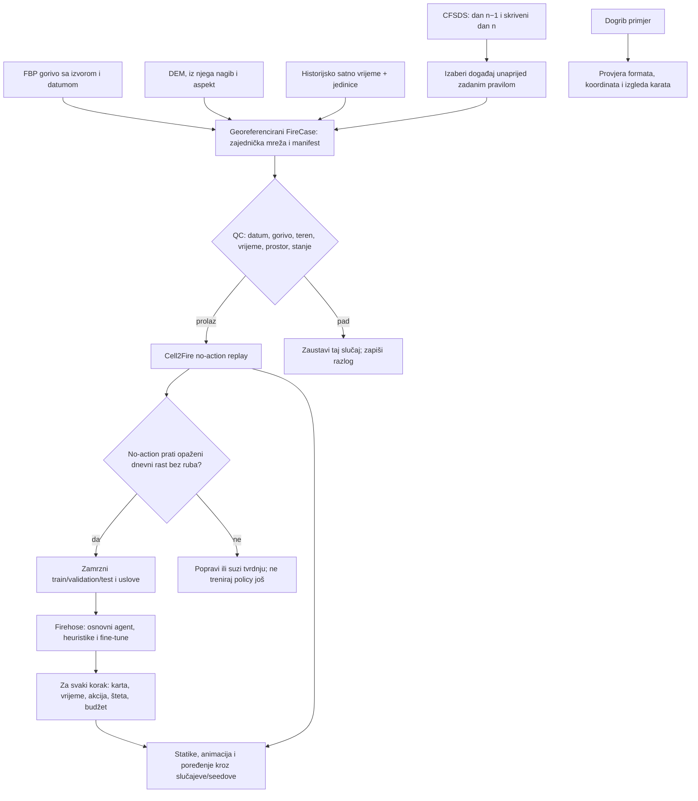

# Provjereni tok prilagođen našem projektu

Datum pregleda izvora i Dogrib ulaza: 2026-10-31. Ovaj dokument pretvara ranije
istraživanje u konkretan izbor: **CFSDS je izvor historijskih događaja; Canadian FBP i
Cell2Fire daju simulaciju širenja; Firehose daje RL agenta.** Koristimo već objavljene
postupke tamo gdje odgovaraju, a njihove poznate zamke pretvaramo u naše obavezne provjere.

## Odluka ukratko

Ne moramo praviti novi simulator ni pripremu podataka počinjati od nule. Rad W.I.S.E.
već je sastavio veliki broj scenarija iz **istog CFSDS 1.1** izvora koristeći
gorivo, teren i historijsko vrijeme. Cell2Fire je već korišten na stvarnim pejzažima,
uključujući Dogrib. Firehose je već trenirao upravljačke agente kroz Cell2Fire simulacije.
To su tri dijela toka koje možemo ponoviti u našem projektu.

Kratki rječnik: **cilj** je sutrašnja opažena granica koju koristimo samo za poređenje;
**bez gledanja cilja** znači da pri pravljenju početka ne otvaramo sutrašnju mapu;
**bez intervencije** znači da simulator širi požar bez ijedne akcije gašenja; **CRS** je
dogovor kako se koordinate na karti prevode u stvarni položaj; **seed** je broj koji
omogućava ponoviti isti nasumični početak. Kad kažemo **gate**, mislimo na provjeru
prolaz/pad prije nego krenemo dalje.

| Provjereni rad | Šta preuzimamo | Šta ne kopiramo bez izmjene |
| --- | --- | --- |
| W.I.S.E. nad CFSDS 1.1 | uparivanje susjednih dana, zajednički geografski raster, FBP gorivo, teren, ERA5-Land, odbacivanje očigledno neupotrebljivih slučajeva i prostorne metrike | njihov početni front ponekad se bira gledajući i sutrašnji target; njihovi dodatni scenariji biraju trajanje/vjetar prema poznatom targetu. To su korisne dijagnostike, ali ne smiju postati naš pošteni trening ili test ulaz |
| Dogrib + Cell2Fire | gotovi tipovi simulator fajlova, stvarni 100 m fuel/terrain slojevi i ideja da se rezultate prikaže kao kartu iznad stvarnog perimetra | podešavanje brzine/oblika požara prema istom završnom scaru ne predstavlja nezavisni test. Naši preuzeti fajlovi imaju otvoreno neslaganje paljenja, scar na nonfuelu, premalo sati vremena i full-map/20×20 razliku |
| Firehose | agent uči kroz akcije i posljedice koje računa simulator; iste scenarije, seedove, budžet i vrijeme koristimo za osnovnog i prilagođenog agenta | uspješan agent na demonstracijskom/sintetičkom pejzažu ne dokazuje da je naša historijska mapa ispravna ili da bi stvarna šteta bila manja |

### Zašto je W.I.S.E. najbliži recept za podatke

W.I.S.E. koristi CFSDS 1.1 za 19.848 dnevnih parova iz 2.210 požara tokom 2014–2024.
Autori su izbacili neke događaje bez dva susjedna dana rasta, parove gdje dvije granice
nisu susjedne, spot-požare odvojene od prethodnog fronta, problematične/nepoznate fuel
ćelije i požare sa zabilježenim gašenjem kad rade no-action poređenje. Za uslove simulacije
pripremili su FBP gorivo, MRDEM teren i dosljedan ERA5-Land vremenski izvor. To je dobar
recept za **slaganje paketa i QC filtere**, a ne gotov skup Cell2Fire ulaza koji samo
preuzmemo. Rad navodi da se obrađeni podaci dijele na zahtjev.

Postoje dvije razlike koje moramo namjerno riješiti:

1. W.I.S.E. za početni rub uzima dijelove granice dana n−1 koji dodiruju granicu dana n.
   To koristi informaciju iz cilja. Naš input mora se praviti samo iz podataka dostupnih
   do dana n−1; cilj dana n čuvamo odvojeno i koristimo ga tek za provjeru poslije
   simulacije.
2. W.I.S.E. ima dane, ne tačan sat paljenja. Zato rezultat poredimo s dnevnom kartom kao
   približnim prostornim ciljem, uz više seedova i vremenskih pretpostavki. Ne nazivamo
   dnevnu granicu tačnim satnim frontom.

Laička analogija: W.I.S.E. je napravio dobar recept kako sastaviti „teren za igru“ iz
stvarnih geografskih podataka. U jednom dijelu je pri postavljanju početka pogledao
fotografiju sutrašnjeg požara. Mi preuzimamo recept za teren i vrijeme, ali fotografiju
sutrašnjeg dana stavljamo u zatvorenu kovertu dok simulator ne završi.

## Naš prilagođeni tok



JSON ostaje „naslovnica“ scenarija: ID požara, izvori/verzije, vrijeme, definicija mreže,
veze na fajlove, hashovi, jedinice, pravilo za početno stanje i QC zastavice. Velike
geografske karte ostaju kao georeferencirani rasteri, a ne kao dugački nizovi u JSON-u.
Cell2Fire zatim dobija poznate fajlove (`Forest.asc`, teren, `Data.csv`, `Weather.csv`,
`Ignitions.csv`/`InitialState.csv`). Historijski target nije među fajlovima koje agent
učitava.

## Šta smo već konkretno uradili na tom putu

### Dogrib je postao kontrolna karta za geometriju i buduće prikaze

Javni Dogrib fajlovi su preuzeti u ignorisani `data/raw/dogrib-reference/`, pinovani su na
Git commit Cell2Fire repozitorija i provjereni prema zabilježenim SHA-256 hashovima.
Kolege ih mogu preuzeti i provjeriti pomoću
[`fetch_dogrib_reference.py`](../../scripts/fetch_dogrib_reference.py); manifest čuva URL,
veličinu i hash svakog fajla. Iz modernog Python/GIS okruženja mogu ponoviti kartu ovako:

```sh
python scripts/fetch_dogrib_reference.py
python scripts/fetch_dogrib_reference.py --verify-only
MPLCONFIGDIR=.local/matplotlib XDG_CACHE_HOME=.local/cache \
  python scripts/plot_dogrib_reference.py
```

Dodani su reproducibilni crtač
[`plot_dogrib_reference.py`](../../scripts/plot_dogrib_reference.py), karta
[`dogrib-reference-alignment.png`](../../reports/real-fire-data/dogrib-reference-alignment.png)
i mašinski receipt
[`dogrib-reference-alignment.json`](../../reports/real-fire-data/dogrib-reference-alignment.json).

Karta pokazuje fuel mapu i okvir 20×20, reljef i KML perimetre, opaženi scar s obje
objavljene lokacije paljenja te poređenje dva rastera koja paket sadrži. Oznake i legenda
razdvajaju ono što je opaženo od podataka iz primjera. Izlaz je **provjera GIS ulaza i
izgled buduće vizualizacije**, ne novi Firehose run ili potvrda fizičkog modela.

Karta/receipt su izmjerili:

- puna Dogrib mapa je 223×357 ćelija na 100 m, dakle oko 22,3×35,7 km; postojeći agent
  vidi samo 20×20 ćelija, odnosno 2×2 km;
- KML lokacija paljenja upada u red 189/kolonu 92 (brojimo od 1), dok `Ignitions.csv`
  kaže red 188/kolona 91; razlikuju se za jednu ćeliju u oba smjera;
- od 10.210 ćelija u rasteru opaženog scara, 663 su kodirane fuel kodom 101;
- priloženi `Weather.csv` ima osam satnih redova od 16.10.2001. 13:00 do 20:00. To je
  sedam sati između prvog i posljednjeg uzorka, dok se početni i završni KML perimetar
  vremenski razlikuju 22 h 52 min;
- postojeći Sub20 blok koji se može naći po podacima goriva/visine ne potvrđuje isti
  geografsku registraciju; slope/aspect se ne poklapaju s tim blokom.

Zato Dogrib zasad **ne koristimo za no-action dokaz**. Dobar je kao referenca formata i
za namještanje vizualizacijskog toka. Prije simulacije treba razriješiti paljenje, scar,
vrijeme i prostorni prozor — ili ga zadržati kao fixture i ne predstavljati kao fizički
benchmark.

Jednostavnije rečeno, problemi koje trenutno imamo nisu „ne znamo napraviti fajl za
simulator“: tri CFSDS slučaja već smo pretvorili i Cell2Fire ih je izvršio. Problem je
što neke karte ne znamo sigurno datirati, a simulator na malom isječku brzo dođe do ivice.
To je kao da napravimo maketu šume koristeći pouzdanu mapu, ali ne znamo da li mapa prikazuje
šumu prije ili poslije požara, i damo joj poslužavnik veličine 2×2 km dok stvarni požar
zauzima mnogo veći prostor. U takvom slučaju rezultat postoji, ali ga ne možemo pošteno
uporediti s cijelim stvarnim požarom. Zato prvo provjeravamo izvor mape i veličinu
poslužavnika, pa tek onda puštamo agenta da „gasi“.

## Pravila da buduće vizualizacije budu jake i poštene

Isti manifest mora sačuvati CRS/koordinatni sistem, transformaciju rastera, redoslijed
redova/kolona, veličinu ćelije, jedinice i lokalno/UTC vrijeme. Svaka figura i animacija
nasljeđuje taj opseg i skalu; ne povećavamo ili smanjujemo kartu tako da vizuelno izgleda
da se poklapa.

Za jedan slučaj je ciljani prikaz:

1. **Ulazna karta:** fuel tipovi, reljef/nagib/aspekt, početno opožareno stanje i aktivni
   rub, sa izvorom, datumom mape, skalom i legendom.
2. **Historijska usporedba:** granica dana n−1, skrivena dnevna granica n i neizvjesnost
   zbog satelitske interpolacije. Target se crta samo nakon što se run zaključa.
3. **Vremenski prikaz:** po koracima simulatora istom geografskom skalom prikazati novi
   požar, aktivni rub, tretirane ćelije, agentovu izabranu lokaciju, potrošen budžet,
   simulirano vrijeme i razlog završetka.
4. **Agent vs. baseline:** iste ćelije, isto vrijeme i seed, jedna paleta za opaženo,
   jedna za simulator, a akcije agenta kao posebne oznake; nikad ne spajati „tretirano“ i
   „izgorjelo“ u jednu klasu.
5. **Sažetak više runova:** šteta/površina i budžet po požaru i seedu, uz raspone ili
   intervale nesigurnosti. Mapa jednog sretnog seeda nije dokaz prednosti.

Minimalni zapis po epizodi zato treba imati vremensku tabelu (`vrijeme`, agent, akcija,
budžet, opožarene/tretirane ćelije, kumulativna šteta i terminalni razlog), stanje mreže po
koraku ili dovoljno podataka za njegovo ponovno stvaranje, te hash ulaza/modela. Iz toga
se naknadno mogu napraviti iste karte, GIF/MP4 animacije i uporedni paneli bez ponovnog
pokretanja simulatora.

## Šta još mora proći prije glavnog treninga

1. **Dovršiti train-only izvore:** odrediti da li gorivo za datum požara ima dokaziv
   vremenski cutoff i pravilo za ranije scars; zapisati porijeklo DEM-a i historijskog
   vremena; za svaki slučaj označiti da li postoje dokazi gašenja.
2. **Formirati target-blind kandidata:** odabrati dan n−1 i početni rub bez otvaranja
   target ćelija; odbacivanje kandidata određuje se po pravilima unaprijed, ne po tome
   da li se rezultat modelu sviđa.
3. **Riješiti mjerilo:** za svaku mapu unaprijed odlučiti koju geografsku površinu pokriva
   agent. Ako je 20×20 premalo, treba validirati veći prostor/akcijski model; ne rastezati
   cell size i ne porediti mali prozor sa cijelim požarom.
4. **Pokrenuti no-action gate:** isti početni scar, vrijeme i deklarisani horizont, bez
   tretmana, kroz unaprijed zadane seedove. Zabilježiti ciljnu površinu, IoU/F1, grešku
   površine, udaljenost granice i dodir ruba. Ako model brzo ispuni mapu ili rezultat
   osjetljivo zavisi od nedokumentovanih ulaza, stati i riješiti uzrok.
5. **Tek poslije toga trenirati i porediti:** zamrznuti fire-level split; trenirati samo
   na TRAIN simulator rolloutima; frozen checkpoint, fine-tuned, no-op i heuristike
   dobijaju iste budžete, seedove, horizonte i informacije.

Trenutno je **samo Dogrib input/visual QA završen kao konkretan novi izlaz**. Nije
napravljena nova CFSDS kohorta, nije prošao no-action gate i nije pokrenuto RL treniranje.
Postojeći `research_ready=false` ostaje tačan. Ovo je prilagođen i izvediv recept, a ne
prečica preko otvorenih dokaza.

## Izvori

- Bennett et al. (2026), [W.I.S.E. procjena na CFSDS 1.1](https://doi.org/10.1071/WF26072), posebno izbor 19.848 dnevnih parova, pakovanje rastera/vremena i odjeljak o početnom frontu koji koristi day-n susjedstvo.
- Kim et al. (2025), [Cell2Fire na sintetičkim i stvarnim pejzažima](https://doi.org/10.1038/s41598-025-05706-6), posebno Dogrib fuel/DEM/weather primjeri i optimizacija prema burn scar-u istog požara.
- Shen & Curtis (2022), [Firehose: DRL za upravljanje požarima](https://williamshen-nz.github.io/firehose/firehose-paper.pdf), za RL interakciju preko Cell2Fire-a.
- Pais et al. (2021), [Cell2Fire: ćelijski model rasta požara](https://doi.org/10.3389/ffgc.2021.692706), za redoslijed pripreme inputa, simulacije i izvoza rezultata.
- Naši prethodni nalazi i detalji izvora: [poređenje ranijih tokova](CFSDS_PRIOR_WORK_AND_PLAIN_EXPLANATION.md), [train input QC](CFSDS_TRAIN_INPUT_QC.md), [no-action dijagnoza](CFSDS_NO_ACTION_DIAGNOSIS.md).
