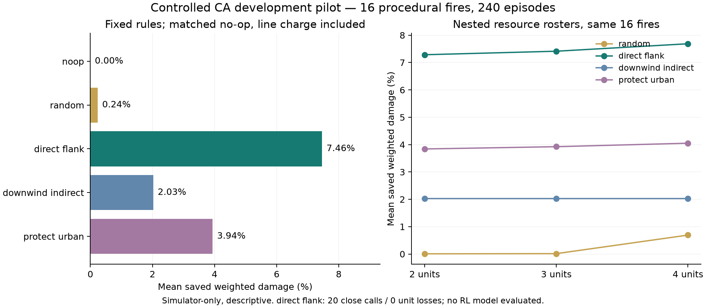

# Kontrolisani CA pilot v2

Završeno 2026-11-21 na `codex/ca-controlled-pilot`, izvedenoj iz `664d890d` završene
SimFire repair grane. Korisnik je odobrio prelazak na CA; nije tvrdio niti ovaj rad
pokazuje da su naučene SimFire politike nadmašile heuristike. Razlozi/ograničenja tog
pravca ostaju u [SimFire izvještaju](SIMFIRE_OBSERVATION_REPAIR.md).

**Ishod:** novi zajednički ugovor opažanja i mali development benchmark rade.
Svih 240 epizoda prolazi tehničke provjere. `direct_flank` je najjača od tri fiksne
heuristike na ovom skupu, uz 7,46% prosječno spašene težinske štete, ali i 20 bliskih
susreta. Nema naučenog modela u ovoj ocjeni. Ovo je vlastiti sintetički CA, nije
Cell2Fire, fizička validacija ili istraživački dokaz RL prednosti.

## Šta je sačuvano, a šta novo

Postojeći CA već ima probabilističko širenje, brzine kretanja i gradnje, dolazak i
povlačenje jedinica, kumulativnu štetu i kontrafaktualni no-op. Ispravke TASK-024
napretka gradnje i obračuna ćelija linije ostaju. Nismo mijenjali fiziku ili
retroaktivno popravljali stare rezultate; ADR-028 brojevi ostaju poništeni ADR-029.

Novi `CAObservationV2` je opt-in wrapper. Zadržava legacy ključeve i dodaje:

| Ključ | Sadržaj |
| --- | --- |
| `native` |21×128×128 u ovom pilotu,180 m po ćeliji: aktivna vatra, kumulativna šteta, linija, urbano, voda,13 kategorija goriva, nonburnable, elevacija i nagib |
| `unit_state` |4×9: prisutnost, aktivnost, gubitak, vrsta, dolazak, tačan red/kolona, metri napretka i prethodna akcija |
| `forcing` |trenutni midflame vjetar, smjer, vlaga i lokalni sat |

Verzija je `ca-native-current-v2`. Native mapa je dostupna i budućem modelu i
heuristikama. `observed_policy(obs, mask)` rekonstruiše samo minimalni pogled potreban
za postojeća pravila; ne prima živi environment, budući vremenski niz, latentne
spread parametre ili no-op otisak. Time je uklonjena ranija razlika u prostornoj
informaciji između pooled opažanja agenta i native heuristika. Ovo još ne dokazuje
potpunu Markov opservaciju: preostalo trajanje gorenja, ros noise i latentni parametri
nisu eksplicitno opaženi. Stari checkpointovi nisu kompatibilni ugovor i nisu učitani.

**Vrijeme je eksplicitna pretpostavka:** prije odluke sve politike savršeno znaju
forcing koji važi za naredni jednosatni interval. Buduće sate ne vide. Ovo nije
lagged gridMET ili tvrdnja da je takva informacija dostupna u stvarnom gašenju.

**Važna razlika goriva:** urbano 91 je u ovom CA modelu zapaljivo, s težinom štete 50.
Voda 98 je negoriva. SimFire nonfuel maska zato nije prekopirana u CA.

## Protokol prije mjerenja

Plan/ADR-039 commit `c8d8563c` prethodi implementaciji `7b45ee19` i ocjeni `8ba4ced2`.
[Zamrznuti JSON](../../configs/frozen/ca-controlled-pilot-v2.json) sadrži konkretne
međusobno disjunktne liste:32 train,16 development i64 proceduralna test sjemena.
Samo development je generisan/skoriran. Stari nasumični trening imao je širok raspon,
pa nove liste ne zovemo dokazano historijski netaknutim. Real VALIDATION i TEST 2024
nisu korišteni. Nema stvarnih pejzaža, downloadova, checkpointa ili treninga u pilotu.

Isti generator,12h odluka i12h tail, početni požar, pejzaž, vrijeme i counter-based
slučajne struje koriste se za svaku politiku i roster jednog slučaja. Četiri su slota:

| Roster | Resursi i dolazak |
| --- | --- |
| B2 |dozer u0min, ručna ekipa u60min |
| B3 |B2 plus ručna ekipa u120min |
| B4 |B3 plus ručna ekipa u180min |

Rosteri su ugniježđeni i čuvaju red postojećih slotova. CA budžet znači broj dostupnih
jedinica; nije broj SimFire crew-shift linija i hektari dva simulatora se ne rangiraju.
Generator zadržava postojeće presampliranje do30 novih no-op ćelija, najviše16 pokušaja;
u ovoj ocjeni nijedan završni slučaj nije ispod praga ili izbačen iz rezultata.
Nasumična politika koristi isti seed+771 kroz rostere; svaka politika ima iste maske.

Prva dva slučaja:30 epizoda,9,64s. Preostali run sa reuseom tih slučajeva:50,04s,
četiri radnika; svaki sa zabilježenim nice19, po jedna BLAS/OMP nit. Dva početna
sandbox pokušaja zaustavljena su prije generisanja jer snižavanje prioriteta nije
bilo dozvoljeno. Odobreni lokalni run van sandbox ograničenja prolazi; worker initializer
izričito postavlja/provjerava nice19. Nijedan rezultat nije iskorišten za promjenu
politika, slučajeva ili metrike.

## Rezultati

Primarni ishod je udio težinske nove no-op štete koji je politika sačuvala. Urbano
ima težinu50, ostalo gorivo1. Ćelije linije unutar no-op otiska računaju se kao
potrošene; sama gradnja linije nije spašavanje. Svaki red ima48 epizoda,16 požara
puta3 rostera; 48 nisu nezavisni požari.

| Politika | Prosjek spašene težinske štete | Medijan | Izgubljene jedinice | Bliski susreti |
| --- | ---: | ---: | ---: | ---: |
| no-op |0,00%|0,00%|0|0|
| random |0,24%|0,00%|0|1|
| direct_flank |7,46%|1,14%|0|20|
| downwind_indirect |2,03%|0,00%|0|4|
| protect_urban |3,94%|0,52%|0|21|

`direct_flank` minus random: **+7,23 procentna poena**, opisni95% interval
[+0,44;+16,49] p.p. Bootstrap resamplira16 cijelih požara i zajedno drži sva tri
rostera,10.000 uzoraka, seed0. Najbolja heuristika izabrana je na ovim development
rezultatima; interval nije korigovan za taj izbor niti predstavlja nezavisni test.
Nema learned-policy prihvata/prolaza iz ovog pilota.

`direct_flank` prosjeci po rosteru: B2=7,29%, B3=7,41%, B4=7,69%. Dodatne dvije ručne
ekipe u ovom kratkom pilotu daju oko0,40 p.p. veću srednju uštedu; to još ne dokazuje
korist prilagodbe budžetu. Veći prosjek uz mali medijan pokazuje heterogenost slučajeva.
Neponderisana line-charged ušteda ovog pravila je86,40ha po epizodi; ona je zasebna
sekundarna mjera, nije7,46% ukupnih hektara. Jedan proceduralni požar dodiruje rub mape
u sva tri rostera za svaku politiku; ti slučajevi nisu isključeni.

**Sigurnost nije dokazano riješena:** nema izgubljene jedinice, ali najbolja heuristika
ima20 bliskih susreta prema1 za random. Spašena šteta i sigurnost moraju ostati odvojeni
u izboru i prihvatu budućeg modela. Automatsko povlačenje je pojednostavljena modelska
zaštita, ne potvrda stvarne sigurnosti.



## Dokaz tehničkog ugovora

- Testovi su prvo pali bez novog modula pa prošli: kategorije13/voda/urbano, current-only
  forcing, isti potezi pravila iz opažanja, no-op i nepromijenjena dinamika wrappera,
  disjunktnost/ugniježđenost i resampling cijelog požara.
- Postojeći CA testovi pokrivaju ograničene brzine kretanja/gradnje, napredak pri promjeni
  smjera, kumulativnu štetu, jednokratnu naplatu linije, gubitke, bliske susrete i CRN.
  Deterministički koridor ima nenulti učinak prepreke, uz naplatu same ćelije linije.
- Svih240 putanja provjerava observation space/finiteness, legalnost/no-op, monotonu
  štetu/charge, terminalni obračun kao uniju opožarenih i naplaćenih ćelija, povrat sa
  sigurnosnim kaznama i odsustvo ranog kraja dok vatra traje. No-op ima iste cijele maske
  kao nezavisni interni no-op. Hashovi svijeta/no-op maski isti su kroz politike/rostere.
- Prvi unaprijed navedeni slučaj ponovljen je bez case-cachea: svih15 epizoda tačno
  reprodukuje akcije, cijele maske, obračune i sigurnost. To je tehnički replay, nije
  dodatni statistički uzorak. [Replay receipt](../../reports/synthetic/ca-controlled-replay-v2.json).
- Full suite: pinovani runtime352 testa/0 skip, moderni337/3 skip, core284/38 skip.
  Knowledge15/15 i strict86Markdown prolaze; CLI smoke PASS. Broj skipova zavisi od
  optional biblioteka i lokalnih ulaza. [Verification](../../reports/synthetic/ca-controlled-verification-v2.json)
  veže izvore, plan, izvještaje i logove. Runtime PASS nije fizička validacija.

## Reprodukcija i sljedeći zadatak

CA ne zahtijeva SimFire paket ili stvarne mape: potrebni su NumPy, SciPy i Gymnasium.
Koristi postojeći odgovarajući venv ili numeričke requirements u izolovanom venvu;
verzije stvarnog runa su u result.guard.runtime. `P` označava taj interpreter.

```sh
export PYTHONPATH=src OMP_NUM_THREADS=1 OPENBLAS_NUM_THREADS=1 VECLIB_MAXIMUM_THREADS=1
nice -n 19 "$P" scripts/run_ca_controlled_pilot.py --case-limit 2 --workers 2 --out .local/ca-new
# Tek nakon provjera:
nice -n 19 "$P" scripts/run_ca_controlled_pilot.py --case-limit 16 --workers 4 --out .local/ca-new
```

Runner odbija promjenu source/plan/runtime guardova pri resumeu i postojeći finalni
izvještaj. Cache je lokalni; javni JSON čuva svih240 ishoda, akcije i hashes. Nema velikih
mapa ili težina u Gitu. Potpuno nov runtime može dati nove numeričke hashove; ne tvrditi
bit-identičnu reprodukciju između NumPy verzija bez mjerenja.

**Završeno:** TASK-035 ugovor i tehnički/heuristički pilot. **Naredni TASK-038:** verzionisani
encoder/checkpoint provenance za v2 i unaprijed registrovan kratki BC/PPO. Učiteljska
referenca je ovaj development `direct_flank`, uz obaveznu zasebnu provjeru sigurnosti;
trenutna prednost u spašenoj šteti nije dovoljan kriterij. Legacy training CLI ne
usvaja novi ugovor automatski. Train/test liste su rezervisane, nisu iskorištene.
Dugi trening, proceduralni test i stvarni holdout nisu pokrenuti. TASK-037 SimFire
physics/gate put ostaje dokumentovan, odgođen izborom CA. Nema mergea ili novog PR-a.

Objava: grana je commitana/pushana. [CI na3ad3f72c](https://github.com/goralija/wildfire-rl-adaptation/actions/runs/44836958711)
prolazi core3.11/core3.13, numeric i knowledge. Verification bilježi tačan testirani commit.
Kasniji publikacijski commit ne mijenja numerički kod ili rezultate. Nema novog PR-a ili mergea.
