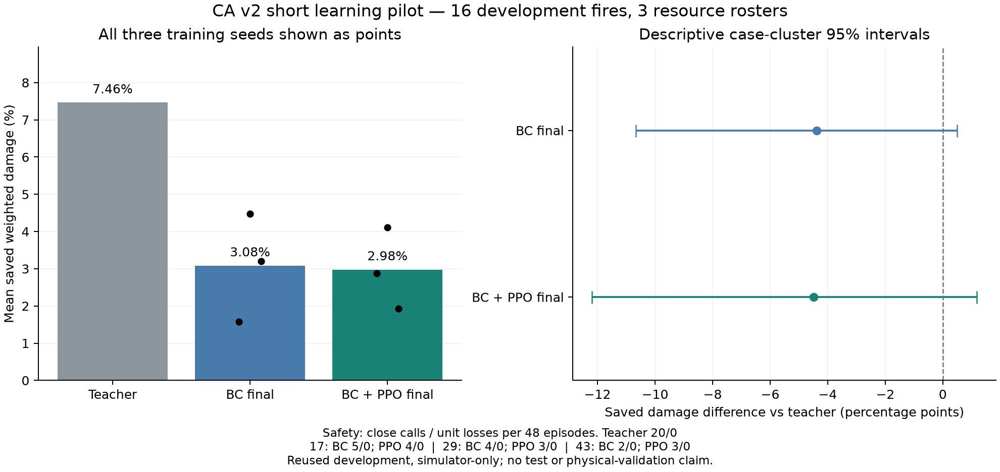

# Kratki CA v2 BC/PPO pilot

Završeno 2026-11-21 na `codex/ca-learning-pilot`, izvedenoj iz završene CA grane
`3b7b56a2`. Korisnik je zatražio sljedeći TASK-038. [Plan](../../configs/frozen/ca-learning-pilot-v1.json)
i ADR-041 commit `6f2e4b61` prethode demonstracijama i treningu. Numerički kod je
`fca17851`, s tehničkim regresijama `fa55b3a3` i `51bbdff2`; kasniji test/plot ne mijenja kod treninga.

**Ishod:** novi model, BC, PPO i sigurno spremanje/učitavanje tehnički rade. Na istih
16 razvojnih požara BC štedi prosječno **3,08%**, BC+PPO **2,98%** težinske štete,
a fiksni `direct_flank` **7,46%**. Nijedan kandidat ne prelazi registrovani kriterij
nastavka. Modeli imaju manje bliskih susreta u ovom uzorku, uz nula gubitaka, ali
nema potvrđene prednosti u spašenoj šteti ili stvarnoj sigurnosti. CA je vlastiti
sintetički simulator, nije Cell2Fire ili fizički validiran model.

## Šta je implementirano

- `ca-geometric-local-v1` encoder čita samo `ca-native-current-v2` opažanje: native
  7×7 izrez sa svih 21 kanala oko svake jedinice, stanje jedinice i slot, geometriju
  fronta/naselja te globalne kategorijske i vremenske sažetke. Izrez je na 180 m.
- Shared MLP 64/64 obrađuje svaku jedinicu, globalni MLP ima 32 izlaza, a actor i
  value grane po jedan sloj 64. MaskablePPO ima četiri slota po 17 poteza.
- Prostorne/geometrijske transformacije su dio politike. To je kompresija dostupnog
  v2 ulaza, ne potpuna Markov reprezentacija; nije dokaz da je iscrpljena informacija
  iz native mape. Heuristika i model prije vlastite obrade imaju isti v2 ugovor.
- Nagrada ostaje line-charged sačuvana težinska šteta minus kazne za gubitke i bliske
  susrete. Nisu mijenjani širenje, resursi, rokovi ili pravilo uvijek legalnog no-opa.
- Trenutni forcing narednog sata savršeno je poznat svim politikama; budući vremenski
  niz nije dostupan. To je eksplicitna pretpostavka prethodnog CA ugovora.
- Težine su numerički NPZ, bez object nizova, uz JSON verzije/plana/izvora/runtimea i
  SHA256. Učitavanje koristi `allow_pickle=False`, odbija pogrešan ugovor/hash prije
  čitanja nizova i provjerava svaki naziv, oblik, dtype i konačnost tenzora. Nema
  starih policy-v1, SB3 zip ili Torch pickle checkpointova. To su inference snapshoti,
  ne nastavak kompletnog optimizer/rollout stanja.

## Kako su iskorišteni podaci

Koristi se 32 proceduralna TRAIN sjemena rezervisana u ADR-039 i sva tri ista
ugniježđena rostera B2/B3/B4. Nisu korištene stvarne mape ili stvarni vremenski podaci.
Za svaki požar i roster učitelj `direct_flank` izvršava cijelu epizodu i daje:
trenutno opažanje, legalnu masku, svoju akciju i ostvarene nagrade. Dobijeno je
**96 epizoda, 1.152 stanja i 2.846 slotova sa stvarnim izborom poteza**. Prisutni su
kretanje i gradnja u svih osam smjerova; agreement ne broji obavezne no-op slotove.

BC uči maskiranim negativnim log-likelihoodom učiteljeve akcije, uz 0,1 MSE value
cilja. Value cilj je diskontovan učiteljev povrat, gamma 0,99. Budući ishod služi
kao TRAIN oznaka/nagrada; nije dio ulaza politike pri odlučivanju.

Za svako od sjemena **17, 29 i 43** izvršeno je tačno **60 BC epoha**, pa **4.096 PPO
koraka** kroz dva rollout okruženja. Svaki run je posjetio svih 96 TRAIN kombinacija.
Iste demonstracije koriste se za sva tri sjemena. Završni BC i završni BC+PPO su
unaprijed zadati kandidati; nije birana najbolja epoha, checkpoint ili sjeme na devu.

BC agreement na učiteljskim TRAIN stanjima: **100%, 99,9649%, 99,9649%**. To pokazuje
fit tih oznaka, ne učinak modela na vlastitim putanjama ili novim požarima.

Konačna kolekcija traje 19,82 s, trening sva tri modela 368,42 s (119,14 / 135,42 /
113,86 s), a razvojna ocjena 62,29 s. Zbir tih poslova je oko 7,5 min, bez ranijih
tehničkih pokušaja i testova. Jedna nit po procesu, nice19; learner i dva rollout
radnika, odnosno najviše tri eval radnika uz koordinaciju. Nema automatskog produženja.

## Tehničke ispravke bez promjene eksperimenta

1. Test je prije treninga pokazao da konstrukcija modela pri checkpoint provjeri
   resetuje RNG. `fa55b3a3` čuva Python/NumPy/Torch tokove; regresija je prvo pala,
   zatim prošla. Time provjera checkpointa ne mijenja slučajnost PPO runa.
2. Prvi BC17 je završen, ali SB3 je odbio `set_env` sa 1 na 2 okruženja prije prvog PPO
   koraka. `51bbdff2` održava dva pripremna slota od početka; novi test stvarno izvršava
   prelaz i osam kratkih PPO koraka. Stari izlaz je sačuvan odvojeno. Kolekcija je
   ponovljena pod novim source guardom: svih 32 fajla imaju identične numeričke nizove.
   Nije bilo razvojne ocjene prije ispravke, niti promjene parametara/kandidata.
3. TRAIN wrapper čisti stari distance cache pri novom požaru i ograničava cache
   pripremljenih požara na četiri. No-op cache služi samo environment nagradi.
   Test poredi cijele maske i nagrade cached reset-a sa svježim v2 no-opom.

## Upareni razvojni rezultati

Sve politike vide iste scenarije, resurse, horizon 12h plus 12h tail, maske i vremenski
ugovor. Svih šest modela ocijenjeno je na 16 DEVELOPMENT požara ×3 rostera: **288
putanja**, 48 po modelu. Zaključani rezultati heuristika ponovo su korišteni tek nakon
provjere source/runtime i hashova svakog svijeta/no-op maske. TEST i stvarni holdouti
nisu generisani ili skorirani. TRAIN i DEVELOPMENT su disjunktni; istorijska
neizloženost ovih sjemena ranijem širokom random treningu nije dokazana.

Glavna mjera je udio spašene težinske nove no-op štete, s urbanim ćelijama težine 50.
Ćelija linije u no-op otisku je potrošena, ne spašena. To nije procenat običnih hektara.

| Kandidat / model seed | Spašena težinska šteta | Bliski susreti / 48 epizoda | Gubici |
| --- | ---: | ---: | ---: |
| direct_flank, ista referenca |7,46%|20|0|
| BC17 |1,57%|5|0|
| BC29 |4,48%|4|0|
| BC43 |3,20%|2|0|
| BC+PPO17 |2,88%|4|0|
| BC+PPO29 |4,12%|3|0|
| BC+PPO43 |1,94%|3|0|

| Prosjek tri model seeda | Spašeno | Razlika prema heuristici | Opisni 95% interval razlike |
| --- | ---: | ---: | ---: |
| BC |3,08%|−4,38 p.p.|[−10,67; +0,49] p.p.|
| BC+PPO |2,98%|−4,49 p.p.|[−12,19; +1,19] p.p.|

BC+PPO minus BC je **−0,105 p.p.**, interval **[−2,08; +1,21] p.p.** Jedno sjeme se
popravlja, dva pogoršavaju; nema stabilnog poboljšanja iz ovog kratkog PPO nastavka.
Niže srednje vrijednosti i široki intervali ne dokazuju statističku inferiornost
cijele klase modela, ali ne ispunjavaju unaprijed zadat zahtjev pozitivne donje granice.

Po rosteru BC ima 2,66 / 2,68 / 3,91%, PPO 1,98 / 2,77 / 4,18%, heuristika
7,29 / 7,41 / 7,69%. To je zajednički model preko budžeta, bez zasebnog fine-tuninga
po budžetu; nije dovršena studija koristi adaptacije resursa.

Bootstrap prvo prosječi tri model seeda unutar požara/rostera, zatim resamplira svih
16 cijelih požara sa sva tri rostera zajedno, 10.000 drawova seed0. Nisu 144 nezavisna
požara. Interval ne uključuje punu nesigurnost trening distribucije i ne koriguje
poređenje dva kandidata ili raniju upotrebu developmenta. Rezultati su eksploratorni.

**Kriterij nastavka nije prošao za oba kandidata.** Svaki model prolazi registrovani
brojčani sigurnosni uslov (ne više gubitaka ni susreta od iste heuristike), ali nijedna
primarna donja granica nije iznad nule. Manje susreta uz slabiju uštedu može značiti
manje rizičnog ili manje aktivnog ponašanja; uzrok nije izmjeren ovim sažetkom. Nula
gubitaka u ovom uzorku ne dokazuje stvarnu sigurnost. Ukupan reward ne mijenja zaključak.



## Provjere i artefakti

Svih 288 putanja provjerava maske/no-op, observation space, kumulativnu štetu,
terminalni obračun unije izgorjelih i naplaćenih ćelija, povrat sa sigurnosnim kaznama
i zabranu ranog kraja aktivne vatre. Sve nove no-op maske odgovaraju referenci. Nezavisna
rekalkulacija javnih redova provjerava sredine, intervale, sigurnost, source hashove,
svih šest checkpointova i posjetu svih 96 TRAIN kombinacija po model seedu.

Pinovani suite: **362 testa /0 skip**; moderni **347/3 skip**, core **286/40 skip**.
Dodatno poboljšani checkpoint test u oba runtimea poredi svaki tenzor i predikciju pri
aktivnom izboru poteza, te odbijanje tampera/verzije i očuvan RNG. Knowledge15/15,
strict87 Markdown i CLI smoke prolaze. Ovo je tehnički dokaz, ne fizička validacija.

[Javni svi ishodi](../../reports/synthetic/ca-learning-development-v1.json) sadrže sve
modele/seede, akcije, source/plan/runtime i checkpoint hashove. Težine i demonstracije
ostaju lokalni. [Verification](../../reports/synthetic/ca-learning-verification-v1.json)
i [manifest lokalnog paketa](../../reports/synthetic/ca-learning-artifacts-v1.json)
čuvaju provjere i putanju za prenos; nema venv-a, starih težina, stvarnih mapa ili
privatne prepiske u paketu. Nema novog PR-a ili mergea.

Prenosivi lokalni paket ima 7.175.838B i256 provjerenih fajlova plus interni manifest.
Svaki član je ponovo pročitan i hashiran. Iz raspakovanog source-a učitano je svih šest
modela; prvi unaprijed navedeni razvojni slučaj ponovljen je u svih18kombinacija,
sa potpuno istim akcijama, maskama, nagradama i sigurnošću za8,52s.
[Restore receipt](../../reports/synthetic/ca-learning-restore-v1.json). To nije druga
puna ocjena ili nova instalacija biblioteka. Paket ne sadrži kasniju dokumentaciju
objave i nije uploadovan; javni manifest čuva SHA256.

## Zaključeno i naredni korak

**TASK-038 je završen.** Imamo provjereni v2 encoder, BC/PPO pipeline, tri nezavisna
model inicijalizacijska seeda, šest bezbjedno serijalizovanih snapshotova i uparenu
ocjenu. Nemamo potvrđenu RL prednost. Model dobro fituje učiteljeve TRAIN oznake, ali
ne prenosi taj učinak na development u ovom eksperimentu; razlog ostaje za dijagnozu.

**Predloženi TASK-039:** prvo TRAIN-only analiza poteza i ponašanja modela na vlastitim
putanjama, pokrivenosti učiteljskih stanja i kodiranja geometrije, pa unaprijed zadato
kratko prikupljanje učiteljevih odluka u stanjima modela ako dijagnoza to opravda.
To su hipoteze/protokol, ne već dokazani uzroci. Ne povećavati PPO korake naslijepo
niti birati samo uspješnije sjeme29. Novi trening nije pokrenut automatski.
Proceduralni test, stvarni VALIDATION i TEST2024 ostaju zatvoreni.

Reprodukcija: uz odgovarajući postojeći izolovani Python/NumPy/SciPy/Gym/SB3/Torch
runtime iz zapisa, postaviti `PYTHONPATH=src`, BLAS/OMP niti1 i izvršiti svaki stage
redom s novim izlazom. Stari checkpointovi nisu ulaz.

```sh
nice -n 19 "$P" scripts/run_ca_learning_pilot.py --stage collect --out .local/NEW_CA_RUN
nice -n 19 "$P" scripts/run_ca_learning_pilot.py --stage train --out .local/NEW_CA_RUN
nice -n 19 "$P" scripts/run_ca_learning_pilot.py --stage evaluate --out .local/NEW_CA_RUN
```

Runner odbija promjenu source/plana/runtimea pri resumeu, postojeću završnu ocjenu
ili parcijalni model bez završenog receipt-a. To su inference snapshoti, pa nema tvrdnje
o nastavku tačnog optimizer/RNG/rollout stanja iz prekinutog PPO treninga.
