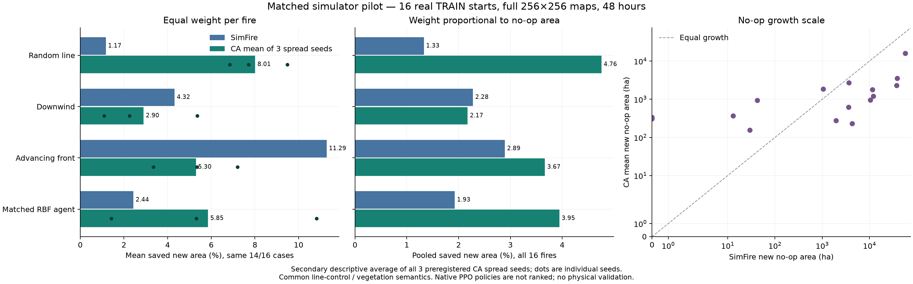

# Isti početni požari: SimFire i kontrolni CA bridge

Stanje 2026-11-21. Korisnik traži procente na istim situacijama prije odluke o prelasku,
ne samo blizinu agenta heuristici. Na `codex/ca-simfire-paired`, iz722d5f2d, izvedena je
**faza A TASK-040: common-control poređenje** (završno ADR-044). Plan56c460db, ulazna dopuna ae0d13af i
ADR-043 prethode CA ishodima. Numerički kod c69cc5a2/a831d654. Izvori i hashovi su u JSON-u.

**Nalaz:** isti zahvati nemaju proporcionalno isti učinak u dva backend-a. CA prosječno
širi znatno manji no-op požar; relativne koristi i rang politika se mijenjaju. Mali
upareni RBF agent u prosjeku tri CA sjemena ima veću procentualnu uštedu, ali s velikom
varijabilnošću i intervalom preko nule. To ne opravdava automatski prelazak na CA.

**Granica:** ovo nije poređenje prethodnog SimFire PPO-a s novim CA unit PPO-om. Jedan
bira sektor linije, drugi vodi ekipe/dozere, uz različite budžete i horizonte. Da bi
uslovi bili jednaki, oba backend-a sada rješavaju isti mali problem jedne linije,
s istim heuristikama i novim jednakim RBF postupkom. Native PPO poređenje ostaje otvoreno.
CA bridge nije retroaktivno izmijenjena policy-v1 ili TASK-038 politika.

## Šta je zaista izjednačeno

| Uslov | Zajednički zapis |
| --- | --- |
| Početak |isti stvarni TRAIN FEDS scar/front, provjereni receipt i početna cijela maska |
| Prostor |puna256×256 mreža,180m, bez CA128crop-a ili izbacivanja dijela početnog požara |
| Vrijeme |48h, četiri odluke svakih12h, bez dodatnog CA12h taila |
| Atmosferski ulaz |isti ispravljeni gridMET segmenti, WAF0.10, ista fizička brzina/smjer/vlaga |
| Dostupne informacije |identično categorical/local v2 opažanje; strogo raniji dnevni weather zapis; bez no-op budućnosti |
| Kapacitet intervencije |B=1, jedna trenutno postavljena front-edge linija; ista funkcija geometrije i maska gorivosti |
| Tačna rasterizacija |1260m po osi;1272,79m dijagonalno zbog5dijagonalnih i4corner ćelije, isto u oba backend-a |
| Obračun |nove ćelije van početne štete; unija opožarenih i tretiranih ćelija unutar vlastitog no-op otiska |
| Učenje |isti terrain536 prikaz, isti RBF meni, isti16požara i15fit požara u svakom outer foldu |

Svih16 početnih v2 opažanja i legalnih maski je **bit-identično** arhivi SimFirea.
Za random_legal, downwind i advancing_front64 sve16sekvence se poklapaju i svi
postavljaju liniju na početku. Cijele linijske maske su16/16 identične za svako pravilo.
Dakle, razlika njihovih rezultata u primarnoj provjeri ne dolazi iz drugog početka,
prostornog prozora ili drugačije nacrtane linije. Kod agenta se sekvence poklapaju samo
1/16: postupak je isti, ali agenti uče različitu vrijednost poteza u svojim backend-ima.

**Fizičke razlike ostaju predmet poređenja:** CA ima vlastitu vjerovatnoću paljenja,
rezidenciju po gorivu, spotting i dnevni ciklus uz2min subkorak. SimFire je zamrznuti
WAF0.10/ROS1/90min/5min/last_write/per_minute zapis ADR-031. Njegova poznata numerička
osjetljivost nije uklonjena ovim zadatkom. SimFire je referenca za poređenje, nije istina.

CA bridge namjerno harmonizuje goriva: samo1–13 je zapaljivo, ostali kodovi postaju99
u CA fizici, dok originalni kodovi ostaju u opažanju. Nema native urban-weight50.
Zato brojevi nisu nastavak starog CA urban/unit benchmarka i ne rangiraju njegovu
fizičku realističnost. Linije su trenutne u oba modela; ovdje nema mobilnih jedinica,
pa ne porediti sigurnosne ishode ili proglasiti da su crew-hour troškovi izjednačeni.
Jednak je kapacitet i pravilo linije, ne cjelokupna operativna simulacija ekipe.

## Kohorta i zašto16

Prije CA ishoda pregledano je98TRAIN ulaza. Native CA podržava početni front na63,
a zajednička vegetativna semantika na61; još dva slučaja imaju front na urbanu91.
Za ovaj bridge unaprijed je uzeto16najnižih SHA256('TASK040:'+ID) među61kompatibilnim
slučajem. Nije birano po CA rastu, uštedi ili uspjehu agenta. Svih98QC zapisa, razlozi
37isključenja i tačni16ID-jeva su u planu. Odabrani ulazi nemaju elevation fill.

Ovo je mali input-compatible TRAIN subset, ne slučajni uzorak svih98požara, novi test
ili završna evaluacija. SimFire cache je stara hash-provjerena B1 tabela, a ne ponovno
korištenje invalidiranih ADR-022–028 brojeva. Stvarni VALIDATION i TEST2024 nisu otvoreni.

## Metode i broj poslova

Fiksne metode: no-op, random_legal(seed0), downwind i advancing_front64. Random je
jedan unaprijed isti RNG seed po epizodi, nije prosjek mnogih random-policy sjemena.

Za svaki backend zasebno fitted je isti nested RBF: outer izostavlja cijeli požar,
unutrašnja četiri ista hash folda biraju alpha .01/.1 i bandwidth .5/2; scaling i kernel
skala koriste samo fitting požare. Cilj je charged ušteda u hektarima u oba backend-a,
ne naknadno podešen procentni cilj. Agent dobija samo trenutno opažanje i masku.
Sve izabrane postavke i akcije su prijavljene. To nisu prethodno trenirani PPO modeli.

CA primarni spread seed0 daje punu33-sequence tabelu za svaki požar: **528 ishoda**.
Odgovarajućih528SimFire ishoda ponovo je korišteno. Dodatni CA spread seed1/2 primjenjuju
iste fiksne metode i agent iz seed0 traininga, bez refita ili izbora najboljeg seeda:
još160ishoda. Spread seeding je stabilan po case ID/replici, CRN zajednički politikama.

Pilot2/2 traje14,72s. Puna komanda uz reuse pilota traje126,02s; analiza/fitting i
robustness40,59s. Najviše3radnika uz koordinaciju, nice19/jedna nit. Primarni plan nije
mijenjan prema skorovima. Tehnički guard je prvo zaustavio dijagonalnu liniju zbog
pogrešnog<=1260uslova; prvo-padajući test i a831d654 prihvataju već postojeći SF1272,79m
kapacitet. Fizika i geometrija nisu promijenjene; stari pokušaj je sačuvan.

## Šta znači procenat i kako se ne bira povoljniji prosjek

Za požar je ušteda `100*(D_noop − D_policy_charged)/D_noop`. Početna šteta se izuzima,
a tretirana ćelija koja bi izgorjela nije spašena. Sve ćelije imaju istu težinu.

**Primarni zapis** daje svakom požaru istu težinu. Na dva slučaja (Coldwater i Organ)
SimFire nema novi no-op rast, pa je procenat undefined. Ne pretvara se u0 niti dijeli
epsilonom. Procentni parovi su na istih14od16slučajeva s pozitivnim rastom u oba modela;
svi16 ostaju u hektarima i pooled obračunu. U sva tri CA sjemena raste svih16slučajeva.

**Sekundarni pooled zapis** je `100*sum(spašenih ćelija)/sum(no-op ćelija)` na svih16.
On većim požarima daje veću težinu, i te težine se razlikuju po backend-u jer se razlikuje
njihov no-op rast. Zato pooled rezultat nije isto što i jednako ponderisan prosjek
istih požara. Oba zapisa su unaprijed planirana; ne bira se onaj koji podržava prelazak.

## Primarni CA seed0

| Metoda | SimFire, mean case% | CA bridge, mean case% |
| --- | ---: | ---: |
| random_legal(seed0) |1,17|9,49|
| downwind |4,32|1,10|
| advancing_front64 |11,29|3,35|
| matched_rbf |2,44|1,42|
| privilegovani finite oracle |23,02|27,91|

Oracle koristi buduće simulatorne ishode da pokaže plafon konačnog menija; nije
politika s dozvoljenim informacijama i nije korišten za odlučivanje ili izbor metode.

## Sva tri CA spread sjemena — dodatni opisni sažetak

Tri CA procenta se prvo prosječe unutar istog požara, zatim preko14zajedničkih požara.
To je sekundarni opis svih unaprijed zadanih replika, ne novi primarni kriterij ili
izbor najboljeg rezultata. SimFire ostaje determinističan i svaki njegov slučaj broji
se jednom. Nisu42nezavisna požara.

| Metoda | SimFire case% | CA case%, prosjek3 | SimFire pooled% svih16 | CA pooled% svih16 |
| --- | ---: | ---: | ---: | ---: |
| random_legal(seed0) |1,17|8,01|1,33|4,76|
| downwind |4,32|2,90|2,28|2,17|
| advancing_front64 |11,29|5,30|2,89|3,67|
| matched_rbf |2,44|5,85|1,93|3,95|

Agent CA po spread seedu0/1/2 daje **1,42 /10,82 /5,32%**. Heuristika fronta daje
**3,35 /7,20 /5,34%**. Time je jasno zašto seed0 sam nije dovoljan, ali ni seed1 ne
smije postati novi glavni rezultat. Tri seeda su spread slučajnost, ne tri nezavisna
trening runa ili novi modeli sa podešenim parametrima.

Deskriptivni paired case bootstrap (10.000, seed0) razlike CA−SF na sredini tri replike:
agent **+3,42p.p.,95%[−0,05;+7,05]**; front heuristika **−5,99p.p.,[−22,29;+5,82]**.
Oba intervala uključuju nulu. Nema refita unutar bootstrapa ili multiple-comparison
korekcije; reused TRAIN i input filter ograničavaju zaključak.

**Heuristike ne zadržavaju proporcionalan učinak.** Front ostaje iznad downwind-a,
ali seeded random linija prelazi obje u CA, dok je u SimFireu ispod njih. Zbog toga
blizina agenta heuristici nije dovoljan argument za zamjenu simulatora. Ni lower mean
u ovom subsetu nije dokaz da je CA općenito inferioran. Pooled front rezultat obrće
smjer poređenja upravo zato što modeli drugačije raspoređuju no-op površinu među požarima.



## Razmjer samog požara

Na svih16slučajeva SimFire bez intervencije doda prosječno **11.363,69ha**, a CA preko
tri sjemena **2.098,78ha**. CA je oko18,5% SimFire novog rasta, odnosno razlika u razmjeru
je oko5,4puta. Prosjek primarnog CA seed0 je1.866,85ha. Nema edge kontakta u ovim no-opima;
puna mapa i početno stanje su očuvani, pa to nije posljedica ranijeg CA128crop-a.

| Metoda | SimFire mean saved ha, svih16 | CA mean saved ha, svih16×3 |
| --- | ---: | ---: |
| random_legal(seed0) |151,07|99,83|
| downwind |258,80|45,63|
| advancing_front64 |328,66|76,95|
| matched_rbf |218,90|82,82|

Mean IoU **novih** no-op maski između dva backend-a u primarnoj replici je **0,0691**.
To je njihovo međusobno neslaganje, ne kalibracija prema stvarnom FEDS rastu. SimFire
nije tretiran kao ground truth. Veći ili manji rast sam po sebi ne govori koji je model
bliži stvarnom požaru; za to treba zasebno TRAIN poređenje sa opaženim FEDS rastom.

## Provjere i šta je ostalo otvoreno

- Svih16 početnih opažanja/maski i prior maski se poklapa; svi CA no-op replayevi su
  identični. Maskiranje/no-op, budžet, puna4koraka, unija štete i line capacity prolaze.
- Deset novih pinovanih SimFire replayeva, prve dvije unaprijed zadate scene i svih
  pet ne-oracle metoda, poklapa cijele arhivirane maske i sve obračune.
- Prvi CA slučaj ponovljen je u svih33ishoda: sve opažajne, maske i outcome matrice
  identične. To su tehničke provjere, ne dodatni nezavisni statistički uzorci.
- Raspakovani source i ulazi ponavljaju33/33 ishoda prvog slučaja identično (13,30s);
  postojeće biblioteke, bez nove instalacije ili kompletne druge analize. Paket ima
  14.888.989B,562 fajla plus interni manifest, svi članovi ponovo hashovani.
- Puni suite:369pinovanih testova/0skip;354modernih/3skip;287core/41skip. CLI i
  knowledge provjere prolaze. Runtime PASS nije fizička validacija.
- [Rezultati](../../reports/synthetic/ca-simfire-paired-v1.json), [sve3replike](../../reports/synthetic/ca-simfire-paired-replicates-v1.json),
  [verifikacija](../../reports/synthetic/ca-simfire-paired-verification-v1.json) i
  [lokalni paket](../../reports/synthetic/ca-simfire-paired-artifacts-v1.json) čuvaju izvore i provjere.

**Zaključak faze A:** korisnikova primjedba je opravdana: agent–heuristika jaz može se
poboljšati dok se sama korisnost fiksne taktike smanjuje. Ovdje su rezultati mješoviti,
zavise od spread seeda i ponderisanja požara, a no-op dinamike su veoma različite.
Nije pokazano da je prelazak na native CA općenito bolji, niti da je SimFire fizički tačniji.

**Sljedeći predloženi TASK-041** je TRAIN audit oba no-op rasta prema istim opaženim
FEDS promjenama, prije novog CA treninga. **TASK-040 faza B ostaje otvorena** za native
resurse/akcije ili zajednički PPO interfejs; sadašnja tabela malih RBF agenata ne smije
se predstaviti kao rangiranje ranijih PPO politika. TASK-039 imitation dijagnoza je odgođena.
Nema novog PPO treninga, VALIDATION/TEST pristupa, invalidiranih nalaza ili mergea.

Reprodukcija uz postojeći odgovarajući izolovani numerički runtime i iste ulazne hashove:

```sh
export PYTHONPATH=src OMP_NUM_THREADS=1 OPENBLAS_NUM_THREADS=1 VECLIB_MAXIMUM_THREADS=1
nice -n 19 "$P" scripts/run_paired_simulators.py --stage collect --case-limit 2 --workers 2 --out .local/NEW_PAIR
nice -n 19 "$P" scripts/run_paired_simulators.py --stage collect --case-limit 16 --workers 3 --out .local/NEW_PAIR
nice -n 19 "$P" scripts/run_paired_simulators.py --stage analyze --out .local/NEW_PAIR
```

Resume odbija promjenu source/plana/runtimea ili NPZ-a, finalna analiza se ne prepisuje.
Svi NPZ podaci učitavaju se bez pickle-a. Velike mape ostaju lokalne i nisu uploadovane.
