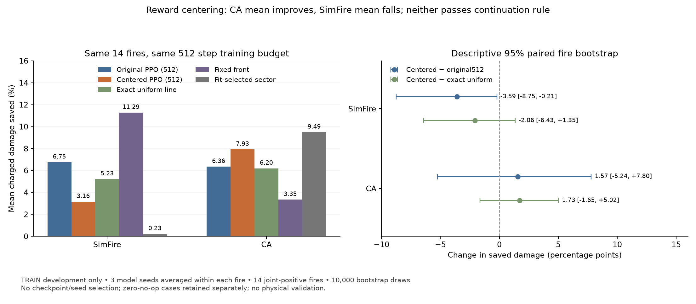

# Centrirana nagrada: kontrolisani PPO pilot

## Završeno — ADR-056, 2026-11-23

Svih šest poslova završilo je bez greške za **20,05 minuta**,21:43 CET. Ukupno
3.072 koraka /768 epizoda,12 novih numeričkih checkpointova0/512. Nije rađen duži
trening, odabir najboljeg modela ili podešavanje nakon uvida u rezultate. U svim
usporedbama tri model seeda prvo se prosječe unutar požara; primarni uzorak ima14
istih požara s pozitivnim no-op rastom u oba simulatora. Svih16 ostaje u ha/pooled
obračunu; Coldwater/Organ su undefined u SimFire pojedinačnom procentu.

**Nalaz:** centriranje samo po sebi nije dovoljno. CA prosjek raste, ali opisni
interval uključuje pogoršanje; SimFire prosjek pada, uz cijeli opisni interval
centered−original512 ispod nule. **Oba unaprijed zadana kriterija nastavka su false.**
Ovo je nalaz istraženog TRAIN development pilota, ne fizička validacija ili nezavisan
potvrdni test. Originalni TASK-043 nalazi i kriteriji nisu promijenjeni.

| Metoda / prosječan charged saved% na istih14 | SimFire | CA |
| --- | ---: | ---: |
| Originalni PPO512 |6,75%|6,36%|
| Novi centrirani PPO512 |3,16%|7,93%|
| Početni model0 |5,72%|4,30%|
| Tačno uniformna prva legalna linija |5,23%|6,20%|
| Fiksno pravilo fronta |11,29%|3,35%|
| Downwind |4,32%|1,10%|
| Fiksni random_legal seed0, ovdje sektor7 |1,17%|9,49%|
| Sektor odabran samo na45fitting: SF6 /CA7 |0,23%|9,49%|

| Uparena razlika u procentnim poenima, opisni95% interval | SimFire | CA |
| --- | ---: | ---: |
| Centrirani−originalni512 |−3,59 [−8,75;−0,21]|+1,57 [−5,24;+7,80]|
| Centrirani−tačno uniformni |−2,06 [−6,43;+1,35]|+1,73 [−1,65;+5,02]|
| Centrirani−početni0 |−2,56 [−9,00;+3,26]|+3,62 [−0,60;+8,42]|
| Centrirani−front |−8,12 [−24,92;+3,59]|+4,58 [−0,17;+9,28]|
| Centrirani−fit-selected sektor |+2,93 [+0,51;+6,47]|−1,56 [−9,76;+5,32]|

Kriterij je zahtijevao donju granicu iznad0 i prema originalnom512 i prema tačno
uniformnom referentu, zasebno za svaki simulator. CA ne zadovoljava nijedan od ta
dva uslova, iako su oba prosjeka pozitivna. SF ne zadovoljava oba. Nema izbora
referenta prema tome koji ispadne slabiji. Bootstrap ima10.000 uparenih uzoraka
požara, seed0; model seedovi nisu dodatni nezavisni požari.

CA−SF promjena u odnosu na originalni512 iznosi+5,16pp[−1,90;+12,28]; to nije
pouzdan dokaz da je centriranje bolje za CA. Relativni razmak do fronta povoljniji
je za CA za12,70pp[+1,20;+28,21], a do uniformnog3,79pp[−0,73;+8,77]. To su opisna
poređenja sa konkretnim pravilima; ne procjena fizičke tačnosti simulatora.

### Hektari i svi model seedovi

Na svih16 slučajeva, uz jednak prosjek model seedova:

| Novi centrirani512 | SimFire | CA |
| --- | ---: | ---: |
| Mean raw nova šteta |11.216,14ha|1.771,61ha|
| Mean charged nova šteta |11.225,45ha|1.782,81ha|
| Mean charged saved |138,24ha|84,04ha|
| Original512 mean charged saved |165,78ha|58,05ha|
| Pooled saved%, sve16 |1,22%|4,50%|
| Original512 pooled saved% |1,46%|3,11%|
| Mean saved%, vlastiti pozitivni slučajevi |3,16%na14|7,36%na16|

Mean po požaru i pooled nisu ista metrika. Simulatori imaju vlastite no-op
površine, pa se apsolutni ha između njih ne tumače kao zajednički RL uspjeh.

| Model seed / novi saved% na istih14 | SimFire | CA |
| --- | ---: | ---: |
|17|8,09%|8,39%|
|29|1,17%|6,16%|
|43|0,23%|9,23%|

### Šta se promijenilo u politici

Težine su se stvarno promijenile. Relative L2 pomak actor parametara od početka
je0,78–0,98% u SF i0,80–1,04% u CA; critic1,12–1,64% /1,07–1,65%. Originalni512
actor pomaci su0,24–0,35% /0,46–0,51%: novi actor se pomjerio više u svih6 modela
(1,68–3,48×), dok su critic pomaci manji. Veći pomak ili
povoljniji prvi gradijentni korak nije dokaz boljih odluka. Prvih16 koraka svih6
modela imaju iste početne ulaze/akcije/maske/value/logprob kao TASK-044; jedino je
reward-derived dio centriran uz unaprijed lokalizovanu float32 toleranciju.

| Model | Greedy prva akcija na16požara | Prosječan najveći p(akcija) |
| --- | --- | ---: |
| SF17 | sektor3na15, sektor6na1 |11,43%|
| SF29 | sektor7na16 |11,78%|
| SF43 | sektor6na16 |11,38%|
| CA17 | sektor7na14, sektor2na2 |11,55%|
| CA29 | sektor1na16 |11,60%|
| CA43 | sektor4na16 |11,57%|

Distribucije imaju99,98–99,99% entropije legalno uniformne distribucije. Dakle,
greedy odluku često određuje mala razlika u gotovo ravnomjernim vjerovatnoćama.
Četiri od šest modela biraju jedan isti sektor na svih16požara; ostala dva mijenjaju
samo između dva sektora. U svih96završnih epizoda linija je postavljena već na prvoj odluci.
Ovo ne pokazuje uvjerljivo naučeno prilagođavanje požaru, iako je tehnički trening uspio.

### Provjera i dokazi

[Kompletan sačuvani obračun](../../reports/real-fire-data/centered-ppo-learning-v1.json)
identičan je lokalnom analysis.json. [Nezavisni audit](../../reports/real-fire-data/centered-ppo-independent-v1.json)
ponovo računa3.072step reward/budget/horizon ledger,192nova i192originalna checkpoint
ishoda, svih96native putanja /480kumulativnih stanja,610reference stanja i32preflight
putanje. Cijele završne burned/line maske identične su starim tabelama. Svih12 novih
modela i12 originalnih0/512 modela učitani su isključivo kao guardovani numeric NPZ.
Nijedan zamrznuti trening/physics/reward-source fajl nije promijenjen ovim auditom.

### Završni testovi i rekonstrukcija

438 pinned testova /0skip,423 modernih /4skip,328 core /51skip,15 knowledge testova,
CLI i strict94 prolaze. Četiri nova audit testa dodana su prije ledger implementacije;
namjerno oštećeni budget/reward/monotonic/reference zapisi se odbijaju. Ranijih11
reward/PPO/stop/parity testova ostaje. Figura je vizualno pregledana; uklonjeno je
preklapanje legende s vrijednošću, bez promjene podataka ili measurementsourcea.

[Lokalni paket](../../reports/real-fire-data/centered-ppo-artifacts-v1.json) ima
54.374.678B,322spoljna fajla plus manifest, uz488članova diagnosis i1035originalnog
PPO roditelja. Svi članovi i ugrađene arhive hashovani prije ekstrakcije. SHA256:
`7dc7664ad78489b90500a00bb219a6757cb3acfddae850eb280e70c88ef2f32b`.
Lokalna putanja je `.local/centered-artifacts-final/centered-ppo-v1.tar.gz` u ovom
worktreeu. Paket s raw ulazima i težinama nije uploadovan ili dodan u Git.

[Puni restore](../../reports/real-fire-data/centered-ppo-restore-v1.json) iz raspakovanog
sourcea/ulaza/svih12numeric modela ponavlja192checkpoint odluke i svih96native
finalnih putanja /480kumulativnih stanja. Svi početni/finalni i međukoračni burned/line
nizovi,features,maske,logits,akcije,finalobs i returns identični. Potom isti nezavisni
audit ponovo prolazi nad raspakovanim podacima. Korištene postojeće pinovane biblioteke;
nije fresh install, novo treniranje ili optimizer resume. Nema aktivnog posla.

### Preporuka, nije novi pokrenuti eksperiment

Centriranu nagradu ne promovirati kao poboljšanje niti automatski produžavati ove
treninge. Ona uklanja case-constant reward offset, ali to nije riješilo kvalitet
odluka u ovom budžetu. Negativan SF nalaz i CA intervali ostaju ravnopravni nalazi.

Predloženi **TASK-046**: mali zasebno zamrznuti pilot **originalna nagrada + odvojeni
actor/critic clipping**, uz iste45/16, seedove,512koraka i sve original512referente.
Time se izoluje drugi mehanizam iz TASK-044 bez istovremene promjene rewarda. To je
hipoteza za narednu iteraciju, nije garancija; nema već pokrenutog novog treninga.
Stvarni VALIDATION/TEST, futureFEDS, fizička validacija i native unit parity ostaju
odvojene teme. Korisnikova background/ETA preferenca ostaje za naredne odobrene poslove.

---

## Plan prije implementacije i rezultata — ADR-055, 2026-11-23

Korisnik nastavlja predloženi TASK-045 i izričito dopušta pozadinski trening uz
završetak sesije i procjenu povratka; to važi i za naredne zadatke. Grana
`codex/centered-ppo-pilot` polazi iz `c2e53f4c`.
[Zamrznuti plan](../../configs/frozen/centered-ppo-pilot-v1.json) prethodi kodu i mjerenjima.

**Činjenica:** TASK-044 je izmjerio početni case-scale/global-clipping mehanizam,
bez dokaza da nova nagrada daje bolju politiku. Centriranje je poboljšalo5/6prvih
koraka, uz CA43kontraprimjer. **Hipoteza:** no-op centriranje može poboljšati učenje
u istom step budžetu. **Provjerljivi cilj:** promijeniti samo reward, a zatim porediti
svih šest novih512step modela sa svih šest sačuvanih originalnih512modela.

Isti45TRAIN fitting/16ranije istraženih development evaluation,3model seeda17/29/43,
isti TASK043hash raspored128epizoda po modelu. Isti v2/terrain536,MLP64×64,PPO parametri,
globalclip,B1,9akcija i4×12h. Nova politika kreće iz istih početnih težina, bez warm-starta.
Sačuvati0/512, bez izbora najboljeg. CAspread0fiksiran; model seedovi nisu novi požari.

Opt-in reward v2 je `(noop_increment − charged_increment)/100 − .01*invalid`.
Vlastiti5state no-op služi samo nagradi. Poslije pune4odluke povrat je charged saved
cells/100 umanjen za invalid kazne; pri gamma=lambda1 poredak poteza se ne mijenja.
Obs/maske/physics i stari reward/checkpointovi se ne mijenjaju. No-op uvijek legalan,
budget0ne završava epizodu, prethodna šteta ostaje u kumulativnoj maski.

Prvo unit testovi reward/shape/binary/prior/budget/masks i numeric save/reload. Zatim
32paired native putanje (4fiksna slučaja×2backend-a×4sekvence), po dvije kopije
raw/centered: svi opažaji,maske,budžeti,akcije i svaka burned/line maska identični,
reward offset matematički tačan. Sve61reference i stari512receipts provjereni.
Prvih16novih training koraka mora imati iste obs/actions/masks/values/logprobs kao
TASK-044prvi rollout; nagrada/returns porede se s centered tensor probom uz float32toleranciju.

Završni novi512modeli se ocjenjuju na svih16i native provjeravaju po cijeloj finalnoj
burned/line maski i charged scoreu prema staroj B1tabeli. Primarno je centered-minus-
original512 na istih14joint-positive, uz model-seed prosjek unutar požara pa opisni
10kpaired bootstrapseed0. Druga granica nastavka je centered-minus-tačnom-uniformnom
referentu. Obje donje95%granice iznad0 daju samo opisni continuation signal; ne fizičku
validaciju ili pobjedu nad svim heuristikama. Front/fitting-onlysector/seed0random,
owninitial0,ha/pooled/zero-noop i svi model seedovi ostaju vidljivi.

Nema promjene clippinga/arhitekture/optimizera ili više koraka. Stvarni VALIDATION/TEST,
futureFEDS, plaćeni compute i merge zatvoreni. Predviđeno15–25min, najviše3radnika+
koordinator,nice19/jedna nit. Poslije potvrđenog starta korisnik dobija vrijeme povratka.
NPZ je inference-only: završeni poslovi se usvajaju uz guard/hash, nepotpuni zahtijevaju
dokumentovan novi pokušaj. Stari TASK-043/044rezultati ostaju historijski nepromijenjeni.

## Status

Plan je zasebno commitovan kao `0d8d3821`, prije implementacije. Opt-in adapter i
runner su implementirani; stari numerički source ostaje nepromijenjen. Trening je pokrenut nakon preflighta; vidi start i nastavak ispod. Jedanaest novih testova obuhvata reward invariance, reference,
statistiku, PPO/NPZ, prekid prije updatea i odbijanje partial/duplicate poslova.
Novi moduli imaju zaseban reward contract, a prva16step provjera čuva tačne ulaze
i lokalnu float32toleranciju `atol=2e-5,rtol=1e-6` samo za izvedene reward tenzore.

Kod: [adapter/statistika](../../src/wildfire_rl/centered_control.py),
[runner](../../scripts/run_centered_ppo_pilot.py), [contract testovi](../../tests/test_centered_control.py),
[RL/stop testovi](../../tests/test_centered_control_rl.py).

Pozadinski posao koristi atomic exclusive coordinator lock, odvojene PID/status/
error/stop/done zapise i numeričke checkpointove0/512. Globalni stop se zapisuje prije
čekanja poola; nedovršen job se ne usvaja kao optimizer resume. Završeni job ima
hash svakog fajla prije usvajanja. Fajlovi s težinama i mapama ostaju u `.local`.

## Preflight i pozadinski start — 2026-11-23

**Provjereno:**434 pinned /0skip,419 modern /4skip,324 core /51skip,15 knowledge,
CLI i strict94.11 novih testova uključuje namjerni pogrešan prvi rollout i prekid
prije prvog optimizer updatea, globalni stop, partial job i dupli koordinator.
[Verifikacija](../../reports/real-fire-data/centered-ppo-verification-v1.json).
Kod `273cfb62` je pushan i [sva četiri CI posla](https://github.com/goralija/wildfire-rl-adaptation/actions/runs/45258731879)
prolaze, prije novog training nalaza.

[Native preflight](../../reports/real-fire-data/centered-ppo-preflight-v1.json):
32 para (64 epizode), četiri fiksna požara×dva simulatora×četiri sekvence,39,90s.
Jednaki svi opažaji i finalni opažaj, maske, akcije, budžeti, fizički score i svaka
kumulativna maska požara/linije. Per-step offset i finalna saved-return jednakost
prolaze;122 referentne putanje i originalni512checkpoint receipts provjereni.
Ovo je tehničko očuvanje ugovora, ne rezultat novog učenja.

[Launch zapis](../../reports/real-fire-data/centered-ppo-launch-v1.json):21:23 CET,
koordinator PID51639, PPID1, nice19, tri radnika, jedna nit. Worktree
`.worktrees/centered-ppo-pilot`, izlaz `.local/centered-ppo-v1`, stdout
`.local/centered-training.log`. Ne pokretati istu komandu dok postoji živ koordinator.

Pri nastavku prvo pregledati lokalni root i job status, lock/PID, first-rollout,
stop/error i done receipts. Ako je kompletno, nezavisno provjeriti šest modela,
3072 trening koraka /768 epizoda, svih96 native final putanja, isti original512,
prve16 korake i bootstrap po požaru. Zatim objaviti sve rezultate i ograničenja,
provesti prenosiv lokalni bundle/restore i zapisati ADR-056. Ako je nedovršeno,
prvo utvrditi razlog; nema optimizer nastavka iz inference-only NPZ checkpointa.

**Snapshot pri predaji:** tri SimFire radnika već napreduju; prvi16 parity PASS
za sva tri (obs/actions/masks/values/logprobs tačno; najveći izmjereni reward-derived
float32 error1,26e-6). CA17/29/43 su u redu čekanja. PPID1/nice19 provjereni iz `ps`,
bez stop/error zapisa. Ovo je snapshot starta; lokalni status ima prednost.
Korisniku procijenjen povratak za oko30min, bez držanja chata otvorenim.
