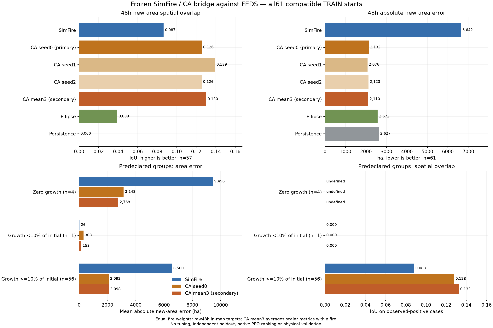

# Zamrznuti SimFire/CA rast na svih 61 kompatibilnih TRAIN početaka

**TASK-042 je završen, 2026-11-21, ADR-048.** Grana `codex/ca-expanded-growth-audit`
iz2de00136; plan5d72b974/ADR-047 i kod9ab1f70a prethode novim ishodima. Korisnikov
nastavak proširuje prethodni16-case nalaz, bez podešavanja simulatora ili novih politika.

**Nalaz:** CA bridge ostaje bliži opaženom rastu u cijelom kompatibilnom okviru.
Primarni CA0 ima67,90% manju prosječnu apsolutnu grešku nove površine i veći mean
new-area IoU od zamrznutog SimFirea. Oba opisna intervala razlike na61 sada su na
povoljnoj strani nule. Efekat je manji nego na prvih16; dodatnih45 i sva3CA sjemena
ostaju posebno prijavljeni. To podržava nastavak CA istraživanja, ne fizičku validaciju
ili dokaz da je RL agent bolji. Četiri požara bez zabilježenog rasta oba modela prerastaju.

## Pitanje, pretpostavka i granica

Pitanje je da li manji CA no-op rast i povoljniji nalaz iz TASK-041 opstaju na svih61
unaprijed poznatih ulazno kompatibilnih TRAIN početaka. Pretpostavka prije scoringa:
prvih16 nije dovoljno za opći zaključak; treba razdvojiti rast, slab rast, nerast i
cenzurisanje domenom. Svi61eligible ID-jeva dolaze iz zamrznutog TASK-040 input QC-a,
bez izbora po ishodu. Preostalih37 od98TRAIN nije kompatibilno s početnim frontom na
zajedničkom gorivu1–13. Nalaz se ne prenosi automatski na njih ili sve stvarne požare.

Ovo je isti **common-line/vegetation CA bridge**, ne native CA urban/unit MDP ili
rangiranje ranijih PPO-a. Isti WAF0.10, puna256×256×180m mapa, scar|front, weather,
48h i četiri12h odluke bez taila. SF ostaje90min/5min/ROS1/last_write/per_minute;
CA zadržava svoje2min/substep, rezidenciju, diurnal i spotting. Samo no-op, bez linija,
PPO težina, kalibracije ili traženja boljeg seeda. Stvarni VALIDATION/TEST ostaju zatvoreni.

FEDS je opažajni zapis, uz nepoznate intervencije i opažajnu grešku, ne potpuno opažen
slobodno goreći kontrafaktual. Pozitivan relativni nalaz ne dokazuje tačnost fizike,
niti da su sve SimFire mogućnosti iscrpljene; TASK-037 ostaje odvojeni mogući pravac.

## Izvršenje i poštena ponovna upotreba

Prethodnih16slučajeva daje64no-op putanje (SF i3CA), sačuvane u32NPZ-a plus32receipt-a.
Ponovo su korištene samo nakon provjere tačnih hashova, originalnog guarda, runtimea,
weather/manifesta i input receipt-a. Novi zapis sadrži `compute_reused` i `reused_from`;
te putanje nisu predstavljene kao nove simulacije ili novi nezavisni uzorci.

Novih45 daje180glavnih putanja:45SF i135CA. Pilot su unaprijed određeni Plateau/Ranch.
Svih45 novih SF završnih cijelih maski identično je originalnoj98TRAIN arhivi. Prvi novi
CA slučaj ponovljen je u sve3replike i svih5maski, dodatne tehničke putanje. Ukupno61×4
model/seed putanje imaju5kumulativnih stanja0/12/24/36/48h. No-op ostaje legalan,
budžet se ne troši, prior šteta se ne gubi i sva4koraka završe i nakon gašenja vatre.

Prediction freeze je upisan prije čitanja kasnijih FEDS geometrija. Samo lokalne
SHA256/original-MD5 provjerene2018/2019 godišnje arhive, jedan puni prolaz po godini
radi svih dijelova tačnog fireID/t. Bez downloada ili2023/2024 mapa. SF pilot15,82s,
puna komanda uz reuse85,24s; CA pilot3,98s, puna komanda34,37s. Najviše3radnika uz
koordinatora, nice19/jedna numerička nit. Prekid interneta nije poništio završene lokalne poslove.

## QC, vrijeme i domena

Svi61 slučajevi imaju svih305validnih exact-time FEDS stanja. T0 scar raster je
identičan61/61; usvojeno local-solar→UTC mapiranje odgovara weather segmentima bez
vremenskog pomaka. To je unutrašnja konzistentnost usvojenog mapiranja, ne tvrdnja da
znamo fizički položaj ili vrijeme fronta u sekundu. Nema gubitka opaženih ranijih ćelija;
raw exact-time i unaprijed zadani cumulative-envelope rezultati su identični.

**59/61 opažajnih putanja potpuno je unutar mape.** Goose Creek ima6,36% pune vektorske
površine izvan domene na36h i28,50%na48h; Martin27,61%/36,85%. Primarni61zapis je
in-map poređenje, a fully-covered59 je zasebna unaprijed zadana osjetljivost. Nije
naknadno promijenjena mapa ili izbačen nepovoljan slučaj. Nijedna od244simulirane
završne maske ne dotiče rub, što samo po sebi nije dokaz da i opaženi požar stane u mapu.

602 od49.467opaženih novih rasterskih ćelija na48h (1,22%) je na nonfuel-u originalne
karte. Target nije maskiran da bi modeli izgledali bolje. Fuel-vintage/geolokacija,
180m/all_touched rasterizacija i nepoznate intervencije ostaju ograničenja.

## Primarni rezultat

Svaki požar ima istu težinu. Area MAE računa se na61požaru, growth IoU na istih57s
pozitivnim opaženim novim rastom. Četiri nulta opažanja ne dobijaju epsilon ili IoU1;
njihov lažni rast je prijavljen posebno. IoU0,126 znači odnos presjeka i unije novih
maski, ne12,6% tačnosti svih ćelija. Početno opožarena površina izuzeta je iz rasta.

Opaženi mean novi rast je **2.627,43ha**.

| Metoda | Mean novi ha | MAE novih ha ↓ | Mean new-area IoU ↑ |
| --- | ---: | ---: | ---: |
| SimFire | 7.183,88 | 6.642,37 | 0,0866 |
| CA seed0, primarni | 1.648,04 | 2.132,29 | 0,1257 |
| CA seed1 | 1.628,60 | 2.076,31 | 0,1394 |
| CA seed2 | 1.689,90 | 2.122,62 | 0,1256 |
| CA mean3, sekundarni | 1.655,52 | 2.110,41 | 0,1302 |
| Fiksna downwind elipsa | 75,37 | 2.572,45 | 0,0391 |
| Persistence | 0,00 | 2.627,43 | 0,0000 |

Primarni CA0−SF: deltaIoU **+0,03904**, opisni95% **[+0,00861;+0,06963]** na57požara;
deltaMAE **−4.510,08ha**, interval **[−6.856,90;−2.414,21]** na61. CA3mean je sekundaran:
deltaIoU+0,04357[+0,01234;+0,07584], deltaMAE−4.531,96ha[−6.868,50;−2.452,64].
Paired case bootstrap10.000/seed0, bez refita ili multiplicity korekcije. Tri spread
sjemena se prosječe unutar požara; nisu183nezavisna požara ili tri nova treninga.

CA0 je bolji po area grešci42/61, lošiji19/61. IoU je bolji37/57, lošiji18/57,
isti2/57. Svi seedi su prijavljeni; nijedan nije izabran nakon rezultata. U zbiru CA0
predviđa samo62,73%opaženog novog rasta, SF273,42%: manja greška i dalje ne znači
riješen razmjer svakog pojedinačnog požara.



## Provjera da rezultat nije samo prvih16 ili rub mape

| Podskup | N area / N IoU | SF MAE ha | CA0 MAE ha | SF IoU | CA0 IoU |
| --- | ---: | ---: | ---: | ---: | ---: |
| Prethodnih16 |16/16|9.736,40|1.317,67|0,1029|0,1604|
| Dodatnih45 |45/41|5.542,27|2.421,94|0,0803|0,1121|
| Fully-covered59 |59/55|6.059,18|1.939,99|0,0865|0,1279|

Dodatnih45 su novi CA/FEDS poređeni slučajevi u ovom auditu, ali i dalje TRAIN.
Primary deltaIoU+0,03184[+0,00125;+0,06131], deltaMAE−3.120,34ha[−5.057,34;−1.349,87].
CA3mean na novih45 dajeIoU0,1103/MAE2.422,75ha; njegov prostorni interval razlike
[−0,00102;+0,05995] uključuje0. Dakle novi slučajevi daju slabiji efekat i više
neizvjesnosti nego prvi16, naročito za sredinu3replike. Nisu proglašeni nezavisnim testom.
Svih16 ranijih case-metric zapisa je numerički identično, nije naknadno popravljeno.

Na59potpuno pokrivenih primary deltaIoU+0,04143[+0,00967;+0,07329],
deltaMAE−4.119,19ha[−6.313,13;−2.153,86]. Povoljniji ukupni nalaz nije samo posljedica
dva cenzurisana opažanja. Svi podskupovi su bili zadani prije novog scoringa.

## Nulti i slabi rast: konkretno ograničenje ostaje

Grupe koriste novi opaženi rast van scar|front, podijeljen početnom union površinom:
0; pozitivan ratio<.10; ratio>=.10. To je različito od starog total-area ratio gatea
ako bi opažanje izgubilo prior ćelije. U ovoj kohorti su obodi monotoni.

| Grupa | N | SF MAE ha | CA0 MAE ha | CA3mean MAE ha | SF/CA0 growth IoU |
| --- | ---: | ---: | ---: | ---: | ---: |
| Bez opaženog rasta |4|9.455,94|3.147,66|2.768,04|undefined/undefined|
| Pozitivan rast<10%početnog |1|25,92|307,80|153,36|0/0|
| Rast>=10%početnog |56|6.559,55|2.092,35|2.098,38|0,0882/0,1279|

Sva4nulta opažanja oba modela prerastaju u svim CA replikama. To je problem čak i kad
je CA manje pogrešan u prosjeku. Nulti slučajevi su:

| Požar | SF lažni novi ha | CA0 | CA1 | CA2 |
| --- | ---: | ---: | ---: | ---: |
| Winter Camp |8.398,08|664,20|1.441,80|1.814,40|
| 206 |6.256,44|6.642,00|6.376,32|4.714,20|
| Pot Hole |9.836,64|3.168,72|1.279,80|1.888,92|
| Shelter Pass |13.332,60|2.115,72|1.704,24|1.406,16|

CA0 je na206čak lošiji odSF. Jedini near-stalled slučaj je Goldstone:3,24ha opaženog
rasta, SF29,16ha iCA0/1/2 311,04/25,92/132,84ha. GrupaN=1 nema osnovu za opći zaključak;
degenerisani bootstrap interval nije potvrda preciznosti. Growing56nalaz ostaje
povoljan, ali se problem opaženog nerasta nije riješio širenjem kohorte.

**Tumačenje:** satelitski nerast nije dokaz uzroka. Nepoznato gašenje, stvarni prekid
širenja i opažajne granice ovim podacima nisu razdvojeni. Budući FEDS obod se ne smije
ubaciti kao signal za gašenje simulatora. Ovaj audit nije kalibrisao proces zaustavljanja.

## Svi slučajevi i mape

Zapisane površine su novi rast unutar iste mape. Zvjezdica označava opažanje izvan domene.
Na četiri nulta opažanja crtica znači izuzeće iz primarnog observed-positive IoU
prosjeka; puni per-mask IoU zapisi ostaju u JSON-u. Nije dodijeljena lažna ocjena1.

| Požar | FEDS novi ha | SF novi ha | CA0 novi ha | SF growth IoU | CA0 growth IoU |
| --- | ---: | ---: | ---: | ---: | ---: |
| Plateau | 19,44 | 0,00 | 460,08 | 0,000 | 0,042 |
| Ranch | 230,04 | 0,00 | 1.001,16 | 0,000 | 0,206 |
| Buzzard | 3.664,44 | 32,40 | 628,56 | 0,009 | 0,131 |
| Coal Hollow | 1.036,80 | 4.270,32 | 22,68 | 0,155 | 0,022 |
| Prospect | 981,72 | 187,92 | 181,44 | 0,111 | 0,185 |
| Stewart Creek | 158,76 | 97,20 | 878,04 | 0,013 | 0,111 |
| Silver Creek | 55,08 | 0,00 | 6,48 | 0,000 | 0,000 |
| Spring Creek | 14.427,72 | 13.870,44 | 2.015,28 | 0,323 | 0,074 |
| Tinder | 4.898,88 | 923,40 | 1.726,92 | 0,129 | 0,149 |
| Bears | 6,48 | 2.144,88 | 162,00 | 0,003 | 0,040 |
| Boot | 881,28 | 2.507,76 | 916,92 | 0,012 | 0,173 |
| Cranston | 5.621,40 | 3.635,28 | 1.843,56 | 0,405 | 0,166 |
| Goldstone | 3,24 | 29,16 | 311,04 | 0,000 | 0,000 |
| Gold Hill | 22,68 | 398,52 | 518,40 | 0,057 | 0,037 |
| Rattlesnake Creek | 1.655,64 | 388,80 | 576,72 | 0,169 | 0,128 |
| Ryan | 1.270,08 | 155,52 | 103,68 | 0,021 | 0,027 |
| Cabin Lake | 482,76 | 226,80 | 149,04 | 0,190 | 0,175 |
| West Valley | 2.990,52 | 37.486,80 | 1.927,80 | 0,054 | 0,268 |
| Sugar Pine | 693,36 | 4.341,60 | 3.009,96 | 0,059 | 0,177 |
| Rattlesnake | 1.010,88 | 42,12 | 664,20 | 0,035 | 0,375 |
| Weston Pass | 3.029,40 | 1.966,68 | 343,44 | 0,306 | 0,083 |
| Indian Valley | 333,72 | 200,88 | 181,44 | 0,031 | 0,032 |
| Red Canyon | 1.237,68 | 119,88 | 450,36 | 0,083 | 0,143 |
| Bull Draw | 1.487,16 | 3.602,88 | 476,28 | 0,210 | 0,244 |
| Winter Camp | 0,00 | 8.398,08 | 664,20 | — | — |
| Dog Creek | 1.247,40 | 11.511,72 | 1.519,56 | 0,108 | 0,254 |
| Sharps | 13.948,20 | 4.059,72 | 1.176,12 | 0,189 | 0,050 |
| Ok Bar | 3.418,20 | 1.509,84 | 628,56 | 0,124 | 0,071 |
| Organ | 861,84 | 0,00 | 204,12 | 0,000 | 0,025 |
| 206 | 0,00 | 6.256,44 | 6.642,00 | — | — |
| Echo | 281,88 | 12.104,64 | 1.380,24 | 0,019 | 0,000 |
| Goose Creek* | 14.132,88 | 4.555,44 | 2.358,72 | 0,081 | 0,058 |
| Sheep Creek | 9.959,76 | 26.496,72 | 5.517,72 | 0,247 | 0,137 |
| Goshute Cave | 22,68 | 3,24 | 132,84 | 0,000 | 0,043 |
| Martin* | 19.261,80 | 57.377,16 | 15.425,64 | 0,099 | 0,069 |
| Black Mountain | 528,12 | 38.244,96 | 2.514,24 | 0,014 | 0,082 |
| Cedar Mountain One | 2.374,92 | 6.852,60 | 563,76 | 0,204 | 0,113 |
| Lakeside | 1.736,64 | 3.366,36 | 1.500,12 | 0,163 | 0,124 |
| Bear Trap | 87,48 | 0,00 | 25,92 | 0,000 | 0,167 |
| North Eden | 2.229,12 | 9.758,88 | 897,48 | 0,105 | 0,000 |
| Lake Wallula | 1.940,76 | 13.776,48 | 5.478,84 | 0,082 | 0,164 |
| Ute Park | 8.304,12 | 23.895,00 | 6.522,12 | 0,151 | 0,249 |
| South | 285,12 | 27.925,56 | 3.207,60 | 0,007 | 0,073 |
| Cellar | 2.426,76 | 8.692,92 | 2.050,92 | 0,166 | 0,063 |
| Decker | 298,08 | 6,48 | 87,48 | 0,022 | 0,202 |
| Mountain | 936,36 | 13.708,44 | 1.292,76 | 0,066 | 0,094 |
| Coldwater | 346,68 | 0,00 | 236,52 | 0,000 | 0,216 |
| Shady | 557,28 | 55,08 | 64,80 | 0,086 | 0,116 |
| Pine Lodge | 1.283,04 | 10.481,40 | 1.010,88 | 0,054 | 0,273 |
| Cove Creek | 605,88 | 408,24 | 839,16 | 0,110 | 0,253 |
| Red Bank | 952,56 | 24.290,28 | 4.827,60 | 0,023 | 0,108 |
| Lookout Point | 1.626,48 | 12,96 | 171,72 | 0,004 | 0,071 |
| Pot Hole | 0,00 | 9.836,64 | 3.168,72 | — | — |
| North Hills | 2.313,36 | 272,16 | 236,52 | 0,102 | 0,069 |
| Ridgetop | 2.653,56 | 0,00 | 690,12 | 0,000 | 0,056 |
| Goose | 1.172,88 | 10.611,00 | 1.963,44 | 0,097 | 0,269 |
| Summit | 709,56 | 12.616,56 | 2.857,68 | 0,055 | 0,195 |
| Shelter Pass | 0,00 | 13.332,60 | 2.115,72 | — | — |
| Sage | 430,92 | 0,00 | 230,04 | 0,000 | 0,010 |
| Mp 97 | 3.006,72 | 1.053,00 | 1.817,64 | 0,183 | 0,417 |
| Walker | 14.132,88 | 116,64 | 1.953,72 | 0,005 | 0,084 |

Mape u istoj46,08km skali, bez izbora po uspjehu:
[1–16](../../reports/real-fire-data/expanded-observed-growth-maps-v1-1.png),
[17–32](../../reports/real-fire-data/expanded-observed-growth-maps-v1-2.png),
[33–48](../../reports/real-fire-data/expanded-observed-growth-maps-v1-3.png),
[49–61](../../reports/real-fire-data/expanded-observed-growth-maps-v1-4.png).

## Verifikacija i prenosivost

Sedam novih testova prije implementacije provjerava izbor cijelog okvira, tačnu10%
granicu, nulte/missing grupe, provenance reuse, runtime/source/array mismatch i puni
no-op horizont. Puni suite:388pinned/0skip;373modern/4skip;306core/44skip; CLI PASS.
Moderni nema Fionu pa reader test iz ranijeg audita prolazi pinovano i u numeric CI.
Knowledge15/strict90 PASS. CI status je u [verifikaciji](../../reports/real-fire-data/expanded-observed-growth-verification-v1.json).

Nezavisno su rekalkulisana2.928mask-metric reda,305target rastera iz punih vektora,
45novih SF cijelih završnih maski,32ponovo korištena prediction NPZ-a, sva16ranijih
case-metric zapisa, primarni prosjeci i intervali, klase i ID-jevi podgrupa.
Deset maski prva2nova slučaja jednako je postojećem exact-time loader-u.

[Lokalni paket](../../reports/real-fire-data/expanded-observed-growth-artifacts-v1.json)
ima18.848.375B i1.064fajla plus manifest, svi hashovi ponovo pročitani. Iz raspakovanog
sourcea/podataka ponovljeno je5SF i3×5CA maski prvog novog slučaja, po jedan stari reuse
u oba backend-a i305vektorskih rasterizacija. Postojeće biblioteke, ne fresh install ili
kompletna druga simulatorska evaluacija. [Restore zapis](../../reports/real-fire-data/expanded-observed-growth-restore-v1.json).
Godišnje arhive, raw mape, venv i PPO težine nisu commitani/uploadovani; mali metrički
rezultati i figure su u gitu, veliki paket ostaje lokalni.

[Full rezultati](../../reports/real-fire-data/expanded-observed-growth-v1.json) i
[unaprijed zadane podgrupe](../../reports/real-fire-data/expanded-observed-growth-groups-v1.json)
čuvaju sve seede, vremenske tačke, raw/envelope i brojčane granice. Runtime PASS nije
fizička validacija ili dokaz RL prednosti. Prekid mreže nije zahtijevao nove simulacije.

## Šta je zatvoreno i šta slijedi

**Zatvoreno TASK-042:** kompatibilni TRAIN okvir je proširen do svih61, isti parametri,
transparentan reuse, robusnost preko3spread seeda, jasni no/near-growth i domain nalazi.
Ne predlaže se dalje proširenje iste kompatibilne liste kao zamjena za novi korak.

**Otvoreno:** niska apsolutna prostorna podudarnost, opaženi nerast bez poznatog uzroka,
37nekompatibilnih početaka, native unit resursi/akcije i korist naučenog agenta. Nije
proglašen konačan izbor fizički validiranog simulatora. TASK-039 ostaje odgođen,
TASK-037 odvojeni SimFire pravac. Stvarni holdouti i dugi trening ostaju zatvoreni.

**Sljedeći prijedlog je TASK-040 faza B.1:** zajednički PPO interfejs nad sadašnjim
common-line bridgeom u oba backend-a, isti v2 ulaz/encoder,9akcija,B=1,48h i jasno isti
obračun nagrade/štete. Prvo zapisati ugovor i testove, zatim kratak tehnički smoke;
nema automatskog dugog treniranja ili tvrdnje da se time rangiraju raniji native PPO-i.
Mobilne ekipe/native unit parity ostaju zaseban dio faze B, ne preimenovati postojeći most.
Nalaz sada daje razumnu osnovu za takav nastavak CA pravca uz eksplicitne granice.

Reprodukcija u odgovarajućem checkoutu s istim input/runtime hashovima:

```sh
export PYTHONPATH=src OMP_NUM_THREADS=1 OPENBLAS_NUM_THREADS=1 VECLIB_MAXIMUM_THREADS=1
nice -n 19 "$SF_PYTHON" scripts/audit_expanded_observed_growth.py --stage predict --backend simfire --pilot --workers 2 --out .local/NEW_EXPANDED
nice -n 19 "$SF_PYTHON" scripts/audit_expanded_observed_growth.py --stage predict --backend simfire --workers 3 --out .local/NEW_EXPANDED
nice -n 19 "$CA_PYTHON" scripts/audit_expanded_observed_growth.py --stage predict --backend ca --pilot --workers 2 --out .local/NEW_EXPANDED
nice -n 19 "$CA_PYTHON" scripts/audit_expanded_observed_growth.py --stage predict --backend ca --workers 3 --out .local/NEW_EXPANDED
nice -n 19 "$SF_PYTHON" scripts/audit_expanded_observed_growth.py --stage score --out .local/NEW_EXPANDED
```

Prediction resume odbija promijenjen guard/runtime/array. Finalni analysis i group
summary se ne prepisuju; originalni16audit je sačuvan. NPZ se učitava bez pickle-a.
