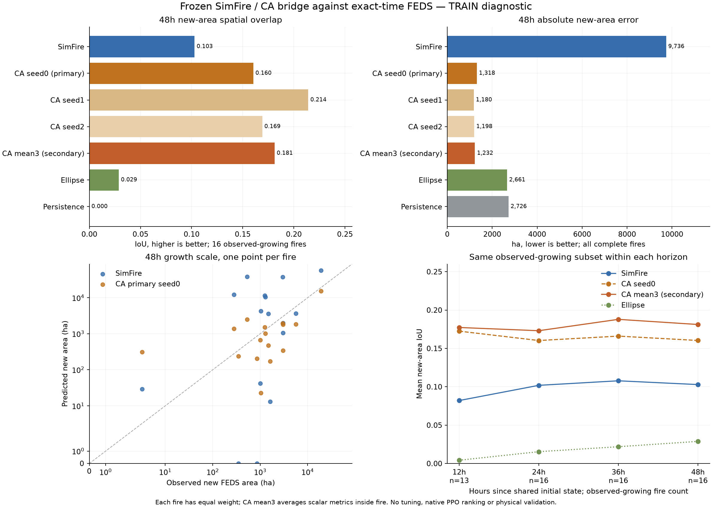
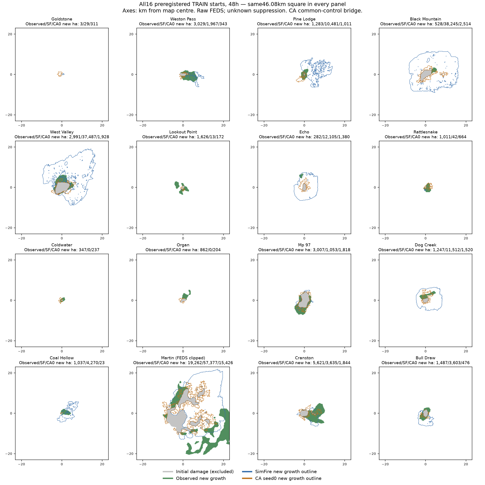

# Rast zamrznutih simulatora prema opaženom FEDS-u

**TASK-041 je završen, 2026-11-21, ADR-046.** Korisnik je odobrio nastavak nakon
uparene policy provjere. Grana `codex/ca-feds-growth-audit`, baza640a910e. Plan46e5371f
/ ADR-045 prethodi novom scoringu, numerički kod7d04fca0 prethodi izvršenju. Isti16
TRAIN slučajeva i isti parametri/seedi iz TASK-040, bez kalibracije ili novog treninga.

**Nalaz:** CA common-control bridge u ovom subsetu mnogo bolje prati razmjer opaženog
rasta. Primarni CA seed0 ima86,47% manju prosječnu apsolutnu grešku novih hektara od
SimFirea. Prostorni IoU je veći u prosjeku, ali interval njegove razlike uključuje0.
Niži CA rast iz TASK-040 zato ovdje nije samo proizvoljno smanjenje simulatora; bliži
je opaženoj površini. To je razlog za nastavak provjera CA pravca, ne fizička validacija,
dokaz prednosti RL-a ili završena odluka o native unit CA simulatoru.

## Šta se poredi

- Isti stvarni početni FEDS scar/front, puni256×256 raster180m,48h i četiri12h odluke.
- Zamrznuti SimFire WAF0.10/ROS1/90min/5min/last_write/per_minute. CA iz TASK-040:
  puni common-line/vegetation bridge, goriva1–13,2min, isti WAF, vlastiti diurnal/spotting.
- Samo no-op, bez linija i taila; epizoda traje puna4koraka i nakon gašenja. Nema agenta
  ili budućeg FEDS-a u ulazu simulatora. Raniji PPO-i se ovdje ne porede.
- SF finalna cijela maska identična prethodnoj arhivi16/16. CA0 cijele maske16/16 iste,
  CA1/2 završni brojevi32/32 isti. Sačuvano je svih5cumulative maski za svaki backend/seed.
- Tek nakon oba završena backend-a upisan je prediction freeze i otvorene kasnije FEDS
  geometrije. Jedan puni prolaz svake postojeće2018/2019 godišnje arhive uz SHA256 i
  originalni MD5; svi dijelovi tačnog fireID/t ostaju vidljivi, uključujući one izvan mape.
  Nema mrežnog preuzimanja,2023/2024 mapa ili novih politika/checkpointova.

Ovo je **isti CA bridge** kao TASK-040. Native unit MDP, urbano91 kao gorivo/težina,
WAF/proceduralna distribucija i pokretne ekipe iz TASK-038 nisu ovim kalibrisani.
Novi nalaz ne zamjenjuje prethodni mješoviti policy rezultat.

## Vrijeme, pokrivenost i opažajni zapis

Svih16 slučajeva ima tačnih5FEDS oznaka0/12/24/36/48h. Naive AM/PM oznake nisu
protumačene kao UTC: postojeći `feds_overpass_utc` i longitude iz weather sampling
lokacije daju iste granice sva4gridMET segmenta, najveća razlika0sekundi. To potvrđuje
unutrašnju konzistentnost usvojenog mapiranja, ne tačnost vremena stvarnog fronta u sekundu.

Svih80 geometrijskih stanja je dostupno i validno; t0 raster identičan scar-u16/16.
Početni front u ovim slučajevima nema ćelija izvan scar-a ili na nonfuel-u. Kasniji
obodi su monotoni u svih16; raw exact-time i kumulativni envelope zato daju iste brojke.
Missing/invalid putanja i nulti nazivnik imaju testove; nisu pretvoreni u rast0.

**Martin je cenzurisan domenom:** na36h27,61%, na48h36,85% pune vektorske površine je
izvan mape. Primary16 zapis mjeri samo dio unutar zajedničke mape, a poseban unaprijed
planirani fully-covered zapis ima15slučajeva. Martin nije tiho izbačen ili mapa naknadno
premještena. Nema rubnog dodira simuliranih no-op maski; to ne znači da opaženi požar
stane u domenu. Za buduću evaluaciju Martina treba veća unaprijed definisana domena ili
jasno označeno cenzurisanje, kroz novi protokol.

Na48h81 od13.464 opažene nove rasterske ćelije (0,60%) pada na nonfuel originalne
karte;72su u Martinu,7u Cranstonu,2u MP97. Target nije maskiran da bi simulator izgledao
bolje. Mogući fuel-vintage, geolokacijski i180m/all_touched uticaji nisu ovim razdvojeni.

## Metrike i nazivnici

Novi rast je maska izvan zajedničkog početnog `scar|front`. IoU je presjek predikcije
i opaženog novog rasta podijeljen njihovom unijom. **IoU0,160 nije16% tačnosti svih
ćelija mape.** Početno opožarena površina ne popravlja tu ocjenu. Apsolutna greška
računa razliku broja novih ćelija puta3,24ha; MAE je prosjek apsolutnih grešaka po požaru,
ne apsolutna razlika dvije prosječne površine.

Na48h svih16 FEDS slučajeva ima bar jednu novu ćeliju, pa svi ulaze u primarni IoU.
Prethodni policy udio je imao14slučajeva jer SimFire nije rastao u Coldwater/Organ;
ovdje ti predviđeni nerastovi dobijaju IoU0 prema pozitivnom opaženom rastu. Na12h samo
13FEDS slučajeva raste; sva3opažena nerasta oba modela prerastaju. Mean lažni rast na
tim3slučajevima: SF867,24ha, CA0 182,52ha, CA3mean203,40ha. Na48h nema potpuno nerastućeg
slučaja, pa ovaj mali subset ne ocjenjuje pouzdano ponašanje na trajno ugašenim požarima.

## Primarni48h rezultat i sva tri CA sjemena

Svaki požar ima istu težinu. CA0 je primaran; ostala dva seeda i prosjek3su unaprijed
zadane dodatne provjere, bez izbora najboljeg. Sredina scalar metrika računa se unutar
požara, zatim preko požara; ne radi se threshold prosječne maske ili48nezavisnih požara.

| Metoda | Mean novi ha | Mean absolute error novih ha ↓ | Mean new-area IoU ↑ |
| --- | ---: | ---: | ---: |
| FEDS opaženi rast |2.726,46|—|—|
| SimFire |11.363,69|9.736,40|0,1029|
| CA seed0, primarni |1.866,85|1.317,67|0,1604|
| CA seed1 |2.092,23|1.179,77|0,2141|
| CA seed2 |2.337,26|1.198,39|0,1691|
| CA mean3, sekundarni |2.098,78|1.231,94|0,1812|
| Persistence, bez novog rasta |0,00|2.726,46|0,0000|
| Postojeća fiksna downwind elipsa |74,72|2.661,05|0,0288|

CA0 ima manju area grešku u13/16slučajeva, veću u3/16. IoU je veći10/16, manji5/16,
isti1/16. Dakle nije svugdje bolji. Mean signed greška SF+8.637,23ha, CA0−859,61ha,
CA3mean−627,68ha: SF često jako prerasta, CA u zbiru i dalje podcjenjuje rast.

Paired case bootstrap10.000/seed0, bez refita i multiplicity korekcije:

| CA minus SF | Srednja razlika | Opisni95% interval |
| --- | ---: | ---: |
| CA0 new-area IoU |+0,0575|[−0,0219; +0,1344]|
| CA0 apsolutna area greška ha |−8.418,74|[−15.211,86; −2.619,71]|
| CA3mean new-area IoU |+0,0783|[−0,0038; +0,1596]|
| CA3mean apsolutna area greška ha |−8.504,46|[−15.192,63; −2.759,51]|

Interval površinske razlike ne uključuje0 u ovom opisnom obračunu; primarni prostorni
interval uključuje0. Reused TRAIN,16kompatibilnih od61od98 i prethodni uvidi ograničavaju
zaključak; ovo nije novi nezavisni test ili potvrdna fizička validacija.



## Provjera osjetljivosti

Fully-covered15 bez Martina: SF IoU0,1031/MAE7.844,47ha, CA0 0,1665/1.149,77ha,
CA3mean0,1888/1.096,92ha. Primary CA0 deltaMAE−6.694,70ha95%[−13.180,33;−1.579,38],
deltaIoU+0,0634[−0,0217;+0,1458]. Prednost razmjera nije samo posljedica cenzurisanog
Martina; prostorna neizvjesnost ostaje. Podgrupa rasta≥10% početne površine ima15požara,
nije ista fully-covered podgrupa; njeni brojevi su zasebno u JSON-u.

Vremenski pooled growth IoU (hit/union sabrani po4vremena, pa jednak case prosjek):
SF0,1003, CA0 0,1581, CA3mean0,1770. Sekundarni CA3mean−SF+0,0767, interval
[+0,0059;+0,1496]. Taj pozitivan sekundarni interval ne zamjenjuje primarni48h interval.
Raw/envelope su identični; nije naknadno odabran povoljniji opažajni zapis.

**Ostao je konkretan problem slabog rasta:** Goldstone FEDS doda samo1ćeliju3,24ha,
SF29,16ha, CA0/1/2 311,04/25,92/132,84ha. Svi imaju0new IoU na48h. CA uz bolji prosjek
nije riješio prerastanje skoro zaustavljenih požara ili prostorni smjer. Primjer je
post-hoc dijagnostika iz svih prijavljenih slučajeva, ne novo pravilo izbora ili tuning.

## Svi slučajevi, bez skrivanja lošijih

Hektari su novi rast unutar zajedničke mape; zvjezdica označava opažanje izvan domene.

| Požar | FEDS novi ha | SF novi ha | CA0 novi ha | SF growth IoU | CA0 growth IoU |
| --- | ---: | ---: | ---: | ---: | ---: |
| Goldstone | 3,24 | 29,16 | 311,04 | 0,000 | 0,000 |
| Weston Pass | 3.029,40 | 1.966,68 | 343,44 | 0,306 | 0,083 |
| Pine Lodge | 1.283,04 | 10.481,40 | 1.010,88 | 0,054 | 0,273 |
| Black Mountain | 528,12 | 38.244,96 | 2.514,24 | 0,014 | 0,082 |
| West Valley | 2.990,52 | 37.486,80 | 1.927,80 | 0,054 | 0,268 |
| Lookout Point | 1.626,48 | 12,96 | 171,72 | 0,004 | 0,071 |
| Echo | 281,88 | 12.104,64 | 1.380,24 | 0,019 | 0,000 |
| Rattlesnake | 1.010,88 | 42,12 | 664,20 | 0,035 | 0,375 |
| Coldwater | 346,68 | 0,00 | 236,52 | 0,000 | 0,216 |
| Organ | 861,84 | 0,00 | 204,12 | 0,000 | 0,025 |
| Mp 97 | 3.006,72 | 1.053,00 | 1.817,64 | 0,183 | 0,417 |
| Dog Creek | 1.247,40 | 11.511,72 | 1.519,56 | 0,108 | 0,254 |
| Coal Hollow | 1.036,80 | 4.270,32 | 22,68 | 0,155 | 0,022 |
| Martin* | 19.261,80 | 57.377,16 | 15.425,64 | 0,099 | 0,069 |
| Cranston | 5.621,40 | 3.635,28 | 1.843,56 | 0,405 | 0,166 |
| Bull Draw | 1.487,16 | 3.602,88 | 476,28 | 0,210 | 0,244 |



## Provjere i ponovljivost

Dvanaest novih regresijskih testova pokriva prior/missing/zero, local-solar
vrijeme, split, puni geometrijski dio izvan mape, freeze prije opažanja i ispravno
prosječenje replika. Module/whole-geometry reader red logovi prethode njihovoj implementaciji.
Puni suite381pinovanih/0skip, moderni366/4skip, core299/44skip;
CLI smoke i knowledge15/strict89 PASS. Moderni preskače i Fiona-reader test jer u tom postojećem venv-u nema
Fione; taj test prolazi u pinovanom runtimeu i numeric CI ga mora izvršiti.

Nezavisna aritmetička provjera ponavlja svih768mask-metric redova, svih80target rastera
iz punih vektorskih snapshotova, endpoint prosjeke i bootstrap intervale. Deset maski
prva2unaprijed izabrana slučaja identično je postojećem exact-time loader-u.
SF pilot17,86s, puna komanda uz reuse58,56s, CA3replike16slučajeva15,60s; nice19,
max3radnika uz koordinaciju i jednu numeričku nit. Nije pokrenuto treniranje.

[Rezultat i svi redovi](../../reports/real-fire-data/paired-observed-growth-v1.json),
[tehnički zapis](../../reports/real-fire-data/paired-observed-growth-verification-v1.json),
[lokalni paket](../../reports/real-fire-data/paired-observed-growth-artifacts-v1.json).
Godišnje arhive, venv, velike mape i PPO težine nisu commitani/uploadovani. Paket ima
numerički source, izabrane ulaze, predikcije i pune izabrane FEDS vektore/maske s hashovima;
obnova koristi postojeće odgovarajuće biblioteke, nije nov environment ili nova naučna evaluacija.

Prenosivi paket ima10.486.862B,436fajlova plus interni manifest; svi hashovi su ponovo
pročitani. Raspakovani source/podaci daju istih5SF maski prvog slučaja (15,04s),
svih3×5CA maski (1,96s) i80/80ponovo rasterizovanih FEDS stanja. To su tehničke provjere
uz postojeće biblioteke; [restore zapis](../../reports/real-fire-data/paired-observed-growth-restore-v1.json).

## Šta je riješeno i šta slijedi

**Riješeno:** manji CA rast sada ima provjeru prema opaženim podacima, uz iste uslove,
sve3replike i opisne intervale. Vrijeme i početni raster su konzistentni, a cenzurisanje
opažanja i skoro nerastući slučaj su eksplicitno zabilježeni. Nismo popravili parametre
da bismo dobili ovaj rezultat; audit je čitao zamrznute modele.

**Nije riješeno:** niska prostorna podudarnost, nepoznate stvarne intervencije/opažajna
greška, skoro nerastući požari, reprezentativnost16slučajeva, native CA urban/unit
interfejs, upareni PPO resursi/akcije i dokaz RL prednosti. Native faza B TASK-040 ostaje
otvorena, TASK-039 odgođen. VALIDATION i TEST2024 ostaju zatvoreni; nema mergea.

**Preporuka:** nastaviti CA kao istraživački/inženjerski pravac uz ovaj povoljniji nalaz
razmjera. Prije većeg treninga predloženi **TASK-042** proširuje isti zamrznuti no-op
audit na svih61ulazno kompatibilnih TRAIN početaka, uz budući-obod/domain QC, odvojene
near-stalled/no-growth grupe i sva3CA spread seeda. Novi plan prethodi novom scoringu,
bez podešavanja prema ovih16ishoda. Zatim odlučiti treba li kalibracija ili native
TASK-040 faza B; ovaj nalaz sam ne opravdava proglašenje simulatora validiranim.

Reprodukcija u odgovarajućem checkoutu, uz iste ulazne hashove i postojeće izolovane runtimeove:

```sh
export PYTHONPATH=src OMP_NUM_THREADS=1 OPENBLAS_NUM_THREADS=1 VECLIB_MAXIMUM_THREADS=1
nice -n 19 "$SF_PYTHON" scripts/audit_paired_observed_growth.py --stage predict --backend simfire --case-limit 2 --workers 2 --out .local/NEW_GROWTH
nice -n 19 "$SF_PYTHON" scripts/audit_paired_observed_growth.py --stage predict --backend simfire --workers 3 --out .local/NEW_GROWTH
nice -n 19 "$CA_PYTHON" scripts/audit_paired_observed_growth.py --stage predict --backend ca --workers 3 --out .local/NEW_GROWTH
nice -n 19 "$SF_PYTHON" scripts/audit_paired_observed_growth.py --stage score --out .local/NEW_GROWTH
```

Score odbija incomplete/hash mismatch, finalni izlaz se ne prepisuje. NPZ se čita
bez pickle-a. Skripta nikad ne učitava native PPO težine ili stvarni holdout.
