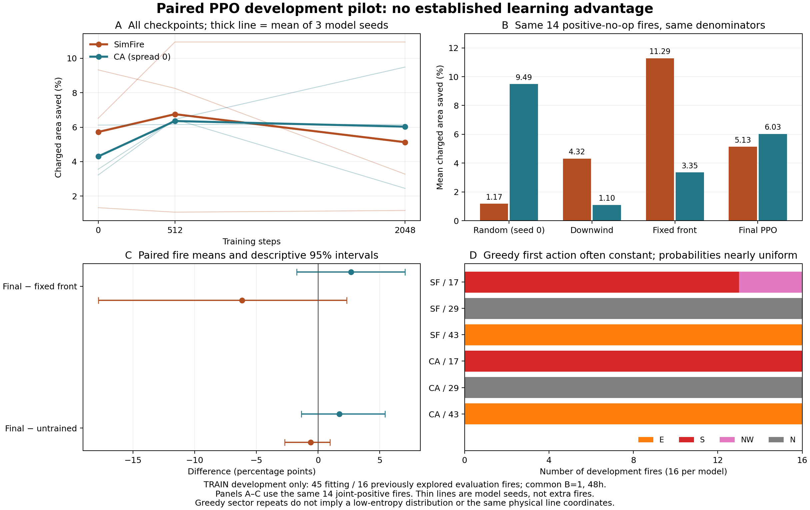

# Upareni PPO learning pilot

## Rezultat — TASK-043 završen, ADR-052, 2026-11-22

**Nijedan backend ne prolazi unaprijed zadani opisni learning kriterij.** Svih šest
treninga završilo je bez grešaka, uz zamrznuti plan i isti postupak u oba simulatora.
CA ima viši završni prosjek spašenog od SimFire-a u ovom poređenju, ali nije potvrđen
pouzdan pomak učenjem ili prednost nad fiksnim front referentom. Ovo je razvojni
TRAIN pilot, bez nezavisne fizičke validacije ili automatske odluke o promjeni simulatora.

[Svi modeli i skorovi](../../reports/real-fire-data/paired-ppo-learning-v1.json),
[nezavisni audit i dijagnostika](../../reports/real-fire-data/paired-ppo-independent-v1.json)
i [verifikacija](../../reports/real-fire-data/paired-ppo-verification-v1.json).

### Šta je tačno upoređeno

45 TRAIN požara za učenje, drugih 16 za razvojnu evaluaciju; svi su ranije istraživani
u projektu. Tri **model** seeda (17/29/43) u oba backend-a, po 2.048 koraka. CA koristi
samo ranije fiksirani **spread seed 0** po slučaju; tri model seeda nisu tri nove
fizičke replike ili dodatni požari. Isti v2/terrain536, MLP64×64, PPO hiperparametri,
B=1, devet akcija, četiri odluke i 48h. Isti receipt-i, početne maske i lagged vrijeme.
Privatni vlastiti no-op otisak služi samo nagradi, bez budućeg FEDS-a u učenju.

Početne težine su identične između backend-a za isti model seed. Svaki ima isti
raspored 512 epizoda. Sačuvano je svih 18 modela na 0/512/2048 koraka. Završni 2048
je primaran; nije izabran povoljniji seed ili checkpoint na 512.

### Primarno poređenje procenata

Sve vrijednosti u tabeli su prosjek procenta spašenih **charged** ćelija prema
vlastitom no-op, na **istih 14 požara** s pozitivnim no-op rastom u oba simulatora.
Tri model seeda prvo se prosječe unutar požara. SF Coldwater i Organ imaju nulti
no-op rast: njihov procenat ostaje undefined, a hektari ostaju u sekundarnom obračunu svih 16.

| Politika / checkpoint | SimFire | CA spread 0 |
| --- | ---: | ---: |
| PPO prije učenja (0) | 5,72% | 4,30% |
| PPO nakon 512 koraka | 6,75% | 6,36% |
| **PPO nakon 2.048 koraka** | **5,13%** | **6,03%** |
| Fiksna front heuristika | 11,29% | 3,35% |
| Downwind | 4,32% | 1,10% |
| Fiksni `random_legal` referent | 1,17% | 9,49% |

CA PPO je po tačkastoj procjeni iznad svog front referenta, dok je SF PPO ispod svog.
Međutim, i sam front referent je mnogo slabiji u CA. Zato veći CA PPO procenat ili
manji razmak do heuristike ne predstavljaju sami po sebi bolji ukupni rezultat.

`random_legal` je unaprijed postojeća politika sa seed0 ponovo inicijalizovanim za
svaki slučaj. Na ovih 16 početnih maski daje **isti sektor 7** u oba backend-a. To
je jedan fiksni random referent, a ne Monte Carlo prosjek svih nasumičnih linija.
Završni seed29 u oba backend-a bira taj isti potez i tačno prati njegove skorove.
Referent nije naknadno promijenjen; ova ograničenost je eksplicitno prijavljena.

### Pomak učenjem i relativni gap

Opisni 95% intervali su paired bootstrap po požaru, 10.000 uzoraka/seed0. Model
seedovi su prosječeni unutar požara; N=14, ne 42. Sve jedinice ispod su procentni poeni.

| Razlika | Prosjek | Opisni 95% interval |
| --- | ---: | ---: |
| SF završni − početni PPO | −0,59 | [−2,69; +0,98] |
| CA završni − početni PPO | +1,73 | [−1,34; +5,45] |
| SF završni PPO − fiksni front | −6,16 | [−17,83; +2,32] |
| CA završni PPO − fiksni front | +2,68 | [−1,72; +7,07] |
| CA − SF razlika u PPO-minus-front gapu | +8,84 | [−0,38; +20,02] |

Nijedan backend nema obje unaprijed tražene donje granice iznad nule. Ni povoljniji
CA relativni gap nema interval potpuno iznad nule. To nije dokaz da učenje nikada
ne može pomoći: ovaj budžet, representation, reward i optimizacija nisu dali traženi signal.

Završni pojedinačni model seedovi 17/29/43: SF **3,28 / 1,17 / 10,94%**, CA
**2,45 / 9,49 / 6,16%**. Razlike među seedovima su važne; nijedan nije izabran kao pobjednik.

### Sekundarno: hektari i ponderisanje

Ovdje je nazivnik svih 16 požara, uključujući nulti SF no-op. Hektari su 3,24 po ćeliji.

| Prosjek po požaru, svih 16 | SimFire | CA spread 0 |
| --- | ---: | ---: |
| No-op nova šteta | 11.363,69 ha | 1.866,85 ha |
| Završni PPO charged šteta | 11.155,79 ha | 1.799,21 ha |
| Završni PPO raw šteta | 11.145,13 ha | 1.788,62 ha |
| Završni PPO spašeno charged | 207,90 ha | 67,64 ha |
| Front heuristika spašeno charged | 328,66 ha | 43,94 ha |
| PPO pooled procenat svih 16 | 1,83% | 3,62% |
| Front pooled procenat svih 16 | 2,89% | 2,35% |

Mean procenat daje svakom požaru istu težinu; pooled daje više težine velikim no-op
požarima. Razmjer SF i CA požara ostaje bitno drugačiji. Ni manji CA broj hektara ni
veći SF broj spašenih hektara samostalno ne rangiraju agente. Ovo ne ponavlja ili
kalibriše raniji TASK-042 audit opaženog rasta.

### Šta politika stvarno radi

Svi završni modeli u evaluaciji postavljaju liniju odmah na prvoj odluci. CA seed17
bira sektor3 na svih16, seed29 sektor7 na svih16, seed43 sektor1 na svih16. SF seed29/43
također stalno biraju sektor7/1; SF17 bira sektor3 na13 i sektor6 na3 požara.
To je slab dokaz prilagođavanja kontekstu. Isti sektor ipak znači poziciju izračunatu
iz trenutne fronte, ne istu apsolutnu liniju ili koordinate na različitim požarima.

Važna razlika: soft distribucija **nije** postala gotovo deterministička. Prosječna
najveća vjerovatnoća prvog poteza je SF11,66–11,85%, CA12,00–12,28%, dok ravnomjerna
distribucija nad9akcija daje11,11%. Entropija je SF99,94–99,99%, CA99,91–99,95% maksimuma.
Greedy inference uzima malu prednost istog sektora, iako politika ostaje skoro ravnomjerna.
Ovo opisuje opaženo ponašanje; uzrok nije dokazan tim nalazom.

### Provjera i reprodukcija

Sva6posla imaju kompletne hash-vezane receipts. Nezavisni audit provjerava svih
12.288koraka/3.072epizode, isti raspored i budžet, float32 training nagrade i18NPZ-a,
288policy skorova i128heurističkih skorova. Svih96native finalnih putanja/480kumulativnih
maski i njihov povrat odgovaraju union obračunu i originalnim cijelim finalnim burned/line
maskama. Svih610reference maski i132preflight putanje također su provjereni. Početne
težine po seedu i obnovljeni logits/akcije su identični. Nema unpicklinga starih modela.

Cijeli background run trajao je3.127,99s (52,13min), s najviše3radnika+koordinator,
nice19/jedna numerička nit. Pojedinačni SF train+eval poslovi traju44,95–45,43min,
CA6,60–6,94min. To je lokalno tehničko mjerenje ovog posla, ne opšti speed benchmark.
Svi procesi su završili; nema nastavljenog ili novog treninga.

### Sljedeći prijedlog: TASK-044, dijagnoza prije dodatnog treninga

Prvo mali TRAIN audit signala nagrade/advantagea, stvarne promjene politike i adekvatne
nasumične reference: razlikovati razliku među požarima od razlike među potezima unutar
istog požara. Provjeriti puni uniformni referent i fiksne sektore uz unaprijed zadan
fit/evaluation ugovor. Tek po tome preregistrovati eventualnu izmjenu centriranja/skale
nagrade ili optimizacije, jednako u oba backend-a. Ovo je prijedlog, nije započet novi trening.

TASK-043 je završen kao kontrolisan razvojni nalaz bez traženog learning signala.
Native mobilni resursi ostaju otvoreni dio TASK-040 B; TASK-039 odgođen. Stvarni
VALIDATION/TEST, fizička validacija, novi PR i merge nisu rađeni.

## Plan prije koda i rezultata — 2026-11-22, ADR-051

Korisnik traži nastavak i opsežno testiranje, izričito dopušta duži lokalni trening
i završetak sesije dok on radi. Grana `codex/paired-ppo-learning` polazi iz
`720c914b`. [Zamrznuti plan](../../configs/frozen/paired-ppo-learning-v1.json) je kanonski.

**Činjenice:** TASK-040 B.1 daje zajednički encoder/PPO/charged reward ugovor i
tehnički PASS. Svih 61 kompatibilnih TRAIN požara već je korišteno u razvoju projekta.
**Pretpostavka:** isti PPO postupak može naučiti prenosivu kontrolu u ovom interfejsu.
**Provjerljivi cilj:** odvojiti pomak u učenju od razlike u razmjeru simulatora i od
blizine istim heuristikama. Nalaz ostaje eksploratorno razvojno poređenje.

Prvobitnih 16 hash-odabranih TASK-040 požara služi razvojnoj evaluaciji; drugih 45
uči model. Skupovi su disjunktni za nove težine, identični u oba backend-a. Ovo nije
nezavisan naučni holdout. Stvarni VALIDATION/TEST i budući FEDS ostaju zatvoreni.

Tri model seeda (17/29/43), po 2.048 koraka u svakom backend-u, isti v2/terrain536,
MLP64×64 i svi PPO parametri iz B.1. Isti seed određuje isti hash-raspored 512 epizoda
na 45 fitting slučajeva. Čuvaju se svi modeli na 0/512/2048 koraka; završni 2048 je
primaran, bez izbora najboljeg. Fizika, B=1, četiri odluke/48h i reward nisu promijenjeni.

Prije treninga: provjera ulaza svih 61, početnih opažaja/maski svih 16 i pune 33
native putanje na prva dva evaluacijska slučaja u oba backend-a. Finalni PPO zatim
ide native na svih 16 po seedu/backend-u i mora odgovarati staroj B=1 tabeli po
cijelim finalnim burned/line maskama i scoreu. Ostali checkpointovi i heuristike
mogu koristiti tačan lookup: do prve linije opažaj je no-op putanja; poslije nje
ostaju samo no-op potezi. Tabela ne daje buduće informacije politici ili treningu.

Primarno: prosjek procenta spašenih charged ćelija na istim slučajevima s pozitivnim
no-op rastom u oba backend-a. Sva tri model seeda prvo se prosječe unutar požara,
zatim opisni paired bootstrap po požaru, 10.000 uzoraka/seed0. Nema uvećavanja N
brojanjem model seedova kao novih požara. Prijaviti i sve seedove zasebno.

Uz to: charged/raw hektari, pooled procenat i nulti no-op slučajevi, pomak prema
vlastitom početnom modelu te razlika prema istim heuristikama. `advancing_front64`
je unaprijed fiksni referent; svi noop/random/downwind/front rezultati ostaju vidljivi.
Ključan je i CA−SF pomak u PPO-minus-heuristic razlici, ne samo veći CA procenat.
Nulti nazivnik ostaje undefined. Nema naknadnog odabira najbolje heuristike/modela.

Pozitivan opisni signal zahtijeva i final-minus-initial i final-minus-fixed-front
donju granicu opisnog intervala iznad nule u tom backend-u. To nije fizička validacija,
nezavisan dokaz RL prednosti ili automatska odluka o prelasku na CA.

Procjena je 45–75 minuta, najviše tri radnika i jedan koordinator, nice19 i jedna
numerička nit. Kod i testovi završavaju prije starta. Background proces ima logove,
status/greške, atomic receipts i sačuvane checkpointove. Završeni poslovi se mogu
usvojiti samo uz iste hashove; prekinut posao kreće od nule jer NPZ nije optimizer
resume. Nema tihog skraćivanja, produžavanja ili podešavanja po rezultatu.

## Status nakon završnog audita

Plan d586c1bc prije koda13a234ba; frozen numerički source nije mijenjan nakon starta.
Svih6poslova završilo bez grešaka za52,13min; nema aktivnih treninga.413pinned/0skip,
398modern/4skip,315core/48skip,15knowledge,CLI/strict92PASS. Pet novih audit testova
prethodi helper implementaciji. Primarni rezultati i kriteriji ostaju isti.

[Preflight](../../reports/real-fire-data/paired-ppo-preflight-v1.json) i
[launch receipt](../../reports/real-fire-data/paired-ppo-launch-v1.json) su historija
starta, ne dokaz aktivnog procesa. [Završna verifikacija](../../reports/real-fire-data/paired-ppo-verification-v1.json)
veže sve source/log/result hashove i čuva ograničenja.

[Local bundle](../../reports/real-fire-data/paired-ppo-artifacts-v1.json):30.563.393B,
1.035fajlova plus manifest, sha a34d0d0fb2f463a2b3a8cacaa89c1907b9d6678c1663b766f6a5f96967149879.
Sadrži training/physics/audit kod,61ulaz, reference, putanje i18numeric inference
checkpointova; ostaje u ignorisanom `.local/paired-ppo-artifacts`, nije uploadovan.
[Restore](../../reports/real-fire-data/paired-ppo-restore-v1.json) iz raspakovanog koda/
ulaza/modela ponavlja288odluka i svih96native putanja/480maski, logits/features/akcije
identično. Postojeće pinovane biblioteke, bez fresh installa ili ponovnog treninga.
Grafikon se reproducira repo skriptom `scripts/plot_paired_ppo_learning.py`; plotting
helper je dodan nakon kreiranja numeričkog paketa i nije dio te arhive.



## Operativni nastavak

Iz task worktreea, pinovanim runtimeom, izabrati nov izlazni direktorij:

```sh
nice -n 19 .local/simfire-venv/bin/python scripts/run_paired_ppo_learning.py preflight --out .local/paired-ppo-v1
# Samo nakon preflight PASS; run ima najviše tri radnika i jedan koordinator.
nice -n 19 .local/simfire-venv/bin/python scripts/run_paired_ppo_learning.py run --out .local/paired-ppo-v1
```

Za background se isti `run` pokreće u nezavisnoj sesiji s preusmjerenim stdout/stderr.
`.local/paired-ppo-v1/status.json` prati cijeli run, `job-*/status.json` fazu i broj
koraka, `job-*/done.json` završetak s hashovima, `error.json`/`stop.json` grešku,
`coordinator.lock` PID aktivnog koordinatora. Ne pokretati drugi proces dok prethodni
postoji. Atomic completion se usvaja samo uz iste guardove i sve file hashove.

Poslije završetka: pročitati `analysis.json`, nezavisno prebrojati svih6×512epizoda,
288policy skorova i96native finalnih putanja; provjeriti cijele maske/score/returns,
checkpoint hashove i početne težine po seedu. Prijaviti0/512/2048 i sve seedove, iste
heuristike, oba razmjera i opisne intervale. Zatim figures, lokalni bundle/restore,
finalni testovi, STATUS/NEXT_SESSION/ADR/experiment log i push. Ne mijenjati numerički
source dok run radi; naknadni bug zahtijeva dokumentovan novi pokušaj.
