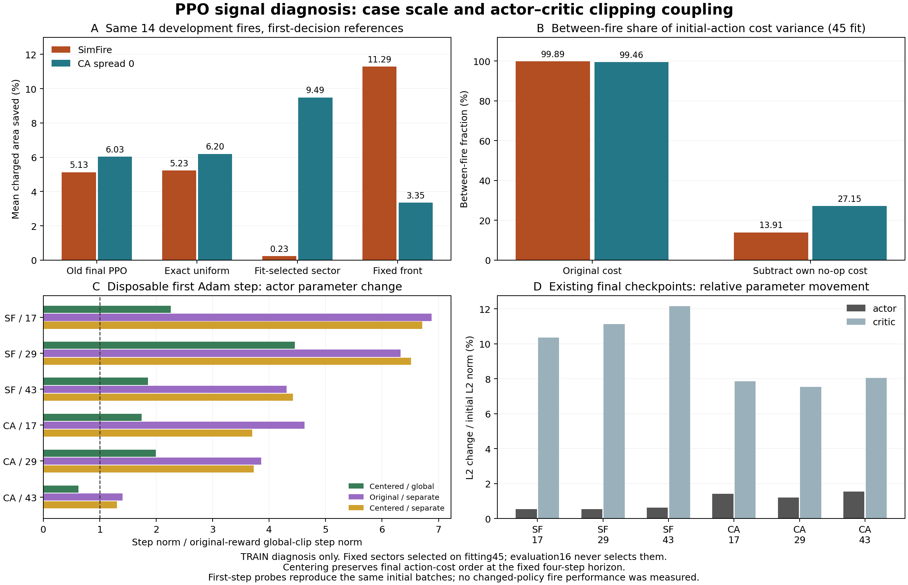

# PPO signal i reference

## Rezultat — TASK-044 završen, ADR-054, 2026-11-23

**Identifikovan je početni mehanizam koji može ograničavati učenje politike:** razlike
u trošku između požara dominiraju početnim akcijskim signalom, a veliki critic
gradijent zajedno ograničava i actor gradijent. To je izmjereno na prvim rolloutima
i jednokratnim koracima. Nije dokazano da je to jedini uzrok cijelog TASK-043 nalaza,
niti da bi promijenjeni puni trening bio bolji. Novi puni trening nije pokrenut.

Plan `44658302` prethodi kodu `e1a28379` i mjerenjima. Stari simulatori, reward,
checkpointovi i TASK-043 primarni rezultati ostali su nepromijenjeni.
[Sve brojke](../../reports/real-fire-data/ppo-signal-diagnosis-v1.json),
[nezavisni audit](../../reports/real-fire-data/ppo-signal-independent-v1.json),
[verifikacija](../../reports/real-fire-data/ppo-signal-verification-v1.json).

### 1. Pošteniji referenti: stari PPO je blizu uniformnog odabira

Novi uniformni referent je **tačno očekivanje** izbora među legalnim nenultim akcijama
na prvoj odluci, uz no-op ako nema legalne linije. Nije jedan seed ili Monte Carlo
uzorak. I dalje govorimo samo o liniji na prvoj odluci, ne uniformnoj politici nad
svim vremenima intervencije. Oba backend-a imaju iste početne maske.

| Mean charged saved%, istih14joint-positive evaluation požara | SimFire | CA spread0 |
| --- | ---: | ---: |
| Završni PPO iz TASK-043, prosjek3model seeda | 5,13% | 6,03% |
| **Tačan uniformni početni izbor** | **5,23%** | **6,20%** |
| Fiksni sektor odabran samo na45fit | 0,23% | 9,49% |
| Stari fiksni front referent | 11,29% | 3,35% |

PPO je po tačkastoj procjeni oko−0,10pp/−0,16pp ispod novog uniformnog očekivanja.
Novi interval ili test značajnosti nije uveden. Raniji neprošli learning kriteriji
ostaju isti. Povoljniji CA procenat sam za sebe ne pokazuje prednost učenja.

Jedan sektor je izabran po najvećem **mean charged saved broju ćelija svih45fitting**
požara; isti kriterij oba backend-a, tie najmanji ID. To je sektor6(NW) za SF i7(N)
za CA. Evaluacijskih16nije birao sektor. SF odabrani sektor slabo prenosi korist na
evaluaciju; CA sektor7daje isti rezultat kao raniji fixed random seed0. Svi sektori,
oba skupa i svi pojedinačni skorovi su prijavljeni. Nedostupan sektor postaje legalni
no-op; uniformni referent takve sektore ne uzorkuje.

Sekundarno svih16: uniformni pooled SF1,46%/CA3,07%, mean charged saved ha
SF166,25/CA57,33. (Jedinica je obični hektar; 3,24ha po ćeliji.) Individualni SF
Coldwater/Organ procenti ostaju undefined, a hektari su zadržani. CA uniformni mean
na vlastitih16pozitivnih je6,36%; primarno poređenje koristi istih14u oba modela.

### 2. Razlika među požarima prekriva signal izbora poteza

Na45fitting slučajeva računata je varijansa troška `charged_cells/100`: svaki požar
ima istu težinu, unutar požara uniformna težina legalnih početnih akcija **uključujući
no-op**. Ovo je deskriptivna razgradnja akcijske tabele, ne interval nesigurnosti.

| Udio varijanse između požara | SimFire | CA |
| --- | ---: | ---: |
| Originalni trošak | 99,89% | 99,46% |
| Isti trošak minus vlastiti no-op | 13,91% | 27,15% |

Unutarpožarna varijansa pritom ostaje ista: SF0,64917/CA0,15597 u return² jedinicama.
Centriranje uklanja dio razlike među slučajevima, a ne razliku među potezima istog
slučaja. To matematički čuva poredak poteza jer svim potezima istog požara dodaje isti
ukupni offset. Ne znači da je naučen dobar potez ili da su slučajevi fizički validirani.

Vremenski centrirana proba dodaje no-op prirast svakog12hsegmenta/100 stvarnoj nagradi.
Uz gamma=lambda1 i pune4odluke zbir je `(noop_final_new − charged_final_new)/100`.
Prethodna šteta, potrošene linijske ćelije, maska i budžet ostaju isti. Nema promjene
opažaja ili pristupa budućem FEDS-u. Ovo je samo tensor proba, bez production reward izmjene.

### 3. Globalno ograničavanje smanjuje i actor korak

Ponovljeni su prvi16koraka/4epizode za svaki model seed i backend, ukupno96native
koraka. Svi scenario/action/reward/budget/charged redovi tačno ponavljaju stari
trening. Samo prikupljanje nije promijenilo težine ili optimizer. U ovih šest početnih
batch-eva samo4od16odluka ima više od jedne legalne akcije: preostalih12su prisilni
no-op nakon prve linije. To nije mjera svih kasnijih batch-eva.

Na svakom istom batchu i istim početnim težinama urađene su4odbačene Adam probe:
original/centered reward × global/separate actor-critic clipping. Ručni originalni
loss i prvi update testom odgovaraju pinovanom MaskablePPO-u. Adam eps=1e-5,
learning rate=1e-4, max_grad_norm=0,5, vf_coef=0,5. Optimizirane probne težine nisu
sačuvane kao modeli niti evaluirane na požarima.

Originalni globalni clipping zadržava SF0,31–1,61% actor gradijentne norme i
CA1,12–22,00%. Critic gradijent prije clippinga je SF31,02–159,95, CA2,18–44,52;
actor je SF0,38–0,51, CA0,50–0,63. Dijelovi mreže su odvojeni, ali njihova norma
se ograničava zajedno. Adam kompenzacija znači da gradijentni faktor nije isto što
i faktor stvarnog pomaka težina — zato je mjeren i stvarni update.

| Faktor actor pomaka prema original/global koraku | SF17 | SF29 | SF43 | CA17 | CA29 | CA43 |
| --- | ---: | ---: | ---: | ---: | ---: | ---: |
| Centered reward, isti global clip | 2,26× | 4,45× | 1,85× | 1,74× | 1,99× | **0,62×** |
| Original reward, zaseban actor/critic clip | 6,88× | 6,33× | 4,31× | 4,63× | 3,86× | 1,40× |

Counterexample CA43je bitan: centriranje ne pojačava svaki početni korak. Veći korak
također nije dokaz boljeg smjera ili boljeg konačnog agenta. Izvorni optimizer momentum
kroz2.048koraka nije sačuvan; ovi rezultati ne rekonstruišu cijeli trening.

### 4. Težine su se mijenjale; početni actor nije zasićen

Svih18postojećih checkpointova pregledano je na početnim opažajima61požara, fit i
evaluation odvojeno. Relativni L2pomak početno→završno: actor SF0,54–0,62%, CA1,21–1,54%;
critic SF10,36–12,14%, CA7,53–8,04%. Nije riječ o nepromijenjenom checkpointu.
Ipak, promjena parametara sama ne dokazuje dobru politiku.

Početni feature raspon je[−0,9994;1],115od536dimenzija konstantno je na fitting skupu.
Nijedan početni actor Tanh izlaz u svih18modela/61slučaju nije prešao|0,95|.
Time na ovom ulazu nije pronađeno objašnjenje u velikom input scale-u ili Tanh
zasićenju. Postojeći greedy/entropy nalaz ostaje: politika je slabo promijenila preference.

### Provjere, paket i granice

405novih CA traženih početnih putanja (45×9),405SFfitting ishoda transparentno
ponovo korišteno, te288eval reference ishoda (16×9×2). Native CA no-op cijele putanje
odgovaraju staroj arhivi45/45. Nezavisno405CA putanja/2.025kumulativnih maski i sve
finalne linijske maske prema SFgeometriji, početna parity45/45,96starih training
redova,24gradient metrike i18parameter-delta provjera PASS. Nelegalni zatraženi
sektori se eksplicitno preslikavaju u no-op, pa405nije405različitih legalnih poteza.

423pinned/0skip,408modern/4skip,322core/49skip,15knowledge,CLI/strict93PASS. Šest
aritmetičkih i četiri RL/audit testa uključuju exact source-equivalent Adam korak,
reward invariance i zaštitu od float32roundoffa. Prvi audit je koristio prestrogu
generic1e-8toleranciju za float32GAE: lokalno je dodana1e-6absolute/relative tolerancija
samo na return provjeri, uz regresiju koja i dalje odbija izmijenjenu nagradu. Nisu
mijenjani cell countovi, mjerenja, modeli ili glavna statistika. Oba audit loga su sačuvana.

Dijagnostički run138,80s,nice19/3radnika+koordinator/jedna nit. Nema aktivnog punog
treninga ili novog performance nalaza. Fizički model nije kalibrisan/validiran; svi61
su ranije istraženi TRAIN slučajevi, CAspread0fiksiran. TEST/VALIDATION i futureFEDS zatvoreni.

### Sljedeći prijedlog: TASK-045, kratak kontrolisani centering pilot

Preregistrovati samo jednu promjenu: no-op-centred incremental reward, uz isti global
clip i sve ostale postavke. Predloženo512koraka/3seeda/2backend-a naspram već sačuvanih
originalnih512checkpointova: isti45fit/16development, isti raspored/budžet/encoder,
isti uniformni/fitting-only referenti i originalne heuristike. Novi reward ugovor
i testsum/budget/mask/replay prije starta; sve seedove prijaviti, bez najboljeg izbora.
Zaseban clipping ostaje zasebna hipoteza, ne dodatna tiha promjena u istom pilotu.
Ovo je prijedlog; TASK-045 nije implementiran ili pokrenut.

TASK-043 zaključak ostaje isti: nema potvrđene RL prednosti. TASK-044 dodaje mjerljiv
pravac za provjeru uzroka, a ne novu pobjedničku politiku. Native unit parity i fizička
validacija ostaju odvojene otvorene teme; novi PR i merge nisu rađeni.

## Plan prije mjerenja — ADR-053, 2026-11-23

Korisnik nastavlja predloženi TASK-044. Nova grana `codex/ppo-signal-diagnosis`
polazi iz `c160fd0e`. [Zamrznuti plan](../../configs/frozen/ppo-signal-diagnosis-v1.json)
prethodi implementaciji i novim brojkama; TASK-043 nalazi ostaju nepromijenjeni.

**Činjenica:** stari pilot nije prošao learning kriterij. Soft distribucije su skoro
uniformne, a greedy izbor često isti. Fixed random seed0 daje sektor7 na svih16.
Pinovani MaskablePPO2.7.1 računa MSE value loss i globalno ograničava normu svih
policy parametara, uključujući actor/critic; Adam policy default eps je1e-5.
To je provjereno u instaliranom izvornom kodu, ne pretpostavljeno iz naziva algoritma.
**Hipoteza:** veličina reward/value signala i zajedničko ograničavanje gradijenata
mogu otežavati actor update. Ovo još nije nalaz ili dokaz uzroka cijelog treninga.
**Provjerljivi cilj:** izmjeriti reference, promjenu parametara i početni gradient
mehanizam pod istim scenarijima, bez novog punog treninga ili mijenjanja starih skorova.

1. Tačan uniformni izbor među legalnim linijama na prvoj odluci. Svi9traženi sektori
   (uključujući no-op) na45fitting požara: SF iz arhive, CA novi native replay. Isti
   front/nonfuel mask i budžet. Jedan fiksni sektor bira se samo po mean charged saved
   ćelijama na45fitting, s najmanjim ID-em pri izjednačenju. Tek zatim ocjena na16.
   Prijaviti i sve sektore, sve nazive/denominatore, mean%/ha/pooled i zero-noop.
2. Svih18postojećih numeric checkpointova na početnim opažajima svih61: actor/critic
   pomaci parametara, entropy/greedy/KL, Tanh saturation i feature rasponi. Fit/eval odvojeni.
3. Ponoviti prvi rollout16koraka/4epizode za svaki od3seeda i oba backend-a, bez
   `train` poziva. Mora odgovarati prvih16originalnih training redova i početnim
   težinama. Tada na istom minibatchu4jednokratne, odbačene Adam probe: originalna/
   centrirana nagrada × zajedničko/odvojeno actor-critic ograničavanje. Nove težine
   se ne čuvaju kao politike i ne mjere na požarima.

Centriranje dodaje vremenski poravnat no-op prirast/100 nagradi. Uz gamma=lambda1
i puni4step horizont ukupni pomak je isti no-op damage/100 za svaki potez tog požara,
pa ne mijenja poredak konačnih charged troškova. Ovo se prvo testira i računa na
istim putanjama; production reward/physics/maske/checkpointovi ostaju isti.

Unit test mora potvrditi ručni PPO loss/gradijent/Adam prvi korak prema instaliranoj
implementaciji. Probe mjere aktivne naspram prisilnih odluka, skalu returna/advantagea,
norme prije/poslije clippinga, Adam eps i stvarni pomak actor/critic parametara.
Originalni optimizer momentum nije sačuvan; nalaz važi za početni korak, ne cijeli trening.

Procjena native dijela5–15min, najviše3radnika+koordinator,nice19/jedna nit. Nema
novog punog treninga, tuninga, stvarnog VALIDATION/TEST, budućeg FEDS-a ili mergea.
Ni povoljnija jednokratna proba nije dokaz da bi novi puni trening učio bolje.

## Status

Plan44658302 prije measurement kodae1a28379; numerički source/parent podaci nisu
mijenjani nakon starta. Dijagnoza završena, nema aktivnog treninga.

[Lokalni paket](../../reports/real-fire-data/ppo-signal-artifacts-v1.json):49.496.735B,
488članova plus manifest i hash-vezani roditeljski paket1035članova. SHA256
`5ecf9840bc23384ff25ed7e649d332c0f326b1be914fbb120ecc8597a52973b7`.
Svi outer/parent member hashovi provjereni. [Restore](../../reports/real-fire-data/ppo-signal-restore-v1.json)
iz raspakovanog sourcea/ulaza/checkpointova svježe ponavlja9CA putanja i32native
SF/CA rollout koraka (seed17),8gradient modes, s identičnim numeric nizovima. Ponovno
provjerava svih405pohranjenih putanja/24gradient modes/18parametara. To nije drugi
puni native405run, fresh dependency install ili optimizer resume. Paket/težine/raw
karte ostaju u ignorisanom `.local/signal-artifacts`; nisu uploadovani ili u Gitu.



Reprodukcija u novom izlaznom direktoriju s pinovanim runtimeom i parent bundleom:

```sh
nice -n 19 .local/simfire-venv/bin/python scripts/diagnose_ppo_signal.py --out .local/signal-NEW
nice -n 19 .local/simfire-venv/bin/python scripts/verify_ppo_signal.py --folder .local/signal-NEW --out .local/signal-NEW/independent.json
```

`scripts/bundle_ppo_signal.py pack` vezuje tačan parent archive; `replay` iz
raspakovanog script root-a radi navedenu prenosivost. Source/runtime/model guardovi
se ne preskaču. Fitting/evaluation su ranije istraženi TRAIN, ne nezavisan test.
