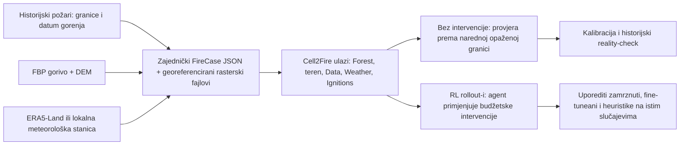

# Od stvarnog požara do Cell2Fire scenarija

Datum provjere izvora: 2026-10-30. Ovo je konkretan pipeline za korisnikov cilj: učiti i
porediti politike na simulatorima koji koriste pejzaže, vremenske uslove, početna stanja
iz raspodjele uslova izvedene iz stvarnih požara. Tri train slučaja (`2018_747`, `2018_241`,
`2018_1770`) pretvorena su u simulator ulaze i izvršena su no-action ponavljanja u C++
simulatoru. To još nije validacija fizike,
dataset za obuku niti dokaz da agent smanjuje stvarnu štetu.

## Ukratko

Tvoja ideja je u pravom smjeru, uz jednu bitnu razliku: stvarni požari mogu odrediti
uslove i raspodjelu trening-scenarija, ali historijski raster nije odgovor modelu
„ovako treba gasiti“. Historija ne bilježi kontrafaktual: ne znamo gdje bi požar izgorio
da je kontroler izabrao drugu ćeliju. Umjesto toga:

1. Od historijskih slučajeva uzmemo stvaran tip goriva, teren, vrijeme i početno stanje
   požara.
2. Te ulaze složimo u Cell2Fire format i pokrenemo više kontrolisanih simulacija.
3. Agent dobija nagradu/štetu koju **izračuna simulator** dok agent bira intervencije.
4. Dnevna historijska granica požara služi kao nezavisan reality-check za simulaciju,
   a kompletan požar ostaje zajedno u trainu, validaciji ili testu.

Tako agent trenira na raspodjeli uslova stvarnih požara, a ne na izmišljenim nasumičnim
mapićima; pojedinačni RL rollout-i su ipak novi simulacijski kontrafaktuali.

Najjednostavnije: **Y je sirovi opis stvarnog događaja**, često zasebne karte i tabele;
**X je konkretan paket malih, poravnatih fajlova koje Cell2Fire zna učitati**. JSON nam
služi kao naslovnica/manifest za Y i opis konverzije; tek GeoTIFF-ovi i konverter daju
Cell2Fireu njegove ASC/CSV ulaze. Historijska granica ostaje zaključana kao odgovor za
provjeru, da je agent ne vidi dok trenira ili bira akciju.



## Šta simulator stvarno očekuje — X

U ovom projektu X nije jedan CSV. To je mapa više usklađenih fajlova i jedna vremenska
serija za **jedan scenario**:

| X / fajl | Sadržaj | Kako nastaje iz historijskog slučaja |
| --- | --- | --- |
| `Forest.asc` | Numeric raster grid-value kodova goriva iz `fbp_lookup_table.csv` (npr. 1=C-1, 2=C-2; posebno kodirati NF); sve ćelije iste veličine | FBP fuel-type mapa, isječena na lokaciju, pa eksplicitno premapirana preko kompatibilne Cell2Fire lookup tabele; ne ubacivati tekstualne klase ako parser očekuje brojeve |
| `elevation.asc` | visina tla u metrima | DEM poravnat na potpuno istu mrežu |
| `slope.asc`, `saz.asc` | nagib i smjer padine | Izračunati iz istog poravnatog DEM-a; aspect/saz mora koristiti ugaonu konvenciju koju očekuje C++ kod |
| `Data.csv` | jedan red po ćeliji; 20 kolona: `fueltype,mon,jd,M,jd_min,lat,lon,elev,ffmc,ws,waz,bui,ps,saz,pc,pdf,gfl,cur,time,pattern` | generiše se redom ćelija iz normalizovanih rastera i provjerenog Cell2Fire `DataGeneratorC`; nedostajuće vrijednosti ne popunjavati nulama napamet |
| `Weather.csv` | Cell2Fire parser očekuje tačne kolone `Scenario,datetime,APCP,TMP,RH,WS,WD,FFMC,DMC,DC,ISI,BUI,FWI` | lokalna stanica ako postoji; inače historijski ERA5-Land uz provjerene jedinice, smjer vjetra i FWI kodove. Sami vremenski podaci nisu dovoljni ako nedostaju početne FWI vrijednosti |
| `Ignitions.csv` + `InitialState.csv` | `Ignitions.csv` ostaje za jednu tačku; lokalni adapter dodatno prima one-based row-major listu `burnt` i `burning` ćelija | `InitialState.csv` učitava prethodni scar i više aktivnih ćelija kao zajedničko početno stanje; C++ import je provjeren na fixtureu i stvarnom CFSDS slučaju |
| `fbp_lookup_table.csv` | veza gorivnog koda i FBP parametara/boje | fiksna, verzionisana tabela kompatibilna s Cell2Fire buildom |
| `Reward.asc` (opciono) | prioritetni region koji se štiti | tek ako je prioritet definisan prije evaluacije; ne crtati ga iz buduće granice požara |

Trenutni validirani input za glavni checkpoint je 20×20, 100 m po ćeliji: 2×2 km,
400 mogućih akcija. Agent vidi RGB sliku stanja šume/požara i bira jednu ćeliju;
intervencija je u ovom modelu trajno tretiranje/uklanjanje ćelije, ne ekipa s vremenom
putovanja i količinom vode. Zato rezultat mora biti opisan kao ishod u ovom apstraktnom
simulatoru. Postoje i Firehose 40×40 checkpoint fajlovi, ali nisu dio izvršene 12-case
provjere. [Firehose projekt i 20×20/40×40 eksperimenti](https://williamshen-nz.github.io/firehose/).
20×20 od 100 m pokriva samo 400 ha: to nije cijeli Dogrib požar (~10,216 ha). Veći
event se mora predstaviti kao definisan manji prozor/front (uz izvještavanje o odsječenju)
ili se mora promijeniti i validirati model/akcijski prostor; ne skalirati ga neprimjetno
u tile i porediti tile površinu s cijelim historijskim požarom.

## Šta web podaci daju — Y

| Izvor | Šta sadrži | Korisnost za nas | Šta mu nedostaje / ograničenje |
| --- | --- | --- | --- |
| **Dogrib 2001 / Cell2Fire** | stvarna 100 m FBP mapa i topografija; historijski vremenski fajlovi; real-scar i documented incident/perimeter reference. Objavljeni Cell2Fire primjeri uključuju 20×20 (400 ha) i 40×40 (1,600 ha) podmape iz Dogrib pejzaža | koristan formatni primjer u istom FBP/Cell2Fire ekosistemu; direktno relevantan za postojeći Firehose | jedan povezani požar, ne skup nezavisnih događaja. Trenutni `Sub20x20` ima pogrešno/geografski neprovjereno poravnanje headera; fuel/elevation matchuju jedan blok pune mape, ali slope/aspect nisu isti. `Ignitions.csv` ćelije 372/381 nisu potvrđene kao stvarna tačka paljenja. Weather fajl datira 16.10.2001, ali tačno poravnanje sa početnim perimetrom/horizontom još nije dokazano |
| **CFSDS v1.1** | 5,435 kanadskih požara >500 ha, 2014–2024; 90 m raster procijenjenog dana gorenja iz MODIS/VIIRS detekcija, uz environmental covariates | najbolji javno pronađeni izvor za širu raspodjelu stvarnih događaja i dnevne progression targete | dan gorenja je satelitski interpolisan, ne sat-po-satu izmjerena fronta. Ne daje Firehose-ready FBP mapu/DEM/hourly `Weather.csv` za svaki događaj u jednoj spakovanoj strukturi |
| **CFSDS/W.I.S.E. pripremljeni parovi** | u objavljenoj metodi: 2,210 događaja i 19,848 susjednih parova uzastopnih dnevnih granica (2014–2024) nakon filtera | gotov recept kako formirati dnevne start/target granice, ignorisane/spot slučajeve i skup kompatibilnih fuel/weather/topo ulaza | izvedeni job set članka nije ponuđen kao slobodan download; rad kaže da se podaci daju na razuman zahtjev. Pipeline treba reproducirati iz javnih inputa |
| **CNFDB/NBAC i Alberta wildfire zapisi** | fire pointovi i/ili finalne granice, datum/lokacija/veličina; Alberta historical database s dodatnim incident poljima | pronalaženje ID-ja, ignition konteksta, završne površine i indikacija intervencija | CNFDB/NBAC finalne granice nemaju dnevni redoslijed širenja. Alberta GIS portal za neke slojeve traži verificiran račun; tabelarni podaci sami ne čine replay |
| **ERA5-Land** | globalni hourly meteorološki/reanalysis podaci od 1950, oko 9 km rezolucije | dostupna, dosljedna historijska vremenska serija za većinu CFSDS požara; koristili su je i autori velikog benchmarka | jedna grid tačka pokriva skoro čitav naš 2×2 km patch; to je grublje od goriva/terena i ne treba lažno predstavljati kao lokalno izmjeren vjetar |
| **Canadian FBP fuel maps + MRDEM** | godišnje/periodične FBP gorivne klase; nacionalni DEM na 30 m | pretvaraju rasterske događaje u gorivo/topografiju koju Cell2Fire/FWI/FBP razumiju | odabrati vremenski primjerenu mapu. Današnji sloj nije automatski historijski sloj; ranije burn scarove i unknown/nonfuel klase treba obraditi po objavljenim pravilima |

Dogrib i CFSDS su zato komplementarni: Dogrib je **formatni primjer**, CFSDS je
**odabrana šira multi-event distribucija**. CFSDS se ne smije svesti na dnevni CSV sa `firearea`
prosjekom: za simulator su potrebni prostorni slojevi i vremenski niz.

### Ako je cilj BiH

Lokalno je preuzet mali FireSpread_MedEU v2 ZIP i prostorno presječen s Natural Earth
Admin 0 granicom BiH. Prvi pregled daje **7 kandidata koji dodiruju BiH**:
EFFIS IDs `12321`, `13228`, `22108`, `25244`, `25274`, `43482`, `205938`. Screen koristi
grubu 1:110m državnu granicu, zato ID-jeve treba potvrditi na preciznoj administrativnoj
granici i službenom EFFIS zapisu prije zamrzavanja uzorka. Verzionisani nalaz i hashovi
su u [spatial-screen izvještaju](../../reports/real-fire-data/medeu-spatial-screen.json).

Najčistiji prvi historijski referent je `EFFIS_id=205938`: dnevni koraci 15–18.07.2022,
svaki s quality `very high`, završna prijavljena površina 637.63 ha. Njegov konačni
obuhvat je približno 4.14×4.18 km, dok provjereni PPO vidi samo 20×20 ćelija × 100 m =
2×2 km. Dakle puni događaj ne stane u postojeći agent. Manji `EFFIS_id=43482` ima
216.87 ha i tri rastuće granice, ali je geografski obuhvat 2.56×1.71 km i jedan korak
ima samo medium kvalitet; ni njemu nije moguće garantovati puni extent u 2×2 km prozoru.
Ne treba smanjiti cell size/metričku skalu samo da bi požar „stao“, jer tada mijenjamo
značenje prethodno treniranih 400 akcija i modelsku fiziku. Opcije su validirani 40×40
setup/model, dodatna arhitektura/trening, ili jasno označen ograničeni front/crop.

V2 sadrži poligone napredovanja i godišnje udjele UN FAO LCCS pokrova, ali ne simulator-
spremne fuel-parametre, DEM ili satni weather trace. Pre-fire `Prop_step=0` zapis u radu
može biti tačkasti poligon postavljen u centar prvog vidljivog burn poligona; tretirati
ga kao metadata/placeholder, ne kao izmjerenu tačnu lokaciju paljenja. Za replay koristiti
burned-area pair n−1→n i aktivni front koji ih povezuje. EFFIS navodi da historical
extract/raw perimeter zahtijeva data request. [FireSpread_MedEU v2](https://zenodo.org/records/18200075),
[recenzirani opis](https://doi.org/10.1038/s41597-026-06965-2),
[EFFIS data services](https://forest-fire.emergency.copernicus.eu/applications/data-and-services).

Za gorivo je dodatno preuzeta zvanična **EFFIS European Fuel Map (2017)**. ZIP je 18.2 MB;
rasterski sloj je EPSG:3035, 250 m, a lokalni BiH raster sadrži NFFL/Anderson kodove
1–10. Presjek s dva završna poligona daje 103 validne ćelije za `205938` (40 kod 4,
42 kod 5, 12 kod 9 i 9 bez podataka) i 34 za `43482` (32 kod 3, 2 kod 5). Ovo je
upotrebljiv regionalni početni sloj za istraživanje, ne terenski popis goriva: rezolucija
je gruba, karta je starija, a no-data ostaje no-data. EFFIS navodi da je EU-owned web
sadržaj CC BY 4.0 osim ako pojedinačni sloj kaže drugačije; zabilježiti citat i provjeriti
eventualnu posebnu napomenu za fajl prije objave. [EFFIS opis gorivnih kategorija](https://forest-fire.emergency.copernicus.eu/about-effis/technical-background/fuels),
[EFFIS licenca](https://forest-fire.emergency.copernicus.eu/about-effis/data-license),
[preuzeti sloj](https://data.effis.emergency.copernicus.eu/effis/applications/data-and-services/FuelMap_LAEA.zip).

Ključna kompatibilnost: naš postojeći Firehose C++ build uključuje `CellsFBP` i
`FBPfunc5`; on koristi **kanadski FBP**, ne ove NFFL vrijednosti. Zato kod 4 ne smijemo
proglasiti kanadskim `C-4`, niti kod 9 `C-9`. BiH putanja traži simulator koji podržava
odgovarajuće Anderson/NFFL modele ili naučno opravdan crosswalk i provjeru na historijskim
perimetrima. FIRE-RES opisuje Pan-European server sa 100 m, su-usklađenim gorivnim,
topografskim i canopy slojevima i Scott–Burgan klasifikacijom; prije oslanjanja na njega
treba potvrditi da konkretni BiH slučajevi pokriveni, da slojeve možemo izvesti i pod
kojim uslovima koristiti. Rad opisuje 100 m harmonizirani server, dok aktuelni katalog
proizvoda istovremeno navodi 1 km evropski sloj i 100 m slojeve za odabrane pilot-lokacije;
tačnu rezoluciju/pokrivenost BiH treba provjeriti u samoj aplikaciji. Drugi model još ne
znači da se postojeći Firehose checkpoint može prenijeti. Drugi Cell2Fire forkovi
navode FBP, Scott–Burgan i KITRAL modove, ali spajanje tog simulatora s našim RL wrapperom
i provjera prenosa težina ostaju zaseban posao. [Server/paper](https://doi.org/10.1016/j.geomat.2024.100036),
[javna aplikacija](https://www.cirgeo.unipd.it/fire-res/app/),
[FIRE-RES proizvodi](https://fireurisk.eu/products/),
[Cell2Fire-W modeli](https://fire2a.github.io/C2F-W/index.html).

Za lokalni satni vremenski niz, ERA5-Land je globalna oko 9 km reanalysis od 1950 nadalje;
može popuniti meteorologiju za historijski datum, ali je mnogo grublja od požarne karte.
FHMZ BiH navodi da računa Canadian Fire Weather Index uz lokalna mjerenja/prognozu.
To je korisno za provjeru weather-index konvencije, ali ne dokazuje da kanadski FBP fuel
spread model odgovara bosanskoj vegetaciji. [Copernicus ERA5-Land](https://climate.copernicus.eu/climate-reanalysis),
[FHMZ BiH fire-danger index](https://fhmzbih.gov.ba/latinica/AGRO/pozar.php).

**Preporuka po prioritetu:** najizvodljiviji put za postojeće pretrained težine je
Kanada + CFSDS + kanadski FBP. Lokalni put je BiH + MedEU granice + EFFIS gorivni sloj,
ali uz izbor kompatibilnog NFFL/evropskog simulatora, provjeru licence MedEU ZIP-a,
preciznu potvrdu lokacija i veći grid. To je nova simulator/RL integracija; ne treba
pretpostaviti da se stari agent prenosi bez promjene opažanja, akcija i ponovnog treninga.
Ako fakultetski cilj traži BiH, prvo napraviti no-action replay i jasno nazvati rezultat
simulacijom po regionalnom modelu; ako je važnija izvedivost s postojećim agentom,
izabrati CFSDS. Ni jedna putanja ne dokazuje da bi stvarni požar sigurno bio manji.

## Konkretna normalizacija u zajednički JSON

JSON je **manifest jednog scenarija** i veza između fajlova; veliki rasteri ostaju
GeoTIFF/COG fajlovi s CRS, transformacijom, no-data i SHA256. Za malu 20×20 gridu se
po želji mogu u JSON staviti i sažeti nizovi radi debugovanja, ali to ne mijenja raw
asset niti njegov hash.

Minimalna struktura:

```json
{
  "schema_version": "firecase-1.0",
  "scenario_id": "cfsds-v1_1-2020_210-day-174",
  "event": {
    "source": "CFSDS",
    "source_version": "1.1",
    "event_id": "2020_210",
    "day_of_burning": 174,
    "suppression_status": "unknown"
  },
  "grid": {
    "crs": "EPSG:32610",
    "shape_rc": [20, 20],
    "cell_size_m": 100,
    "row_order": "north_to_south",
    "crop_transform": ["record exact affine transform here"]
  },
  "assets": {
    "fuel_fbp": {"path": "rasters/fuel_fbp.tif", "sha256": "...", "vintage": "2019"},
    "dem_m": {"path": "rasters/dem.tif", "sha256": "..."},
    "observed_day_n_minus_1": {"path": "labels/day_n_minus_1.tif", "sha256": "..."},
    "observed_day_n": {"path": "labels/day_n.tif", "sha256": "..."}
  },
  "weather": {
    "source": "ERA5-Land",
    "nearest_gridpoint": "record latitude/longitude and CDS cell id",
    "timezone": "UTC",
    "units": {"temperature": "C", "wind_speed": "km/h", "precipitation": "mm"},
    "rows_path": "weather/hourly.csv",
    "rows_sha256": "..."
  },
  "initial_state": {
    "method": "day_n_minus_1_boundary_adjacent_to_day_n_growth",
    "fire_front_cells_rc": [["row", "col"]],
    "previously_burned_cells_become_nonfuel": true,
    "requires_simulator_state_import": false,
    "state_import_file": "input/InitialState.csv",
    "state_import_adapter": "firehose-cfsds-initial-state-v1"
  },
  "provenance": {
    "source_urls": [],
    "license": "record per source",
    "transformations": [],
    "quality_flags": [],
    "split_group": "whole-event-id"
  }
}
```

Gornji primjer je **šablon, nije preuzeti niti validirani CFSDS slučaj**. Koordinatni
sistem/transformacija se moraju pročitati iz konkretnog rastera, ne kopirati `EPSG`
napamet. `unknown` suppression mora ostati eksplicitno `unknown`, nikad se ne pretvara u
„nije bilo intervencije“.

Iz tog JSON manifest-a konverter napravi privremeni Cell2Fire input folder sa
`Forest.asc`, tri aligned terrain ASC-a, `Data.csv`, `Weather.csv`, `Ignitions.csv`,
lookup tabelom i opcionim priority maskom. U svakoj generaciji zapisuje conversion
verziju, input/output hashove, veličine, raster bounds i pregled vrijednosti.

## Pravila rastera i vremena

1. **Jedan metrički CRS po slučaju.** Transformisati vektorske granice i sve rastere u
lokalni UTM; snapovati na isti 100 m grid. Zadržati izvorni GeoTIFF kao raw i zapisati
tačan affine transform.
2. **Gorivo je kategorija.** Reproject/resample FBP oznake nearest-neighbour ili mode;
   nikad bilinearno. Nepoznate/vegetated-nonfuel ćelije ne pretvoriti tiho u gorivo.
3. **Teren.** Poravnati DEM, pa iz njega ponovo izračunati slope/aspect; ne kopirati
   rastere koji više ne odgovaraju DEM-u. Testirati ugao i smjer vjetra/aspect na poznatom
   primjeru prije replaya.
4. **Površine požara.** CFSDS 90 m `day-of-burning` reprojectovati na 100 m masku uz
   unaprijed definisano pravilo pokrivenosti/većine. Zapisati koliko pozitivne površine
   se gubi ili dobija pri resamplingu. Sačuvati i 90 m reference za metričke proračune.
5. **Prozor.** Za 20×20 polje izabrati crop koji sadrži prethodnu frontu i sav target
   rast do kraja horizonta uz buffer. Prijaviti target koji izađe iz prozora; ne zvati ga
   uspješnim zadržavanjem požara. Takav slučaj izostaviti iz primarnog rezultata ili ga
   posebno označiti kao edge-censored.
6. **Weather.** Izvući hourly temperaturu, vlagu, U/V ili brzinu/smjer vjetra i
   padavine, zapisati UTC/local-time konverziju i jedinice. Cell2Fire traži i sve FWI
   kodove; oni se ne dobijaju tako što se sirovi ERA5 redovi samo kopiraju. Treba
   istorijska prethodna FWI inicijalizacija i provjeren CFFDRS/FWI postupak za ostatak
   perioda (WISE koristi prethodni dnevni kod sa zasebnog ~31 km FWI proizvoda, pa ga
   ažurira vremenskim podacima). Uporediti rezultat s poznatim weather slučajem i
   provjeriti da C++ očekuje iste jedinice/smjer. Ne može se interpolacijom dnevnih
   sažetaka dobiti stvaran satni vjetar.
7. **Cell ID.** JSON i rasteri koriste `(row, col)` nula-based; Cell2Fire `Ncell` je
   one-based row-major: `Ncell = row * ncols + col + 1`. Test na poznatim uglovima i na
   Ignitions.csv prije prve epizode. Firehose Python action je opet zero-based.

## Historijski front naspram jedne tačke paljenja

CFSDS i W.I.S.E. dnevni testovi opisuju granicu požara od mnogo aktivnih ćelija.
Standardni `Ignitions.csv` i dalje prima jednu tačku po simulacijskoj godini; više redova
se ne tumače kao jedna istovremena ivica.

Ovo rješava projektni adapter kroz `InitialState.csv`: ranije opožarene ćelije su
`burnt`, opaženi aktivni rub je skup `burning` ćelija. C++ simulator je potvrdio uvoz
fixturea i slučaja `2018_747`; TASK-004c je naknadno dodao terminalni cumulative-damage,
front/treatment IDs i reason u cijeloj Python→C++ epizodi. [Runtime receipt](../../reports/firehose-verification/task004c-adapter-smoke.json).
Za glavne RL eksperimente i dalje treba proći odvojeni CFSDS no-action quality gate;
tehnički adapter prolaz ne potvrđuje fiziku niti smanjenje štete.

## Kako od daily CFSDS para napraviti jednu Cell2Fire epizodu

Za izabrani događaj `burn_day = n` i `burn_day = n-1` daju historijski dnevni par,
ali trenutna implementacija **nije leakage-free**:

1. Fuel karta za dan n treba siguran as-of-event bazni vintage i dokumentovan annual
   burn-scar succession. Zatim se samo perimetri istog požara prije dana n mogu
   ukloniti/reclassifikovati prema provjerenom pravilu. Trenutno su te dvije fuel faze
   još blokirane provenanceom i importer contractom.
2. `scripts/build_cfsds_case.py` trenutno traži day n-1 ćelije susjedne targetu day n
   da bi izabrao `InitialState.csv` aktivni front. Time target geometrija uđe u agentov
   početni input iako se target raster fizički čuva u `truth/`. Ovo ponašanje slijedi
   objavljeni W.I.S.E. benchmark, čiji autori eksplicitno kažu da je njihov front
   target-aware i favorizujući [S-037](SOURCES.md#s-037); za unbiased RL benchmark taj
   recept ne možemo prenijeti bez promjene.
3. Prije benchmarka treba preregistrovati front koji se može izračunati samo iz day n-1
   i ranijih podataka (npr. granica prethodno opožarene površine je kandidat, ali još
   nije usvojeno pravilo), pa testirati da početni grid ne mijenja target maska.
   `InitialState.csv` C++ uvoz postoji; fuel/non-fuel kompatibilnost starog scar-a još
   nije riješena.
4. Tek nakon target-blind front i leak-safe goriva postavi poravnati teren i satni
   weather trace. Target dan n ostaje samo za unaprijed definisane evaluacijske metrike.
5. Pusti **no-action** reality-check na train/calibration slučajevima uz isti unaprijed
   definisani horizont. Ako gate ne prođe, popravi input/model i testiraj ponovo; ne
   podešavati na heldout događajima.
6. Tek na prihvatljivom slučaju pokreni frozen checkpoint, fine-tuneani checkpoint i
   heuristike sa istim vremenom, početnim stanjem, C++ seedovima i budžetom. RL reward
   ostaje simulatorova šteta uz eventualni trošak intervencije.

CFSDS raster je dnevno interpolisan iz satelitskih hotspota. Ovakav par je dobar za
dnevnu provjeru rasta, ali ne pruža label svake Firehose akcije niti preciznu satnu
frontu. Benchmark W.I.S.E. zato posebno sastavlja satno vrijeme, FBP, DEM, prethodnu
opožarenu masku i frontu. Od 5,435 CFSDS v1.1 događaja, nakon fuel/date/suppression/
adjacency/spotfire filtera objavljeni benchmark koristi 2,210 požara i 19,848 dnevnih
parova. Njegov izvedeni skup traži se od autora; javne CFSDS/FBP/DEM/weather ulaze i
njihova selekcijska pravila možemo reprodukovati. [CFSDS dataset](https://doi.org/10.1038/s41597-024-03436-4),
[W.I.S.E. metod i filteri](https://doi.org/10.1071/WF26072).

## Validan train/validation/test skup

- **Grupa za split je cijeli događaj (`event_id`), nikad crop ili dan.** Svi patch-evi
  i dnevni parovi istog požara ostaju u jednoj particiji.
- Stratifikovati split po godini, ekozoni, veličini događaja i gorivnoj klasi gdje
  broj slučajeva dozvoljava. Sačuvati broj požara i dana po splitu prije izbora procenata.
- Koristiti odvojene skupove za kalibraciju fire spread modela, izbor fine-tuning
  checkpointa i završnu evaluaciju. Test fire ID lista se zamrzava prije treninga.
- `suppression_status` se vodi kao `yes/no/unknown`. Za no-action fizičko poređenje
  primarni calibration subset treba da isključi evidentirane intervencije kada podaci
  to omogućavaju; ostale događaje analizirati odvojeno, jer opaženi rast uključuje
  rad stvarnih vatrogasaca koji naš simulator ne modelira.
- Jedan događaj može dati mnogo dnevnih parova, ali to nisu nezavisni požari. Izvještavati
  statistiku po događaju i pouzdanost grupisati/bootstrappovati po `event_id`, ne po
  svakom dnevnom redu.
- Weather/Cpp stochastic seeds se uparuju preko politika. Opaženi fire ID se ne smije
  pojaviti u dvije particije. `event_id + day-pair + crop + fuel-vintage + weather hash`
  definišu scenario identitet.

## Šta možemo pošteno tvrditi

Možemo testirati: **„Na zadržanim historijskim inputima, uz ove Cell2Fire postavke i
apstraktnu cijenu jedne tretirane ćelije, fine-tuneani agent je u uparenim simulacijama
imao manje simulirane opožarene površine od zamrznutog modela i heuristika.“** Uz to
moramo pokazati no-action slaganje prema opaženoj narednoj granici i intervale između
požara/seedova.

Ne možemo iz ovoga direktno zaključiti: **„U stvarnosti bi agent smanjio taj požar za
X hektara.“** Historijski požar imao je stvarno gašenje, satelitska granica je nesigurna,
Cell2Fire je model, a naše tretiranje ćelije nije kompletan model ljudskih resursa.
Posebno, ne smijemo porediti 20×20 tile od 400 ha sa cijelim Dogrib požarom od oko
10,216 ha kao da su iste oblasti.

## Predloženi izvori i granice

- Dogrib: [Cell2Fire sub-instances i stvarni landscape podaci](https://doi.org/10.3389/ffgc.2021.692706),
  [Cell2Fire data repository](https://github.com/humnetlab/Cell2Fire/tree/main/data).
- CFSDS: [dataset paper](https://doi.org/10.1038/s41597-024-03436-4),
  [OSF data project](https://osf.io/f48ry/), v1.1 širenje i filteri u
  [2026 W.I.S.E. procjeni](https://doi.org/10.1071/WF26072).
- Fuel/terrain: [kanadske FBP fuel layer verzije](https://cwfis.cfs.nrcan.gc.ca/downloads/fuels/),
  [2026 current layer metadata](https://open.canada.ca/data/en/dataset/851e6a27-a250-41e6-9cd0-d7ff96455dd6).
- Weather: [ERA5-Land hourly product](https://cds.climate.copernicus.eu/datasets/reanalysis-era5-land)
  (oko 9 km, od 1950, CC-BY 4.0).
- Za evropske/mediteranske događaje: [FireSpread_MedEU](https://zenodo.org/records/18200075)
  sadrži 103 požara i 320 visokorezolucijskih (~3 m) propagacijskih koraka iz 2017–2023,
  ali ne daje kompatibilne kanadske FBP slojeve; koristan je za evropsku studiju tek uz
  požarni model i gorivnu klasifikaciju namijenjene tom području.
- Za globalni grubi uzorak: [JRC/GWIS GlobFire](https://developers.google.com/earth-engine/datasets/catalog/JRC_GWIS_GlobFire_v2_DailyPerimeters),
  MODIS-based fire boundaries, nominalno dnevno i 500 m za 2001–2021. Vremenski
  početak/kraj ima nekoliko dana nesigurnosti; nije gorivo/weather/terrain simulator bundle.
- Incident metadata/perimeters: [Canadian Fire History Data Explorer](https://cwfis.cfs.nrcan.gc.ca/en/fire-history),
  [Alberta Wildfire data](https://www.alberta.ca/wildfire-maps-and-data).

## Izvedeni pilot: CFSDS `2018_747`, 15–16.08.2018.

Po korisnikovoj uputi da uzmemo put koji najbolje odgovara postojećem simulatoru,
odabrana je Canada + CFSDS v1.1 + Canadian FBP putanja. Između 44 kandidata koji su
prošli prvi geometrijski pregled izabrali smo `2018_747` za pilot: početni scar i
aktivni rub ne sijeku mapu, a sve ćelije početnog stanja i ciljnog rasta padaju na
podržana goriva C-3 ili D-1. Ovo je jedan od 20 trening-period kandidata, a ne zaključan
konačni benchmark. CFSDS screening lista sadrži najviše pet kandidata po godini; nije
iscrpan popis svih mogućih događaja.

Konverter je napravio 20×20 mrežu ćelija od 100 m. U `input/` su simulatoru vidljivi
gorivo, teren, vrijeme i stanje požara od 15.08.2018. Cilj za 16.08.2018. je izdvojen u
`truth/` i nije stavljen u agentov ulaz. `InitialState.csv` sadrži 175 ćelija ranije
izgorjelog tla i 31 ćeliju aktivnog ruba. Izvorna granica je satelitski interpolisan
raster od 90 m; FBP gorivo je službeni sloj iz 2014. rezolucije 250 m; oba su prebačena
na modelsku mrežu od 100 m. Visina je iz 30 m DEM-a. Vrijeme je 24 satne ERA5-Seamless
vrijednosti iz tačke oko 5.2 km od centra požara. Dnevni FWI brojevi iz CFSDS-a
ponavljaju se po satima jer dataset nema satne FWI serije.

Kompajlirani C++ simulator prihvatio je stvarno viš ćelijsko početno stanje. Šest
no-action seedova (123–128; bez treniranja/intervencija) uspješno je završilo i dalo
identičnu završnu mapu; vrijeme do završetka se razlikovalo. Simulator je dodijelio
66 ha novog opožarenog područja;
CFSDS opaženi cilj iznosi 15.39 ha. Površinski ponderisani IoU je 0.2187. Predikcija je
dotakla 19 ćelija uz rub modelskog isječka, zato dio mogućeg širenja izvan prozora nije
predstavljen. Ovo je dijagnostika velikog neslaganja ulaza i modela, a ne potvrda da
simulator vjerno predviđa stvarni požar.

Manifest konverzije, mjere i ograničenja su u
[`2018_747-case.json`](../../reports/real-fire-data/2018_747-case.json) i
[`2018_747-day228-replay.json`](../../reports/real-fire-data/2018_747-day228-replay.json);
mapa je [`2018_747-day228.png`](../../reports/real-fire-data/2018_747-day228.png).

## Dodatne provjere na train slučajevima

Još dva kandidata iz 2018. prošla su converter i C++ import bez intervencija. Replays su
pokrenuti sa `steps-before=0`, tako da se požar ne širi prije nego što simulator preuzme
historijski početni scar/front. `2018_241` je prošao svih 400 ćelija modela: 237 ha novog
opožarenog prostora prema 12.153 ha CFSDS cilja, IoU .0376, 62 rubne ćelije. `2018_1770`
je dodao 73 ha prema 12.151 ha cilja, IoU .1361, 26 rubnih ćelija. Ova dva slučaja su
trenutno po jednom seedu; za `2018_241` postoji i replay s 20-minutnim zagrijavanjem, a
iste završne mjere pokazuju da ono nije uzrok velikog neslaganja.

Pokušali smo i geometrijski prihvatljiv train kandidat `2014_538`. Gradnja ga je ispravno
zaustavila jer najmanje jedna ćelija historijskog scar/front/targeta pada na Water ili
Non-fuel u dostupnoj FBP 2014b karti. Zato se `2014_538` ne računa kao simulator replay.
Ovaj slučaj pokazuje da spajanje s gorivima mora biti obavezna provjera za svaki kandidat,
a geometrijski screen sam po sebi ne daje validan skup.

Svi dostupni replay sažeci i karte su u
[`reports/real-fire-data/`](../../reports/real-fire-data/README.md). Još nisu povezani
požarni response/suppression zapisi, a 2019/2024 fuel map vintages nisu preuzeti.
Sljedeći gate je ulazni i modelni QC na samo train slučajevima; fine-tuning ostaje
zaustavljen dok simulator na no-actionu ne pokaže razumljivo ponašanje.
