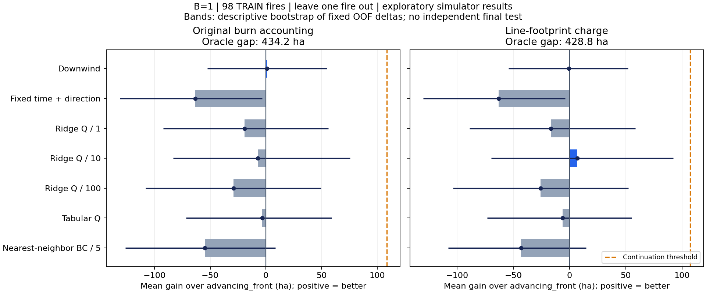

# SimFire B=1 — nastavak nakon faze 2

Stanje 2026-11-19. Grana `codex/simfire-policy-iterations`, baza `f96f744f`.
Korisnik je odabrao SimFire i iterativan, dokumentovan nastavak. ADR-033 bilježi obim,
pretpostavke, fiksne metode i stop-uslove prije analize. Ovo su TRAIN eksperimenti;
VALIDATION nije ponovo korišten, TEST 2024 nije otvoren, CA trening nije pokrenut.

## Pitanje i redoslijed

1. **TASK-028:** Koliko rezultat mijenja konzervativna naplata ćelija linije?
2. **TASK-029:** Koliko najbolji mogući izbor jedne linije može pomoći na istom požaru?
3. **TASK-030:** Može li politika iz trenutnog opažanja naučiti izbor koji pomaže na
   požaru izostavljenom iz fita?

Ovaj redoslijed provjerava prostor za učenje prije novog dugog PPO treninga. Početni
PPO checkpointovi nisu učitani i nisu trenirani. Originalni ADR-031/032 rezultat i
njegove postavke ostaju sačuvani; novi obračun ne mijenja retroaktivno stare brojeve.

## Šta je implementirano

`score_line_damage` računa originalnu novu štetu i uniju te štete s ćelijama linije
unutar novog no-op otiska. Početni scar je isključen iz nove štete; nema dvostrukog
brojanja. Ovo je alternativna modelna konvencija: 180 m ćelija nije izmjerena širina
stvarne vatrogasne linije. Prijavljuju se oba obračuna.

Runner za svaki požar izvršava no-op i osam smjerova u četiri termina (33 niza).
Nelegalan izbor postaje no-op; traženi i efektivni potezi ostaju zabilježeni. Sve
epizode traju četiri odluke / 48 h, i nakon potrošenog budžeta. Mape, WAF 0.10,
ROS 1.0, korak 5 min, `last_write`, `front_edge` i opažanje ostaju isti kao u ADR-032.

Čuva se cijela burn/line maska svakog ishoda, no-op putanja opažanja i legalnih poteza,
hashovi koda, plana, manifesta, vremena i receipt-a. Zasebni heuristički rollout mora
odgovarati tabeli i po broju ćelija i po cijeloj burn maski. Ponovljeni no-op mora biti
identičan. Resume odbija promijenjene postavke, ulaze ili mask artefakt.

## Inputi i razlika u odnosu na prethodni računar

Svih 98 TRAIN mapa bilo je dostupno lokalno. Lokalni weather cache je bio stari,
neispravljeni fajl. Sampler je proširen s `--split train`, uz test koji provjerava da
nikad ne otvara validation arhivu ili njenu geometriju. Ponovo su uzorkovani samo
2018/2019, s ispravnim per-case ćelijama, pre-start zapisom i FEDS local-solar mapiranjem.
Svih šest izvornih arhiva ima iste SHA-256 kao commitovani ADR-032 izvori. Novi weather
hash je `76332f3da26fe02812ca6439fee5dec9f131793227335e0380267d12c0ab937e`;
98 različitih ćelija, najveća udaljenost 2.8025 km.
[Weather profil i hashovi](../../reports/real-fire-data/feds-b1-train-weather-v1.json) su u Gitu;
same vrijednosti i NetCDF ostaju lokalni.

Originalni puni ADR-032 TRAIN benchmark nije dostupan na ovom računaru. Zato pilot
koristi nezavisne svježe scripted runove na istim ulazima. Cijela kohorta se dodatno
poredi s commitovanim no-op i B=1 heurističkim prosjecima. Ni savršeno slaganje agregata
ne bi dokazalo jednakost svakog pojedinačnog požara s nedostupnim starim izvještajem.

## Kako su podaci postavljeni i iskorišteni

Jedinica je cijeli požar, ne pojedinačna ćelija: 98 TRAIN požara iz 2018/2019.
Za svaki slučaj koriste se već pripremljene mape 256×256 ćelija po 180 m
(prozor 46.08×46.08 km), početni FEDS scar i aktivni front, LANDFIRE gorivo i reljef.
FPA-FOD i FEDS veza određuju slučaj i početak; budući historijski obodi nisu cilj
učenja ovih politika. GridMET daje četiri segmenta forcinga i zapis prije početka.
Simulator dobija forcing segmenta, a politika samo dopušteno prethodno vrijeme.

SimFire iz tih ulaza računa šta bi se desilo bez linije i za svaki dozvoljeni izbor
jedne linije. Upravo ti simulirani kontrafaktualni ishodi daju oznake za offline fit.
Stvarni podaci postavljaju okolinu i početno stanje; ne daju stvarne odluke vatrogasaca
ili dokaz učinka gašenja. Pravila i naučene politike dobijaju isti budžet i opažanje
sažeto na 4×16×16 mrežu, vrijeme, budžet i korak; reljef utiče na simulaciju, ali nije
dodat kao novi kanal politike u ovoj iteraciji.

Lokalno su odvojeni `inputs/<scenario_id>/` (dva rastera, početne maske, receipt),
`weather/` (tačno uzorkovani TRAIN fajl) i `cases/` (33 ishoda, opažanja, maske,
reference, hashovi). Mali sažeci ostaju u `reports/real-fire-data/`; veliki ulazi i
puni izlazi ostaju u `.local/`. Takav raspored omogućava ponovnu analizu bez ponovnog
pokretanja svih simulatora, uz provjeru porijekla svakog ulaza.

## Offline učenje i zaštita od curenja

Svaki od 98 foldova izostavlja cijeli jedan požar. Skaliranje i model koriste samo
ostalih 97. Odluka dobija trenutno opažanje i masku; nema budućih opažanja, vremena,
identiteta požara ili njegovog ishoda. Prije jedine linije putanja je jednaka no-op-u,
zato se svaka B=1 politika može tačno ocijeniti preko tabele bez nove simulacije.

Prijavljeni meni: postojeći `advancing_front` i `downwind`; najbolje fiksno vrijeme i
smjer izabrano na fit požarima; linearni ridge fitted-Q s alpha 1/10/100; tabelarni
fitted-Q; imitacija učitelja pomoću pet najbližih fit požara. Fitted-Q uči unazad kroz
četiri odluke: linija dobija konačni dobitak, čekanje vrijednost sljedećeg stanja.
Učitelj imitacije bira najbolji preostali niz koristeći buduće simulirane ishode
samo na fit požarima. Fitted-Q vrijednost čekanja ima donju granicu 0: uvijek
postoji poznata opcija da se nikad ne interveniše. To sprečava biranje predviđenog
gubitka zbog još lošije ekstrapolirane vrijednosti čekanja; ne garantuje stvarni dobitak.
Oracle na izostavljenom požaru vidi sve buduće
ishode i služi samo kao gornja granica, nikad kao dozvoljena politika.

Model uči simulirani dobitak konkretne odluke prema istom no-op slučaju, ne historijsku
akciju vatrogasaca. U raw obračunu oduzimanje tog konstantnog no-op ishoda ne mijenja
najbolju odluku za dati požar; uklanja velik dio razlike u veličini požara iz cilja fita.
Charged obračun je zaseban cilj i zato ima zasebne fitove.

Oba obračuna imaju zaseban fit. Prikazuju se svi kandidati, ne samo najbolji. Opisni
95% intervali su paired percentile bootstrap fiksnih OOF razlika (10.000 uzoraka,
seed 0), bez ponovnog fita modela. Foldovi dijele fit požare, pa ovo nije nezavisan
potvrdni interval. Izbor metode na istim LOO rezultatima je istraživačka selekcija.
Rezultat bez najveće apsolutne OOF razlike samo izbacuje jednu već ocijenjenu razliku;
ne refituje modele bez tog požara i ne uklanja njegov uticaj iz drugih fit foldova.

Prag za nastavak iz ranijeg pregleda: najmanje 30 ha i 25% oracle jaza iznad
`advancing_front`. Neuspjeh ovog konačnog menija ne dokazuje da dobra odluka uopće
nije predvidiva iz opažanja.

## Rezultati — završeno 2026-11-19 (ADR-034)

**Nijedna od osam metoda ne prelazi unaprijed zadani prag, ni u jednom obračunu.**
Ovime se završavaju odobreni TASK-028–030. Nema osnove iz ovog eksperimenta da se
pokrene novi dugi PPO trening ili da se troši novi holdout.

### TASK-029: provjerena tabela

- **98/98 požara, 3.234 reda ishoda** (98×33 tražena niza; neki daju isti efektivni
  potez i ishod). Uz ponovljeni no-op i
  četiri nezavisna scripted rollouta to je 3.724 simulator epizode.
- Pilot 20 slučajeva traje 3.82 min; puna komanda zatim traje **93.21 min**, uključujući
  provjere i pauze testiranja, uz reuse prvih 20. Prvobitna kratka procjena potcijenila
  je velike slučajeve; tokom rada je ispravljena. Sve po nice 19, najviše četiri radnika.
- Cijele reference i sve ponovo izračunate mask metrike prolaze. SHA-256 svih TRAIN
  ulaza odgovara commitovanoj kohorti. No-op i sva tri raw B=1 heuristička prosjeka
  odgovaraju ADR-032 do numeričkog zaokruživanja (<3×10⁻¹⁴ ha).
- Nema dodira ruba u svih **3.234 ishoda**. U 141 ishoda, na 53 požara, vatra dodaje
  više štete nego no-op; to je svojstvo ovih simuliranih ishoda, ne nalaz o stvarnom gašenju.

[Provjera i sažeci tabele](../../reports/real-fire-data/feds-b1-table-check-v1.json).
Originalni puni ADR-032 report i dalje nedostaje; slaganje agregata ga ne zamjenjuje.

### TASK-028: koliko naplata linije mijenja nalaz

No-op dodaje u prosjeku **7.415,70 ha**. `advancing_front` štedi **112,24 ha** u
originalnom obračunu, odnosno **101,04 ha** uz naplatu linije: razlika **11,21 ha**.
`downwind` prelazi sa 113,20 na 100,34 ha, nasumična legalna linija sa 106,49 na
96,08 ha. To je isti seed-0 comparator kao u originalnom B=1 benchmarku, ne prosjek
preko mnogo nasumičnih politika. Naplata je osjetljivost modelne konvencije; zvanična
nagrada i stari rezultati nisu prepisani.

Najbolji naknadni izbor iz svih 33 ishoda štedi **546,44 / 529,84 ha** (raw/charged).
Jaz iznad `advancing_front` je **434,19 / 428,80 ha**. Prostor za bolju odluku zato
postoji u simulatoru i ostaje velik uz naplatu linije; dostupnost tog dobitka politici
iz opažanja nije dokazana.

### TASK-030: učinak na požaru izostavljenom iz fita

Brojevi su prosječne spašene ha prema istom no-opu. Delta je razlika prema
`advancing_front`; pozitivna je bolja. Svi naučeni i podešeni izbori su LOO po požaru.

| Metoda | Raw: spašeno ha | Raw: delta ha | Charged: spašeno ha | Charged: delta ha |
| --- | ---: | ---: | ---: | ---: |
| Postojeće pravilo `advancing_front` | 112.24 | +0.00 | 101.04 | +0.00 |
| Pravilo `downwind` | 113.20 | +0.96 | 100.34 | -0.69 |
| Fiksno vrijeme/smjer iz fit skupa | 48.86 | -63.38 | 37.92 | -63.11 |
| Ridge fitted-Q, alpha 1 | 93.03 | -19.21 | 84.47 | -16.56 |
| Ridge fitted-Q, alpha 10 | 105.04 | -7.21 | 108.01 | +6.98 |
| Ridge fitted-Q, alpha 100 | 83.18 | -29.06 | 75.08 | -25.95 |
| Tabelarni fitted-Q | 108.97 | -3.27 | 94.89 | -6.15 |
| Imitacija, 5 najbližih požara | 57.43 | -54.82 | 57.86 | -43.18 |

Prag traži oba uslova: ≥30 ha i ≥25% jaza. Na ovoj tabeli to znači najmanje
**108,55 ha raw / 107,20 ha charged** dodatno prema pravilu. Niko nije blizu tog praga.
Najbolji raw naučeni kandidat je tabelarni Q, **−3,27 ha** prema pravilu.
Najbolji charged kandidat je ridge alpha 10: **+6,98 ha**, samo **1,63% jaza**;
opisni 95% bootstrap je **[−69,70; +92,04] ha**. Na 28 požara je bolji, na 31 lošiji,
a na 39 isti. Kad se samo izbaci njegova najveća apsolutna OOF razlika, prosjek je
**−13,63 ha**. Nema refita u tom dijagnostičkom izbacivanju.

[Potpuni rezultati svih metoda i svih požara](../../reports/real-fire-data/feds-b1-offline-v1.json).
Dodatno su provjerene sve **1.568 OOF putanja**: legalnost, najviše jedna linija,
odgovarajući ishod iz tabele i ponovni obračun prosjeka prolaze.



### Šta smo saznali, a šta još ne znamo

**Činjenice:** postoji velik simulirani oracle jaz; ovaj meni politika ga nije prenio
na izostavljeni požar; naplata linije nije uklonila taj jaz. Prosjeci su osjetljivi na
pojedinačne požare. **Post-hoc opis, bez novog fita:** najviše pozitivnoj charged ridge-10
razlici doprinosi Bears (+2.005,56 ha prema pravilu). Najbolji fiksni niz odabran i
ocijenjen na svih 98 bio bi `(1,0,0,0)` i 134,00/122,52 spašenih ha; pošteni LOO izbor
fiksnog niza daje samo 48,86/37,92 ha. To pokazuje koliko je optimističan izbor i
ocjena na istim požarima. Ne koristimo taj full-TRAIN izbor kao novi rezultat politike.

**Hipoteza:** trenutnih 28 agregatnih obilježja gubi koristan prostorni signal, a
fiksne jednostavne aproksimacije i mala, heterogena kohorta otežavaju prenos.
Ovo nije dokaz da signal ne postoji u zaključanom opažanju ili da RL ne može uspjeti.
Također nismo testirali sve nelinearne metode, duži PPO, nove observation kanale ili
B=2/B=4. Ništa od toga se ne zaključuje iz ovog konačnog menija.

**Prijedlog nastavka (TASK-034, nije pokrenut):** prije novog dugog treninga zapisati
mali TRAIN protokol koji ispituje koliko informacije gubi ovo sažimanje iste 4×16×16
opservacije, uz jače prostorne baseline-e i izbor metoda unutar fit dijela. Zadržati
no-op, `advancing_front`, oba obračuna i potpuno razdvojene požare. Kandidati, selekcija
i kriterij se pišu prije novog scoringa. Novi kanal, budžeti ili VALIDATION traže
zasebnu odluku/protokol. Ne prilagođavati postojeći prag poslije ovog neuspjeha.

## Reprodukcija

Koristi pinovani Python 3.9 SimFire venv iz [environment runbooka](SIMFIRE_ENVIRONMENT.md).
Podaci i puni izlazi su ignorisani. [Manifest lokalnog paketa](../../reports/real-fire-data/feds-b1-artifact-manifest-v1.json)
čuva hash arhive s 98 TRAIN ulaza, tačnim weather fajlom, punom tabelom, izvještajima
i kopijom izvornog koda. Poslije izdvojenog raspakivanja ponovljena je provjera
punog sažetka; dobijen je bajt-po-bajt isti izvještaj. Environment nije reinstaliran
i nova native simulacija nije dio te provjere. Paket nije uploadovan. `P` ispod je putanja do tog interpretera; nije
potrebna ista lična putanja ili stari checkout. Obnovi TRAIN mape i gridMET arhive
2018/2019 iz javnih izvora; validation se ovdje ne preuzima.

```sh
export PYTHONPATH=src SDL_VIDEODRIVER=dummy OMP_NUM_THREADS=1
export MPLCONFIGDIR="$PWD/.local/mpl-cache" XDG_CACHE_HOME="$PWD/.local/cache"
P=.local/simfire-venv/bin/python
"$P" scripts/sample_gridmet_episode_weather.py --split train \
  --out .local/gridmet/feds-episode-weather-v1.json \
  --coverage-report .local/b1/weather-coverage.json
nice -n 19 "$P" scripts/enumerate_feds_b1.py \
  --weather .local/gridmet/feds-episode-weather-v1.json \
  --input-root .local/feds-simfire-cases --out .local/b1/cases --case-limit 20 --workers 4
# Tek nakon uspješnog pilot reference checka: ista komanda bez --case-limit.
"$P" scripts/summarize_feds_b1.py .local/b1/cases/table-98.json \
  --input-root .local/feds-simfire-cases --out .local/b1/table-check.json
nice -n 19 "$P" scripts/analyze_feds_b1.py .local/b1/cases/table-98.json \
  --out .local/b1/analysis.json
"$P" scripts/plot_feds_b1.py .local/b1/analysis.json --out .local/b1/analysis.png
```

Regeneracija weather JSON-a mijenja hash zbog vremena kreiranja. Resume zahtijeva isti
fajl i identične source hashove; za novi input ili izmijenjeni runner koristi novi
output folder. Objavljeni sažeci sadrže hashove lokalnih potpunih izlaza. Git klon
ne sadrži same velike tabele, raw rastere ili environment.

## Tehničke provjere

[Lokalni verification receipt](../../reports/real-fire-data/feds-b1-verification-v1.json)
čuva verzije, source hashove i hashove logova. Pinovani SimFire 2.0.1 je na izvornom
commitu `04905b19fe8c10dc08d64faddd00303e0561bb66`, Python 3.9.25 / NumPy 1.26.4.

- Pinovani runtime: **314 testova, 0 preskočenih, PASS**.
- Moderni venv: **301 test, 3 preskočena, PASS** (nedostupne dodatne zavisnosti).
- Osnovni Python: **263 testa, 34 preskočena, PASS** (opcionalni paketi).
- Knowledge unit testovi: **15/15 PASS**; strogi checker: **83 Markdown fajla PASS**.
- Synthetic CLI smoke: PASS, samo tehnička provjera pipelinea.

Dugi runovi koriste četiri nice-19 radnika. Tokom dva kruga testiranja jedan radnik je
pauziran ukupno 391.0 s i potom nastavljen; vrijeme slučaja uključuje pauzu. Raw podaci i
tuđi worktree nisu mijenjani. GitHub CI i nezavisna revizija ove grane nisu izvršeni.
Nijedna od ovih provjera ne potvrđuje fizičku tačnost ili prednost politike.

## Otvoreno

SimFire nije fizički validiran ovim radom. LOO na TRAIN-u nije završni test, a studija
B=1 ne rješava korist prilagodbe na B=2/B=4. Nova VALIDATION upotreba, dodatni budžeti
i promjena zvanične metrike zahtijevaju novi protokol prije rezultata.
