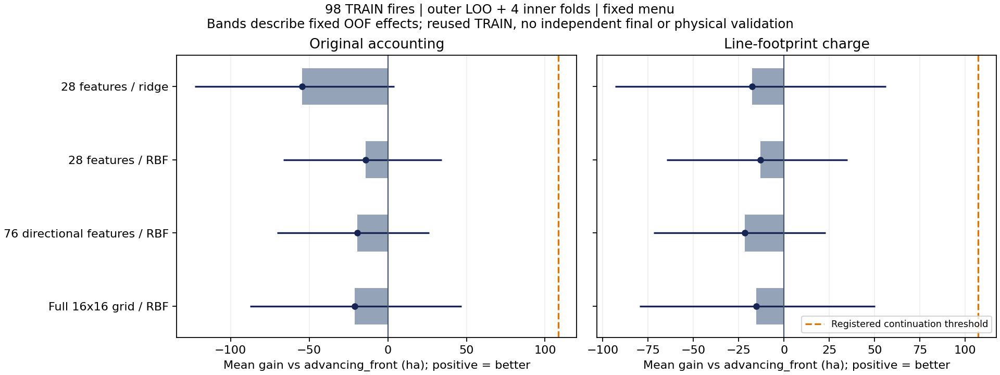

# TASK-034 — SimFire pregled prije odluke o CA

Stanje 2026-11-20, grana `codex/simfire-observation-audit`, baza `58feac72`.
Korisnik traži još jednu obrazloženu SimFire iteraciju prije mogućeg prelaska na CA.
Cilj nije dokazati da više nema nijedne moguće greške: takva garancija nije moguća.
Cilj je provjeriti konkretne sumnje i odvojiti greške, ograničenja modela i otvorene
mogućnosti koje bi zahtijevale novu studiju. Plan je commitovan kao `1e9a263c`, prije
mjerenja. Numerički kod je `855e0fc0`; dinamika i postavke simulatora te ADR-034 tabela nisu mijenjani. Tehnička korekcija
kreiranja output foldera, nakon prvog neuspješnog native starta, opisana je u ADR-035 dopuni.

## Pitanja i granice

1. Da li opažanja odgovaraju ulazima i prate budžet, vrijeme i dozvoljeno prethodno vrijeme?
2. Pomaže li prostorniji prikaz iste opservacije uz nelinearni model i unutrašnji izbor postavki?
3. Koliko dva kontrolna slučaja zavise od redoslijeda obrade, agregacije i trajanja koraka?
4. Šta iz toga slijedi za SimFire i za eventualni CA pravac?

Samo 98 TRAIN požara, isti B=1 i 48h. Nema novog PPO/CA treninga, novih kanala u
politici ili VALIDATION/TEST pristupa. TRAIN je već korišten za razvoj, pa nested
ocjena i dalje ostaje eksploratorna; nije svježi završni test.

## Šta je provjereno

[Input/observation audit](../../reports/real-fire-data/feds-observation-input-audit-v1.json)
ponovo učitava checksum-verifikovane ulaze svih 98 slučajeva i provjerava početnu
4×16×16 mrežu, inicijalnu kumulativnu štetu, sve 392 weather opservacije, strogo
prethodni dan, četiri vremena odluke, budžet i dostupnost no-op-a. Sve prolazi.

Kontrolni testovi pokazuju dva stvarna ograničenja zapisa opažanja:

- Različiti početni frontovi unutar istog bloka 16×16 native ćelija daju potpuno istu
  opservaciju, ali različita mjesta linije. Jedan observed piksel je 2.88 km, a cijela
  linija oko 1.26 km. Ovo je dokaz aliasinga ugovora, ne dokaz koliki dio RL greške izaziva.
- `clip(fuel_code/13,0,1)` daje isti zapis za gorivo 13 i negorive kodove 91–99.
  Nadgradnja modela iz iste opservacije ne može vratiti tu izgubljenu razliku.

Na početnom frontu 37/98 požara ima bar jednu ćeliju nad negorivim gorivom: 731/9.926
front ćelija (7.36%). Od 17.518 planiranih ćelija linije, brojanih zasebno za svaki
traženi niz, 1.094 su na negorivom (6.25%); 47 nepraznih nizova je potpuno na negorivom.
To nisu jedinstvene ćelije ili nezavisne epizode: neke odluke imaju isti efektivni ishod.
FEDS/LANDFIRE razlike i koarsening su nesigurnost ulaza; ne slijedi automatski da su
sve takve ćelije pogrešno označene ili da cijelu kohortu treba odbaciti.
Postojeći placement provjerava stanje ćelije, ne gorivost; budžet može biti potrošen
na beskoristan dio linije. To je zabilježena konvencija, ovdje nije promijenjena.

## Metode i pošten izbor

Četiri porodice: ridge Q sa starih 28 obilježja; RBF Q sa istih 28; RBF sa 76 obilježja
(28 + šest svojstava po svakom od osam smjerova); RBF sa svih 1.031 vrijednostima mreže,
weather-a, vremena i budžeta. Prostorni dodaci su front masa i doseg, gorivo u sektoru,
gorivo na frontu i blizu/daleko od front centroida. Blizu znači dvije observed ćelije
(2/15 u normalizovanim koordinatama); ovo nije povećanje native rezolucije.

RBF implementacija koristi samo NumPy, bez instalacija. Skaliranje, medijan pozitivnih
kvadrata udaljenosti i centriranje cilja uče se samo na fit požarima. Originalna
ridge alpha je 1/10/100, RBF alpha .01/.1 i bandwidth .5/2. Četiri inner folda biraju
postavke prema simuliranoj spašenoj površini, pa se model refituje na svih 97 fit
požara i odlučuje na jednom outer izostavljenom požaru. Čekanje ima poznatu donju
granicu 0 dobitka prema no-opu. Nakon linije nema novih odluka o liniji, ali native
simulacija i dalje traje 48h.

Svih 98 outer foldova i oba obračuna su sačuvani u
[novoj offline analizi](../../reports/real-fire-data/feds-observation-offline-v1.json).
Nijedna porodica ne prelazi prag iz ADR-033/035. Sve su u prosjeku ispod
`advancing_front` (112,24 ha raw / 101,04 charged prema no-opu). Nisu dodavane nove
konfiguracije poslije rezultata. U odnosu na ADR-034 promijenjeni su model i način
unutrašnjeg izbora; ovo nije čista kauzalna ablacija samog feature prikaza. Unutar
tri RBF porodice isti meni i nested pravilo omogućavaju uži opisni prikaz razlike.

| Metoda | Raw spašeno ha | Raw delta prema pravilu | Charged spašeno ha | Charged delta prema pravilu |
| --- | ---: | ---: | ---: | ---: |
| 28 obilježja, nested ridge | 57.89 | -54.35 | 83.58 | -17.46 |
| 28 obilježja, nested RBF | 98.13 | -14.12 | 88.17 | -12.86 |
| 76 prostornih obilježja, nested RBF | 92.87 | -19.37 | 79.55 | -21.49 |
| Cijela 16×16 mreža, nested RBF | 91.05 | -21.19 | 85.76 | -15.27 |

Najbolji charged kandidat sada je summary RBF: 88,17 ha, odnosno −12,86 ha prema
pravilu; opisni interval [−64,80;34,85]. Full-grid RBF daje 85,76 ha; dodatna prostorna
obilježja 79,55 ha. Svih 784 OOF putanja dodatno je provjereno prema legalnim akcijama,
jednoj liniji i tačnom ishodu iz tabele. Prag ostaje ≥30 ha i ≥25% oracle jaza; na
ovoj tabeli ≥108,55 ha raw /107,20 ha charged dodatno prema pravilu. Nijedan nalaz
ne dokazuje da je opažanje bez korisnog signala ili da neka druga metoda ne može uspjeti.



Offline analiza je trajala 17,17 sekundi na četiri nice-19 procesa zahvaljujući reuse-u
tabele i keširanju obilježja, bez novih simulator epizoda. Skaliranje je samo unutar
fit dijela. Opisni bootstrap ne refituje modele i foldovi dijele fit podatke; nema
nezavisne potvrdne interpretacije. Nested selekcija ne briše ranije korištenje TRAIN-a.

## Native osjetljivost — završeno

Unaprijed izabrani slučajevi su prvi TRAIN ID (Plateau) i najveći ADR-034 no-op ishod
(Martin), a ne reprezentativan uzorak. Za svaki: no-op i `advancing_front`, locked,
reverse početnog sprite poretka, max agregacija, max+reverse i 1min korak. Plateau u
svih pet postavki nema novog rasta: služi kao negativna kontrola, ne kao drugi dokaz
osjetljivosti. Martin je informativan veliki slučaj. Sve uspješne epizode traju četiri
odluke /48h i nemaju rubni kontakt.

| Martin, postavka | No-op nova šteta ha | Raw ušteda pravila ha | Charged ušteda pravila ha |
| --- | ---: | ---: | ---: |
| Zaključana, 5min, last_write | 57.377,16 | 3,24 | −25,92 |
| Ista, obrnut početni sprite poredak | 53.741,88 | −252,72 | −281,88 |
| Max agregacija | 71.322,12 | 90,72 | 61,56 |
| Max + obrnut početni poredak | 71.322,12 | 90,72 | 61,56 |
| Last_write, 1min | 57.895,56 | 61,56 | 32,40 |

Promjena početnog poretka mijenja no-op za 3.635,28 ha (6,34%) i predznak učinka
pravila. To potvrđuje da taj kontrafaktualni dobitak može zavisiti od numeričkog
poretka u pinovanom `last_write` engine-u. Max uklanja ovu početnu perturbaciju u
probi, ali mijenja širenje (no-op +24,30% prema locked), pa nije automatski fizički
ispravniji. Jednominutni korak mijenja no-op za +0,90%, ali i mali učinak linije.
Dva odabrana slučaja i jedna početna perturbacija ne pokrivaju sve terene, vremenske
uslove i sve redoslijede. Ne ekstrapolirati ove postotke na svih 98.

[Native zapis i hashovi maski](../../reports/real-fire-data/feds-native-sensitivity-v1.json).
Locked no-op i heuristika odgovaraju staroj tabeli po cijeloj burn maski i površini.
Alternative nisu ponovo prošle growth gate i ne zamjenjuju ADR-031/032. Nije obavljena
nova fizička kalibracija ili VALIDATION evaluacija.

## Potvrđena greška i provjere koje nisu našle grešku

Prvi paralelni native pokušaj pao je na SimFire-ovom `is_dir`/`mkdir` race-u: novi
radnici pokušali su kreirati isti `.local/simfire-runs`. Ostalo je 18 pojedinačnih maski,
bez završenog reporta; sačuvane su, nisu uzete kao rezultat. Dodan je prvo padajući
regresijski test, zatim atomic `mkdir(..., exist_ok=True)` prije konstrukcije simulatora.
Test provjerava 16 konkurentnih inicijalizacija i čuvanje postojećih rezultata.
Uspješan ponovljeni native run traje 2,18 min, uz 20 potpunih rollouta. Ovo je popravka
pokretanja; parametri i aritmetika širenja nisu promijenjeni. Locked mask poređenje je
provjera toga na ova dva slučaja, ne novi cohort benchmark.

Dodatne provjere nisu našle grešku smjera vjetra ili metara/stopa: meteorološki from→to,
north-up raster i sektori se slažu za četiri kardinalna smjera. Poznati DEM nagib 18m
na 180m daje 10% u native manageru, jer OperationalTopographyLayer konvertuje m→ft
prije računanja. Provjera goriva potvrđuje da native kod 13 ima pozitivni fuel load,
a kod91 nula; njihov isti policy kanal je zato stvaran gubitak informacije.
Postojeći testovi dodatno pokrivaju trajanje aktivne ćelije, propagaciju linije,
proboj iznad praga, RNG reset, kumulativnu štetu i budget/no-op. Nisu sve te ranije
provjere novi nalazi ove sesije.

[Verification receipt](../../reports/real-fire-data/feds-observation-verification-v1.json):
327 testova /0 skip u pinovanom runtimeu; moderni 312 /3 skip; core 272 /35 skip.
CLI smoke i 15 knowledge testova prolaze; strict checker provjerava 84 Markdown fajla.
GitHub CI i nezavisna revizija ove nove grane nisu izvršeni.
Pinovani SimFire ostaje 2.0.1, commit `04905b19fe8c10dc08d64faddd00303e0561bb66`;
receipt čuva hashove native fire managera, Rothermel-a i layer koda, kao primarne
lokalno pročitane izvore. Ovi tehnički PASS rezultati nisu fizička validacija.

## Šta smo zatvorili, a šta ostaje

| Oblast | Dokaz i stanje | Šta se iz toga ne zaključuje |
| --- | --- | --- |
| Inputi i koordinate | svih98 SHA, stvarni raster CRS/transform, početna opservacija i maska PASS | FEDS/LANDFIRE odnos nije terenski potvrđen |
| Vrijeme i informacije | 392 opažena zapisa, strogo prethodni dan, sourcehash PASS | dnevni gridMET i fm100 proxy ne predstavljaju svu mikrometeorologiju |
| Jedinice i smjerovi | 10% slope test i kardinalni smjerovi PASS | nije fizička kalibracija po svim gorivima |
| Budžet/šteta/no-op | regresijski i puni testovi PASS | ne govori da je modelna naplata pune ćelije stvarna širina linije |
| Pokretanje više radnika | potvrđeni mkdir race ispravljen i testiran | stari završeni rezultati nisu time postali novi nalazi |
| Numeričko širenje | last_write osjetljivost potvrđena; max postoji i ima order test | max/1min nisu prošli novi cohort growth gate |
| Informacija u opažanju | pooling i fuel alias dokazani; reljef skriven | uzrok cijelog PPO neuspjeha nije izolovan |
| Novi selektori | četiri fiksne nested porodice bez prolaza praga | drugi algoritmi, više podataka ili druga opservacija nisu isključeni |
| Fizička tačnost | ADR-031 IoU rasta ostaje nizak, free-burn prerasta obuzdane požare | runtime/gate PASS nije vjerodostojna simulacija stvarnog gašenja |

## Preporuka o CA i konkretan nastavak

**Preporuka agenta:** opravdan je kontrolisani CA pilot kao sljedeći glavni projektni
korak za odluke o jedinicama i budžetu. Razlog je kombinacija postojećih nalaza i ove
provjere: jednostavni i prostorniji selektori ne daju stabilan dobitak, trenutni SimFire
ugovor skriva informacije na skali akcije, a numerička agregacija utiče na samu metriku
uštede. SimFire nema putovanje, gradnju kroz vrijeme ili sigurnost jedinica u ovom
ugovoru. CA pravac omogućava da se te pretpostavke eksplicitno napišu i testiraju.
Ovo je izbor opsega projekta, ne dokaz da je SimFire iscrpljen ili da će CA dati RL prednost.

**Preostali smisleni SimFire v2 pravac:** kategorijski fuel/nonfuel kanali, reljef i
finija opservacija; `max`/korak ponovo kroz TRAIN growth gate; tek zatim nova B=1 tabela
i isti pošteni policy komparatori. Duži PPO/BC i B=2/B=4 također nisu iscrpljeni. To bi
bio novi protokol i benchmark, a ne samo još nekoliko trening seedova. Ne preskakati
ovaj opis i tvrditi da su sve greške isključene.

**TASK-035, pripremljen prijedlog:** [kontrolisani CA pilot](../../configs/drafts/ca-controlled-pilot-v1.json).
Postojeći CA nije prihvaćen kao fizički validiran niti se vraćaju poništeni ADR-028
brojevi. Prvi korak je ugovor informacija i tehnički pilot: postojeći CA trenutno
opaža `weather.at(decision)`; mora se prije novih rezultata izabrati i zapisati šta
je opaženo, a šta idealizovano poznato. Zatim verzija opservacije/checkpointa, svježi
razdvojeni proceduralni slučajevi i iste jedinice/dolasci/horizont za sve politike.
Prvo no-op i jake heuristike; BC/PPO tek po unaprijed zapisanom kriteriju. CA testovi
u unit suite-u jesu tehničke provjere, nisu novi trening ili istraživački benchmark.
CA trening u ovoj sesiji nije pokrenut, TEST 2024 ostaje zatvoren.

## Reprodukcija i artefakti

Koristi isti pinovani Python3.9 runtime i tačan weather/table fajl iz ADR-034.
`P` je interpreter; ulazne putanje su parametri, lične putanje nisu preduslov.

```sh
export PYTHONPATH=src SDL_VIDEODRIVER=dummy OMP_NUM_THREADS=1 OPENBLAS_NUM_THREADS=1
export MPLCONFIGDIR="$PWD/.local/mpl-cache" XDG_CACHE_HOME="$PWD/.local/cache"
P=.local/simfire-venv/bin/python
"$P" scripts/audit_feds_observations.py .local/b1-cases/table-98.json \
  --input-root .local/feds-simfire-cases --weather .local/gridmet/feds-episode-weather-v1.json \
  --out .local/audit/input-check.json
nice -n 19 "$P" scripts/analyze_feds_observation_audit.py .local/b1-cases/table-98.json \
  --workers 4 --out .local/audit/offline.json
nice -n 19 "$P" scripts/probe_feds_native_sensitivity.py .local/b1-cases/table-98.json \
  --input-root .local/feds-simfire-cases --weather .local/gridmet/feds-episode-weather-v1.json \
  --workers 4 --local-out .local/audit/native-new --out .local/audit/native.json
"$P" scripts/plot_feds_observation_audit.py .local/audit/offline.json --out .local/audit/figure.png
```

Svi izlazi moraju biti novi. [Manifest lokalnog paketa](../../reports/real-fire-data/feds-observation-artifact-manifest-v1.json)
čuva tačne ulaze, staru tabelu, novu analizu, native maske, kod i logove. Nema
checkpointova, venv-a ili upload-a velikih podataka. Manifest i sourcehashovi dopuštaju
provjeru zapisa; ne predstavljaju nezavisnu reviziju naučnog zaključka.
