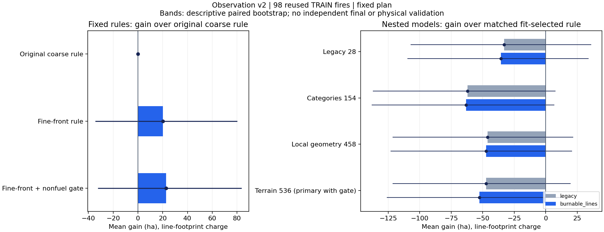

# TASK-036 — još jedan SimFire pokušaj prije odluke o CA

Stanje 2026-11-20. Grana `codex/simfire-observation-repair`, iz `d3bb5b86` prethodne
grane. [PR #20](https://github.com/goralija/wildfire-rl-adaptation/pull/20) ostaje otvoren
za kolege, bez mergea. Korisnik je dao prioritet popravku opažanja i maski prije CA;
novi PR nije obavezan. Plan `81be2e09` prethodi podacima i mjerenjima; wrapper/kolektor
je `c1aa9acc`, fiksna analiza `22a03dfb`. Nema novog PPO ili CA treninga.

**Ishod:** konkretni fuel/front aliasi su uklonjeni iz nove dostupne opservacije,
blokirane su beskorisne potpuno negorive linije, a sva stara dinamika je sačuvana.
Finije pravilo daje veći TRAIN prosjek, ali nesiguran. Nijedan naučeni kandidat nije
prešao prag prema najboljoj uparenoj heuristici. Ovo nije završni ili fizički validiran nalaz.

## Zašto se prethodno stalo

TASK-034 je zatvorio unaprijed zadati meni nad starim opažanjem. Taj stop nije
isprobao popravak zapisa i nije dokazao iscrpljenost SimFire-a. Bolji algoritam nad
istim starim pikselom ne može rekonstruisati izbrisanu kategoriju ili raspored unutar
bloka. Sada je registrovan odvojen eksperiment koji upravo te informacije dodaje.
Prethodna preporuka za CA bila je preporuka projektnog opsega, ne rezultat poređenja
ove popravljene verzije s CA. Korisnikova nova odluka joj je dala prioritet.

## Šta gorivo znači i gdje je bila zabuna

Gorivo je zapaljivi materijal: vegetacija i mrtvi biljni materijal. LANDFIRE kod označava
**tip**, ne brojčanu količinu goriva ili uređenu skalu opasnosti. SimFire mapira taj kod
u native parametre kao što su fuel load, dubina sloja, površina/volumen čestica i vlaga
gašenja; zatim ih s vjetrom, vlagom i reljefom koristi u Rothermel širenju. Native kod 13
ima pozitivan fuel load, a podržani negorivi kodovi ga nemaju. To je provjereno u pinovanom kodu,
ne terenskom mjerenju ove studije.

Stari kanal je `clip(fuel_code/13,0,1)`. Tip 13 i kodovi 91–99 zato postaju 1. Simulator
koristi originalni raster i čuva razliku; politika je iz tog kanala ne može vratiti.
Prosječenje dodatno uklanja lokalni raspored. Jedan stari piksel je 16×16 native ćelija,
2.88×2.88 km; linija je približno 1.26 km. Različiti native frontovi mogu izgledati isto
politici, a dati drugo mjesto linije.

Novi zapis ima **13 kategorijskih kanala i zaseban nonfuel kanal**. Nakon poolinga
vrijednost znači udio te kategorije u bloku: npr. pola tip 13 i pola negorivog daje dva
kanala po 0.5. To čuva razliku između kategorija; sam globalni prosjek još ne čuva svaki
unutrašnji raspored, pa su dodati i native lokalni izrezi.

## Šta je implementirano

Opt-in `SimFireObservationV2` ostavlja legacy env i stare ključeve neizmijenjenim.
Nova verzija ima identitet `simfire-categorical-local-v2` i drugačiji Gym observation
space. Stari checkpoint nije tiha zamjena za ovu verziju; nijedan nije učitan.

| Dio | Oblik i značenje |
| --- | --- |
| Legacy grid/weather/time/budget | ostaju za identični kontrolni slučaj i postojeća pravila |
| `global_grid` |20×64×64; piksel 720 m:3 dinamička kanala,14 fuel/nonfuel i 3 reljefna |
| `action_patches` |8×20×17×17; native 180 m izrez oko svake trenutne predložene linije |
| `candidate_line_masks` |8×17×17; tačne predložene ćelije linije u svakom izrezu |
| `candidate_centres` |8×2; centar kandidata x/y u normalizovanim koordinatama |

Reljef daje elevaciju/5000 m i potpisane x/y gradijente u m/m, odrezane na[-1,1].
Izvan mape lokalni izrez ima nonfuel padding. Nova opservacija razlikuje kontrolni
primjer koji je ranije imao identično opažanje, kao i tip 13 naspram nonfuel.
Globalni zapis i dalje ima agregaciju; v2 nije dokaz potpune Markov opservacije.

Opcionalna `burnable_lines` maska zadržava samo stare legalne linije koje imaju bar
jednu gorivu ćeliju. Miješana linija ostaje legalna; potpuno negoriva se odbija. Koristi
samo sadašnji fuel raster i geometriju, nikad budući no-op otisak. No-op je uvijek
legalan. Odbijen potez postaje no-op uz jednu invalid-action kaznu; budžet se ne troši,
epizoda nastavlja do četvrte odluke. Ovo je maska korisnosti u modelu, ne model stvarne
sigurnosti ili pristupa ekipi.

**Nagrada env-a ostaje originalna raw šteta.** Charged cilj je zaseban offline fit i
zasebna ocjena. Ako se kasnije trenira PPO s charged ciljem, reward i checkpoint ugovor
moraju biti posebno verzionisani. U ovoj studiji nije bilo PPO treninga.

## Podaci i zašto ne ponavljamo svih 33 ishoda

Dinamika ostaje ADR-031: WAF 0.10, ROS 1.0,5 min, `last_write`, `per_minute`, ista početna
stanja i lagged weather. B=1 ima jednu liniju; do nje politika prati istu no-op putanju.
Po jedan no-op replay stoga daje sva četiri nova trenutna opažanja. Poslije linije
konačni ishod se tačno nalazi u postojećoj 33-sequence tabeli.

Pilot prvih 5 sortiranih TRAIN ID-jeva prolazi 5/5 (0,24 min). Puna komanda, uz reuse
pilota, završava 98/98 za 1,34 min na četiri nice 19 radnika. Čuva se 392 opažanja. Sve stare
opservacije i maske su identične,3.136 native geometrija kandidata i njihovi patch
položaji se poklapaju, a svih 98 završnih no-op maski odgovara staroj tabeli. Native
source hashovi odgovaraju prethodnom verification zapisu. Nema promjene fizike.

[Coverage i hashovi](../../reports/real-fire-data/feds-observation-repair-coverage-v2.json).
Od 2.242 prethodno legalna line niza, nova maska uklanja 47. Svih 47 u staroj tabeli ima
nultu raw i charged uštedu. To su potencijalni izbori, ne 47 stvarno potrošenih budžeta.

## Metode i kontrola informacije

Četiri unaprijed zadate reprezentacije, isti RBF meni alpha .01/.1 i bandwidth .5/2:

- `legacy28`: starih 28 obilježja; kontrola cjelokupnog pipelinea.
- `categorical154`: legacy plus globalne i osam smjernih kategorijskih fuel proporcija.
- `local458`: dodaje finu geometriju i native lokalne informacije za osam kandidata.
- `terrain536`: dodaje globalni/lokalni reljef; **primarni kandidat uz burnable masku**.

Oba mask režima i oba obračuna su odvojeni fitovi. Outer LOO izostavlja cijeli požar;
četiri inner folda biraju postavke samo na 97 fitting požara. Skaliranje i kernel skala
se fituju unutar tih podjela. Predikcija vidi samo trenutni korak. Future ishodi iz
TRAIN-a jesu oznake za fit, ali se outer ishod čita tek poslije odluke.

Komparatori su no-op, downwind, coarse advancing_front i `advancing_front64`. Svi dobijaju
iste raspoložive v2 podatke i istu masku; pojedina pravila namjerno koriste samo dio
informacije. Ablacije namjerno ograničavaju prikaz. Za primarni kontrast najbolja od
tri nenulte heuristike bira se samo na 97 fitting požara. U svim 98 foldovima to je fine
advancing_front. Prag je≥30 ha i≥25% preostalog privilegovanog oracle jaza. Staro pravilo
se prijavljuje dodatno radi kontinuiteta, ne kao jedini slabiji komparator.

Kontrolni `legacy28/legacy` u oba obračuna **tačno reprodukuje ADR-035 RBF akcije,
izabrane parametre, inner score i ishode**. Analiza 16 kombinacija traje 29,51 s poslije
pripreme podataka. Svi 1.568 OOF putanja ponovo su provjereni prema starim ishodima i
prosjecima. TRAIN je već korišten; nested selekcija nije novi nezavisni završni test.

## Rezultati — koristan signal u pravilu, bez dokazane prednosti učenja

Svi brojevi su prosječne simulirane spašene ha prema istom no-opu.

| Fiksno pravilo | Raw | Charged |
| --- | ---: | ---: |
| Staro coarse pravilo / legacy maska |112.24|101.04|
| Fine pravilo / legacy maska |132.87|121.27|
| Fine pravilo / burnable maska |135.55|123.72|
| Coarse pravilo / burnable maska |114.92|103.48|

Finija geometrija daje+20,23 charged ha, maska još+2,45 ha. Ukupno **+22,68 ha** prema
starom pravilu (oko 22,45% njegove uštede, ne 22,45% ukupnog požara). Dobitak maske na
fine pravilu dolazi iz jednog požara; sekvenca se mijenja na tri slučaja, dva imaju isti
konačni ishod. Na matched coarse pravilu ista maska daje+2,45 ha; downwind ostaje isti.

Fine+gate je bolji na 13, lošiji na 11 i isti na 74 požara. Opisni 95% bootstrap razlike je
**[−32,30;83,61]ha**. Bez najveće apsolutne razlike ostaje **+3,71 ha** (bez refita).
Najveći pozitivni doprinos je Weston Pass(+1.863 ha), negativni Goose Creek(−1.542,24 ha).
Zato je ovo preliminaran pomak u TRAIN prosjeku, ne potvrđena generalizacija.

[Potpune heuristike i uparene razlike](../../reports/real-fire-data/feds-observation-repair-heuristics-v2.json).
Standalone `make_repaired_heuristic('advancing_front64')` izlaže isto unaprijed zadato
pravilo; ponovni obračun svih registrovanih heurističkih prosjeka se poklapa s analizom.
Nije dodan novi policy kandidat poslije rezultata.

| Reprezentacija | Maska | Raw spašeno ha | Charged spašeno ha | Charged delta prema jačoj referenci |
| --- | --- | ---: | ---: | ---: |
| legacy 28 | legacy | 98.13 | 88.17 | -33.09 |
| categorical 154 | legacy | 78.26 | 59.28 | -61.99 |
| local 458 | legacy | 69.49 | 75.15 | -46.12 |
| terrain 536 | legacy | 83.84 | 73.89 | -47.38 |
| legacy 28 | burnable_lines | 98.13 | 88.17 | -35.54 |
| categorical 154 | burnable_lines | 79.45 | 60.50 | -63.21 |
| local 458 | burnable_lines | 75.25 | 76.47 | -47.24 |
| terrain 536 | burnable_lines | 85.96 | 71.18 | -52.53 |

**Nijedan naučeni kandidat ne prelazi prag.** Primarni terrain 536/burnable štedi
71,18 charged ha, naspram 123,72 jače reference: **−52,53 ha**, opisni interval
[−126,20;14,05]. Preostali oracle jaz je 406,12 ha; prag bi tražio najmanje 101,53 ha dodatno
prema toj referenci. Dodavanje tačnije informacije nije dovoljno za ove male RBF
aproksimatore na 98 heterogenih požara. To ne dokazuje da kategorije štete odlučivanju,
niti da drugi algoritam ili PPO/BC ne može iskoristiti nove kanale.

[Potpuna analiza i svi OOF izbori](../../reports/real-fire-data/feds-observation-repair-analysis-v2.json).



## Native provjera i tehnička provjera

Poslije rezultata odabrani su prvi slučaj i najveća pozitivna/negativna charged razlika
primarnog modela prema referenci. Replay primarne sekvence i žive fine heuristike,
te jedan odbijeni nonfuel potez, daju **7/7 PASS** po cijeloj maski i oba obračuna.
Budžet se na odbijenom potezu ne troši; horizont i kumulativna šteta prolaze. Izbor
ovih tehničkih putanja nakon rezultata nije dodatni performance uzorak ili validacija.
[Native zapis](../../reports/real-fire-data/feds-observation-repair-native-v2.json).

[Lokalni verification receipt](../../reports/real-fire-data/feds-observation-repair-verification-v2.json):
344 testa/0 skip pinovani SimFire; moderni 329/3 skip; core 283/37 skip. CLI smoke PASS.
Unit testovi prvo su pali prije novih funkcija, zatim prošli za razdvajanje kategorija,
prostorni alias, masku/budžet, dataset guardove i izbor reference bez held-out oznaka.
Pinovani native source i postavke ostaju neizmijenjeni. PR #20 ima zeleni CI; novi
repair branch CI se prati pri objavi. Nema nezavisne ljudske revizije ovih novih nalaza.

## Šta je sada zatvoreno i šta je smislen sljedeći posao

**Zatvoreno:** dodatni pokušaj je stvarno izveden, ne samo predložen. V2 uklanja konkretni
fuel/nonfuel alias i daje geometriju na skali odluke. Maska sprječava trošenje na potpuno
negorivu liniju. Sačuvan je dokaz identičnog širenja i reprodukcije starog pipelinea.
Imamo jače, jednostavno referentno pravilo, uz jasno prikazanu nesigurnost. Nemamo
potvrđenu RL prednost ili dokaz fizičke tačnosti.

**Preporuka:** zadržati v2 i fine+gate kao naredni SimFire kandidat/baseline. Za glavni
projekat kontrolisani CA pilot TASK-035 ostaje obrazložen naredni pravac, po prethodno
pripremljenom draftu; njegov ugovor informacija mora se riješiti prije treninga.
Ovaj popravak daje jaču osnovu za tu odluku nego napuštanje SimFire-a poslije starog
opažanja. CA i dalje nije Cell 2 Fire, fizički validiran model ili obećanje RL uspjeha.

**Ako se dalje ostaje na SimFire-u (TASK-037, prijedlog):**

1. Odvojeno ispitati max agregaciju i korak kroz novi TRAIN growth gate. Stari
   `last_write` numerički efekti nisu nestali popravkom opažanja; nova fizika traži
   novu tabelu, bez pripisivanja razlike samo novim kanalima.
2. Pripremiti custom encoder/checkpoint verziju za v2 pa kratki BC/PPO uz jaču fine+gate
   heuristiku i iste informacije. Raw/charged reward ugovor odabrati unaprijed.
3. Akciono dijeljenje parametara, istorija/age informacije, drugi modeli i veći trening
   ostaju neispitane hipoteze. Ova četiri feature prikaza i RBF meni ih ne iscrpljuju.
4. Budžeti 2/4 i fina prilagodba nisu ispitani ovim B=1 radom. Tabela se ne smije koristiti
   poslije prve linije za više intervencija. Novi VALIDATION/TEST pristup nije odobren.

TASK-036 fazaA (opažanje/maska) je završena; širi SimFire v2 physics/gate nije proglašen
završenim. CA trening, novi PPO, TEST 2024 i novi VALIDATION nisu pokrenuti.

## Reprodukcija

Koristi isti pinovani runtime, source/input hashove i tačan weather fajl. `P` je putanja
do interpretera; lične putanje nisu preduslov. Izlazi moraju biti novi; resume kolekcije
odbijen je ako se promijene source/plan/input/NPZ hashovi.

```sh
export PYTHONPATH=src SDL_VIDEODRIVER=dummy OMP_NUM_THREADS=1 OPENBLAS_NUM_THREADS=1
export MPLCONFIGDIR="$PWD/.local/mpl-cache" XDG_CACHE_HOME="$PWD/.local/cache"
P=.local/simfire-venv/bin/python
nice -n 19 "$P" scripts/collect_feds_observation_v2.py .local/b1-cases/table-98.json \
  --input-root .local/feds-simfire-cases --weather .local/gridmet/feds-episode-weather-v1.json \
  --case-limit 5 --workers 4 --out .local/repair/observations
# Nakon pilot PASS: ista komanda bez --case-limit.
nice -n 19 "$P" scripts/analyze_feds_observation_repair.py \
  .local/repair/observations/dataset-98.json --table .local/b1-cases/table-98.json \
  --workers 4 --out .local/repair/new-analysis.json
```

V2 NPZ podaci zauzimaju 28,47 MB i ostaju lokalni. [Manifest prenosivog paketa](../../reports/real-fire-data/feds-observation-repair-artifact-manifest-v2.json)
veže stare ulaze/tabelu i nove opservacije, native maske, kod i logove. Veliki podaci,
venv i checkpointovi nisu u Gitu. Izvedena grana se push-a po korisnikovom nalogu;
PR #20 prethodnog rada ostaje otvoren, novi PR nije potreban.
