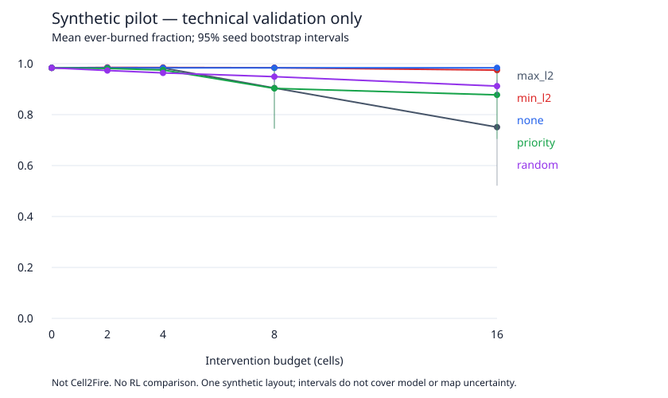

# Sintetički pilot — tehnička provjera

Izvršeno 300 epizoda; horizon=240; 0 epizoda završava uz aktivan požar.
Dvije nezavisne izvedbe dale su identične sve epizodne metrike osim runtime-a.
Konfiguracija, izvorni kod i environment identifikovani su u manifestu.

## Primjer pri B=16

| Politika | Opožareno | Prioriteti opožareni |
| --- | ---: | ---: |
| max_l2 | 75.09% | 73.96% |
| min_l2 | 97.47% | 100.00% |
| none | 98.37% | 100.00% |
| priority | 87.75% | 83.33% |
| random | 91.20% | 96.88% |

Ovo poredi isključivo heuristike u jednoj sintetičkoj mapi. Intervali odražavaju samo
12 simulator seedova, ne neizvjesnost modela požara, novih mapa ili RL treninga.
Nema RL adaptacije ni naučnog zaključka o glavnoj hipotezi. Početni horizon=80
ostavljao je neke požare aktivnim; duži horizont uklanja tu pristrasnost završne štete.



Artefakti: `episodes.csv`, `summary.csv`, `manifest.json`, `replay-check.json`.
Ponovi iz korijena repozitorija:

```sh
PYTHONPATH=src python3 -m wildfire_rl.cli --config configs/pilot.json --out runs/new-pilot
```

Manifest je nastao na source commitu prije dodavanja ovih rezultata; source_sha256
identifikuje tačan Python kod, a config_sha256 tačan sadržaj konfiguracije.
